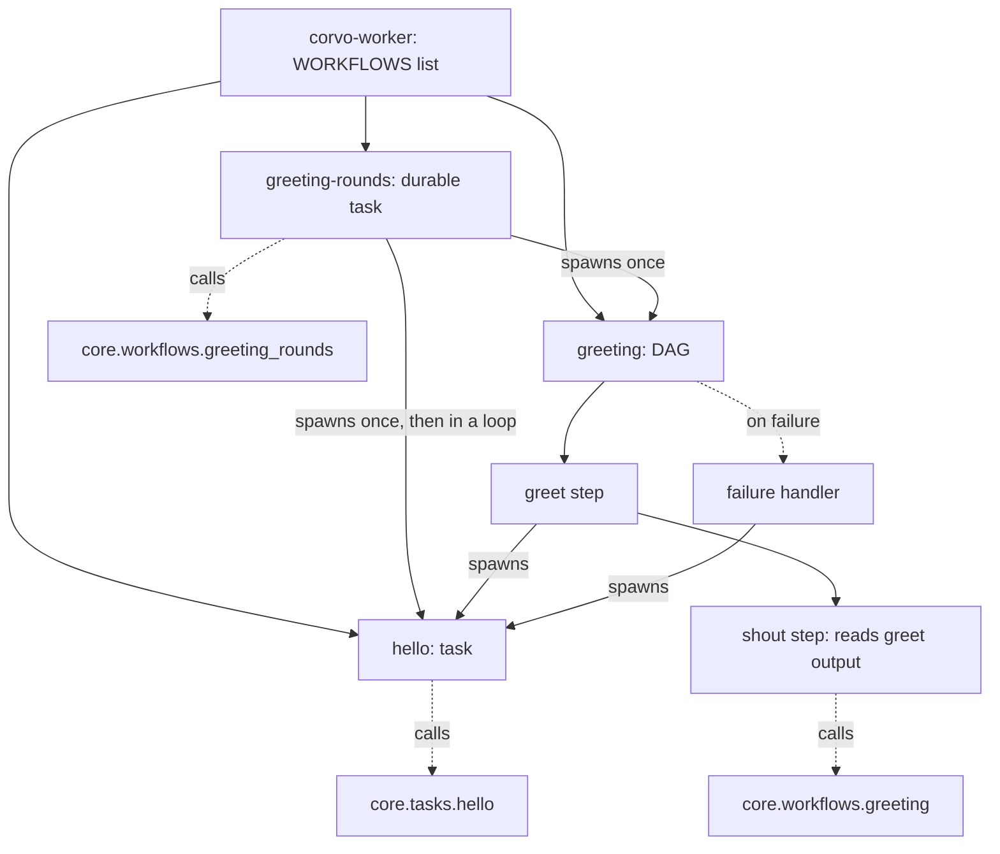
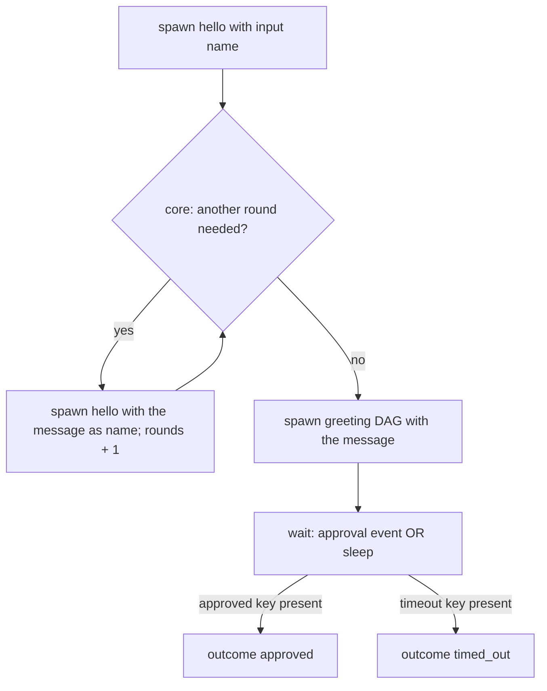

# Worker Tasks and Workflows Skeleton - Plan

## Goal Capsule

- **Objective:** Adding a Hatchet task or workflow to corvo means copying a living example (a worker shell and its core twin), filling it in, adding one line to the worker and writing their tests, with Hatchet used the way its own docs teach.
- **Means:** Hatchet's own API and example layout inside `corvo.worker`, with three living examples whose logic lives in mirrored `corvo.core` modules, a defaults module and a registration test (KTD1, KTD3, KTD5, KTD6, KTD11).
- **Product authority:** the repository owner, who settled every decision recorded under Key Decisions and Key Technical Decisions. The Product Contract wins on behavior; a KTD wins on mechanism within its cited requirements.
- **Execution profile:** five units in dependency order, each landing as one commit. Unit and integration tests land with the unit they prove.
- **Stop conditions:** stop and ask when an SDK behavior the plan relies on (child spawning from a DAG step or failure handler, or-group event waits with scope and lookback, mock runs with patched children) does not work on hatchet-sdk 1.42.1 against engine v0.110.5, or when CI's 90% coverage floor cannot be held without excluding code.
- **Finishes and ships:** crew's development stage under `.crew/config.yaml`, not a hand-made commit or pull request.
- **Open blockers:** none.

---

## Product Contract

### Summary

`corvo.worker` gets the layout of Hatchet's own examples: a `tasks` area for reusable standalone tasks, a `workflows` area for DAG and durable workflows that compose them, one shared client, and a worker that registers everything by explicit list. Three living examples show each shape: `hello` moved into `tasks`, a DAG with a failure handler, and a durable workflow that spawns both and waits for an approval event. Each example is a thin shell over a pure function in a mirrored `corvo.core` module (`core/tasks/`, `core/workflows/`), so the hexagonal split is demonstrated, not just stated. corvo adds only two pieces of its own on the worker side, a module of operation defaults and a test that catches anything left unregistered.

### Problem Frame

corvo's workflows track will put many tasks and workflows on Hatchet, and today nothing tells a contributor, human or agent, where one goes or what shape it takes. The only example, `hello`, is a standalone task living in `src/corvo/worker/workflows/hello.py`. That name implies the folder holds workflows, and no workflow exists to copy. Registration is a hand-edited list in `src/corvo/worker/worker.py`, and nothing fails when an entry is missing: the worker starts without the task, and the gap shows only when a run never gets picked up.

Hatchet offers two ways to compose tasks, DAGs and durable tasks, and corvo needs both. The main flow, taking an issue to production, has human gates and a review-and-fix loop of unknown length, which Hatchet's docs say only a durable task can express. Fixed sub-pipelines fit a DAG. Without an example of each, every first use reinvents the shape.

### Key Decisions

- **Use Hatchet directly, with no corvo layer hiding it.** Tasks and workflows are declared with Hatchet's own API and live inside `corvo.worker`, so the ruff rule that only `corvo.worker` imports `hatchet_sdk` stays as it is. (session-settled: user-directed — chosen over a corvo layer of abstract base classes that hid Hatchet entirely: that layer had to rebuild DAGs, durable waits, a test executor and not-implemented interfaces Hatchet already provides, and grew too large.) Governs R1, R2.
- **Protect against engine lock-in through the hexagonal split, not a wrapper.** Business logic lives in corvo's core, which never imports Hatchet, and tasks stay thin shells that call it. Changing engines would mean rewriting the shells. The examples demonstrate it: each worker module has a core twin at the mirrored path. (session-settled: user-directed — chosen over examples that keep their logic inside the task and state the rule only as a comment: contributors copy the code, not the comment.) Governs R3, R12.
- **Tasks are reusable building blocks; workflows compose them.** (session-settled: user-directed — chosen over each workflow owning its steps, with a tasks area only for tasks that run alone.) Governs R1, R8, R9.
- **Both composition models from the start, each with an example, plus one example of mixing them.** (session-settled: user-directed — chosen over durable workflows now and DAGs added when the first fixed pipeline appears.) Governs R8, R9.
- **Explicit registration, guarded by a test.** (session-settled: user-approved — chosen over automatic discovery and over thin corvo decorators: no magic, one line per definition, the same pattern as Hatchet's own examples.) Governs R4.
- **Every task and workflow declares its name explicitly.** A name derived from a class or module would change on a rename and break in-flight durable runs, registered triggers and by-name callers. (session-settled: user-directed — chosen over derived names guarded by a snapshot test.) Governs R2.
- **Tests use what Hatchet provides.** Every example body runs in-process under Hatchet's mock runs, with child runs and durable waits replaced in the test where they would need an engine, and workflow behavior is proven against the real Hatchet in compose. corvo builds no in-memory executor. (session-settled: user-approved — chosen over excluding the spawning and waiting bodies from coverage: CI's 90% coverage floor counts only in-process code.) Governs R10, R11.

### Requirements

**Layout and conventions**

- R1. `corvo.worker` holds a `tasks` area for reusable standalone tasks, a `workflows` area for DAG and durable workflows, the shared Hatchet client and the worker entry point.
- R2. Every task and workflow is declared with Hatchet's own API, with an explicit `name` and Pydantic input and output models.
- R3. The rule that business logic lives in the core and tasks stay thin shells is written at the top of each example file a contributor copies.
- R12. Each example's logic lives in a pure function under `corvo.core`, at the path that mirrors its worker module (`corvo.core.tasks` for tasks, `corvo.core.workflows` for workflow steps and decisions); the worker module only adapts Hatchet's input and output to it and orchestrates child runs and waits.

**Registration**

- R4. The worker registers its tasks and workflows by explicit list, and a test fails, naming the definition, when a task or workflow in the `tasks` or `workflows` areas is registered on no worker or shares its name with another.
- R5. corvo runs one worker, `corvo-worker`, which registers every task and workflow.

**Operation defaults**

- R6. corvo-wide defaults for retries and execution timeout are defined once and applied by every task and workflow declaration, which may override them.

**Living examples**

- R7. `hello` moves into the `tasks` area and keeps its Hatchet name `hello` and its input and output contract.
- R8. A DAG example workflow uses reusable tasks from the `tasks` area by spawning them as child runs from its own steps: one step reads its parent step's output, and a failure handler triggers another task or workflow when the DAG fails.
- R9. A durable example workflow spawns `hello` and the DAG example as children, repeats a child-spawning step until a condition holds or a maximum number of iterations is reached, waits for an event with a timeout, and takes a different path when the event arrives than when the timeout passes.

**Tests**

- R10. Each example task, DAG step, failure handler and durable workflow has a unit test that runs without a Hatchet engine, with child runs and durable waits replaced in the test; R11 proves that the composition works.
- R11. The integration suite runs every example on the real Hatchet in compose, including both paths of the durable example's wait.

### Acceptance Examples

- AE1. **Covers R4.** **Given** a new task file in the `tasks` area, **when** its line is missing from the worker's list, **then** the registration test fails and names that task.
- AE2. **Covers R4.** **Given** two definitions declared with the same `name`, **when** the tests run, **then** the registration test fails and names both.
- AE3. **Covers R8, R11.** **Given** the DAG example with a node forced to fail, **when** it runs on Hatchet, **then** the failure handler runs and the task or workflow it triggers is observed running.
- AE4. **Covers R9, R11.** **Given** the durable example waiting for its event, **when** the event is pushed before the timeout, **then** the workflow takes the event path; **when** no event arrives, **then** it takes the timeout path after the timeout.
- AE6. **Covers R9, R11.** **Given** the durable example's repeating step, **when** it runs on Hatchet, **then** the step is observed running more than once and the loop stops at its exit condition or its maximum.
- AE5. **Covers R7, R11.** **Given** `hello` in its new place, **when** a client triggers it by the name `hello` with the existing input model, **then** it returns the same output as before the move.

### Success Criteria

- A contributor, human or LLM agent, adds a working task by reading only the examples: a worker shell and its `corvo.core` twin at the mirrored path, one line in the worker, and their unit tests under `tests/worker` and `tests/core`.
- Hatchet's official docs apply to corvo's code unchanged: no corvo-specific API stands between a contributor and Hatchet.

### Scope Boundaries

- No corvo layer over Hatchet: no base classes, no wrapped context, no not-implemented interfaces, no in-memory executor.
- No automatic discovery of tasks or workflows.
- Concurrency, rate limits, cancellation, priority, DAG conditions, crons and event filters get no corvo wrapper or example; they are Hatchet parameters used directly when a first real case needs them.
- No real business logic is written now: the core holds only the examples' trivial functions (R12).

Considered and not built:

- **A check that every declaration passes the defaults.** The registration test cannot tell a forgotten default from a deliberate 0 retries or 60 s timeout, and a forgotten default fails visibly as a timeout. Revisit if a real task ships with Hatchet's defaults by accident.
- **A lint or test guarding durable determinism.** Hatchet provides none; the engine raises `NonDeterminismError` on replay, and the durable example states the rule in its header. Revisit when the first real durable flow lands.
- **Catching a failed child inside the durable example.** A child failure fails the run; the header says so. The main flow's fix loop decides its own handling.
- **Long human gates (hours or days).** The example's wait stays under the 15-minute eviction TTL. The timeout and eviction design for long gates is decided with the main flow.
- **Reading the failed task's error in the failure handler.** Engine v0.110.5 returns it empty for DAG failure handlers.

#### Deferred to Follow-Up Work

- Triggering a workflow from the API, at the first endpoint that needs it. The API may not import `corvo.worker`, and Hatchet's by-name stubs would need `hatchet_sdk` allowed in the API, a ruff change decided then.
- A second worker, when isolation, scale or a different machine calls for one.
- Upgrading the Hatchet images in `compose.yaml` to v0.111.1 or later, which fixes the empty error details in DAG failure handlers (engine PR #5178).
- Replacing the compose stack in the integration tests with the SDK's embedded mode (`hatchet_sdk/embedded.py`, https://docs.hatchet.run/v1/embedded.md), which runs an engine without Docker.

### Dependencies / Assumptions

- hatchet-sdk 1.42.1, as pinned in `uv.lock`, supports everything R8 and R9 need: `wf.task(parents=...)`, `wf.on_failure_task()`, `hatchet.durable_task()`, child spawning and event waits with an or-group timeout.
- The unsigned-token shim in `tests/conftest.py` keeps working for every new module that declares tasks, since each one imports the client built at import time.
- In hatchet-sdk 1.42.1 every DAG node receives the workflow's input, and `wf.add_task` attaches a standalone task only as a node with no parents. A workflow therefore reuses a task by spawning it as a child run from one of its own steps, which reads its parent step's output through the step's context.
- Hatchet's mock runs execute a task body without an engine, but a child spawn inside one makes a real gRPC call, and a durable wait raises `ValueError("Durable task client is not available")`. Unit tests replace both (KTD4); only integration (R11) proves the composition.

### Sources / Research

- Hatchet docs, indexed in `AGENTS.md`, each page served as markdown:
  - Durable tasks vs DAGs: https://docs.hatchet.run/cookbooks/durable-tasks-vs-dags.md. Loops require durable tasks; DAGs handle waits, branches and or-groups; the two compose in both directions.
  - Durable tasks and determinism: https://docs.hatchet.run/v1/durable-tasks.md. A durable task's retry replays from its checkpoints instead of re-running completed work.
  - Durable event waits and lookback: https://docs.hatchet.run/v1/durable-event-waits.md. Match the event with a CEL expression; a lookback needs the same scope on the wait and on the push.
  - Retry policies: https://docs.hatchet.run/v1/retry-policies.md. Retries only for idempotent tasks; `NonRetryableException` skips them.
  - Timeouts: https://docs.hatchet.run/v1/timeouts.md. Execution timeout defaults to 60 s, scheduling timeout to 5 min.
  - Child spawning: https://docs.hatchet.run/v1/child-spawning.md. Any task, durable or not, can spawn children.
- Hatchet examples in hatchet-dev/hatchet: `sdks/python/examples/quickstart/` (shared client, `workflows/`, `worker.py`), `sdks/python/examples/worker.py` (explicit registration list), `dag/`, `on_failure/` (worker and test), `durable/` (or-group waits at `worker.py:159-205`, lookback with scope at `worker.py:347-367`, push-before-trigger test at `test_durable.py:435-490`), `timeout/worker.py`, `unit_testing/`.
- hatchet-sdk 1.42.1 source: `TaskDefaults` fallback at `runnables/workflow.py:96-146`; standalone decorators build their workflow without `task_defaults` at `hatchet.py:611-626` and `hatchet.py:1107-1122`; `on_failure_task` ignores `task_defaults` at `runnables/workflow.py:1866-1886`; the worker keeps its list private at `worker/worker.py:150`; mock durable context at `runnables/task.py:627-645`; `Standalone` subclasses `BaseWorkflow` at `runnables/workflow.py:2040`; `service_name` lowercases names at `runnables/workflow.py:183-187`.
- Engine v0.110.5 behavior, inferred from engine source: the execution timeout keeps running during durable waits (`pkg/repository/sqlcv1/queue.sql:237`, `tasks.sql:550-565`); DAG failure handlers get empty error details until PR #5178 (v0.111.1).
- Current repo: `src/corvo/worker/worker.py`, `src/corvo/worker/workflows/hello.py`, `src/corvo/worker/hatchet_client.py`, `ruff.toml:15-23`, `tests/conftest.py`, `tests/integration/worker/conftest.py`, `tests/integration/worker/test_workflows.py`, `.github/workflows/ci.yml`, `skills/hatchet-cli/`.

---

## Planning Contract

Product Contract preservation: changed: R10 — spawning steps, the failure handler and the durable workflow also get engine-free unit tests, with child runs and durable waits replaced in the test, because CI's 90% coverage floor counts only in-process code. The "Tests use what Hatchet provides" Key Decision and the mock-run assumption were updated to match. Added: R12 — each example's logic lives in a mirrored `corvo.core` module, replacing the scope boundary that left R3 as an undemonstrated convention (user-directed; the lock-in Key Decision now governs R12). The scope boundary on deferred work moved under `Deferred to Follow-Up Work`. The questions deferred to planning are answered by KTD1, KTD3, KTD6, KTD7, KTD10 and U1.

### Key Technical Decisions

- KTD1. **Defaults are plain constants in `src/corvo/worker/defaults.py`, passed as keyword arguments on every declaration.** Hatchet's `TaskDefaults` does not fit: it reaches only `hatchet.workflow` steps, never standalone tasks or failure handlers, and its fallback treats a value equal to Hatchet's own default as unset, so a step cannot override back to 0 retries. Plain kwargs work the same on every decorator, and an override is just a different value. The values are `RETRIES = 3` and `EXECUTION_TIMEOUT = 10 minutes`, on the premise that a corvo task is idempotent. A task that is not raises `NonRetryableException` or declares `retries=0`, as Hatchet's retry docs prescribe. (session-settled: user-approved — chosen over one retries and timeout pair for every declaration: retrying a non-durable parent duplicates its child run.) Governs R6.
- KTD2. **A non-durable step that waits on a child run declares `retries=0` and `WAITING_EXECUTION_TIMEOUT`, and a durable task keeps `RETRIES`.** A non-durable step has no checkpoint, so its retry spawns a second child while the first may still run. A durable task's retry replays from its checkpoints and spawns nothing twice. `WAITING_EXECUTION_TIMEOUT` lives in `defaults.py` and covers one child declared with the defaults: `EXECUTION_TIMEOUT × (RETRIES + 1)` plus Hatchet's 5-minute scheduling timeout, 45 minutes in all. (session-settled: user-approved — chosen over the same defaults on parents and children: a parent's clock would run out before a retried child finishes.) Governs R6, R8.
- KTD3. **`worker.py` exposes the list as a module constant `WORKFLOWS`, and `tests/worker/test_registration.py` checks it against what the two areas define.** Hatchet's `Worker` keeps its list private and fills its registry only at `start()`, so a public constant is the only engine-free view. The test walks `corvo.worker.tasks` and `corvo.worker.workflows` with `pkgutil`, collects module-level `BaseWorkflow` objects deduplicated by identity, and fails, naming each culprit, when:
  1. a defined object is missing from `WORKFLOWS`;
  2. one object appears twice in `WORKFLOWS`;
  3. two objects share a name, compared lowercased as Hatchet's `service_name` does;
  4. a directory in the areas holding Python files has no `__init__.py`, which `pkgutil` would skip silently;
  5. a module in the areas fails to import, instead of being swallowed by `walk_packages`.

  The checks run as a pure function inside the test module, which its own tests feed with definitions declared in the test. Hatchet itself lets a duplicate name win silently, which is why the test exists. (session-settled: user-approved — chosen over checking only the two cases R4 names: the extra cases are cheap, and each one would hide a definition the worker never registers.) Governs R4, R5.
- KTD4. **Unit tests replace child runs and the durable wait with pytest's `monkeypatch`, and use Hatchet's `aio_mock_run` for everything else.** A child's `aio_run` is replaced on the corvo object (`hello`, `greeting`). The durable wait is replaced on `DurableContext.aio_wait_for`, because the mock run builds its context internally. The replacement returns Hatchet's wait-result shape (`{"CREATE": {<readable_data_key>: [payload]}}`), which the integration suite proves against the engine. Governs R10.
- KTD5. **The DAG example is `greeting`.** Its step `greet` spawns `hello` and returns its message. Its step `shout`, with parent `greet`, reads that output and shouts it through its core twin (KTD11), or raises `NonRetryableException` when the input's `force_failure` is true. Its failure handler spawns `hello` and returns that output without reading the failed task's error (engine v0.110.5 returns it empty). `NonRetryableException` keeps the forced failure from being retried, so the handler runs at once. Governs R8.
- KTD6. **The durable example's approval is the arrival of a `greeting:approved` event that matches the run's `approval_key`.** The input requires an `approval_key` limited to lowercase letters, digits and hyphens, so it is safe to embed in the CEL expression. The wait is an or-group:
  - a `UserEventCondition` on `greeting:approved`, with `readable_data_key="approved"`, an expression matching `input.approval_key` against the run's key, scope `approval_key:<key>`, and a 5-minute lookback from `ctx.aio_now()`;
  - a `SleepCondition` of the input's `approval_timeout_seconds`, with `readable_data_key="timeout"`.

  The branch is `approved` when the `approved` key is present in the result, `timed_out` otherwise. Nothing else in the payload is read. An event arriving after the timeout matches nothing and is lost. The key must be unique per approval request: a reused key lets an older approval inside the lookback approve a new run. The header comment says so. The wait's signal key is a constant, so replay stays deterministic. (session-settled: user-approved — chosen over approving on any event with the key, or reading an approve/reject payload: the docs match events by expression and scope, and approve or reject is the main flow's decision.) Governs R9.
- KTD7. **The durable example is `greeting-rounds`.** Its input bounds keep it inside its own timeout:
  - `max_rounds` 1 to 10;
  - `target_length` 1 to 200;
  - `approval_timeout_seconds` 1 to 600, below the 15-minute eviction TTL.

  It declares `execution_timeout` of 30 minutes, because durable waits count toward the timeout. That covers the longest wait plus children that succeed on their first attempt. Every timeout or eviction choice for longer flows is left to the main flow (Risks). Governs R9.
- KTD8. **The loop spawns `hello` again with the previous message as the name.** `max_rounds` caps the total number of `hello` spawns, the first one included, and `rounds` in the output counts them all. The loop stops when the message reaches `target_length` or `rounds` reaches `max_rounds`. Each `Hello, ...!` grows the message, so the exit depends only on checkpoint outputs and input, as the determinism rule requires. A failed child raises `TaskRunError`, which fails the run. (session-settled: user-approved — chosen over catching the child failure in the example: the fix loop's handling belongs to the main flow.) Governs R9.
- KTD9. **Integration tests trigger every example by name through `hatchet.stubs`, as the existing hello test does.** Each await runs under `asyncio.timeout`, so a stuck run fails the test instead of the 20-minute CI job. The event-path test pushes the event with its scope before triggering, so the lookback is proven on purpose. Each durable test uses its own `approval_key`. The failure path polls the run's details with a deadline until the failure handler completes, as Hatchet's `on_failure/test_on_failure.py` does. Governs R11.
- KTD10. **Each example's header comment carries the rules a copier needs.** Every example states the thin-shell rule and the top-level declaration rule. Every example also says not to put by-name stubs in the two areas, since a stub is a `BaseWorkflow` the registration test would flag. The durable example adds the determinism rule from Hatchet's durable-tasks doc, the approval-key rule (KTD6) and the child-failure rule (KTD8). `defaults.py` states KTD1 and KTD2 in prose. Governs R3, R6.
- KTD11. **`src/corvo/core/` mirrors the worker's areas with pure functions over plain values.**
  - `core/tasks/hello.py` builds the greeting.
  - `core/workflows/greeting.py` shouts a message.
  - `core/workflows/greeting_rounds.py` decides whether another round is needed, from the message, `target_length`, the rounds so far and `max_rounds`.

  The core takes and returns `str`, `int` and `bool`. The Pydantic input and output models stay in the worker, because they are Hatchet's contract. Spawning children, waiting and reading Hatchet's result shapes are orchestration and stay in the worker. The durable example calls only pure core functions between checkpoints, which keeps replay deterministic. Nothing new enforces the boundary: ruff's banned-api rule already stops anything outside `corvo.worker`, `core` included, from importing `hatchet_sdk` or `corvo.worker`. Core tests live in `tests/core/` and call the functions directly, with no mock run. `tests/worker/` and `tests/core/` become packages with `__init__.py`, as `tests/integration/` already is, so mirrored test names such as `test_hello.py` do not collide in pytest or mypy. (session-settled: user-directed — chosen over examples holding their logic inside the task, with the rule stated only in a comment: logic in `core/tasks/` and `core/workflows/`, thin shells in `worker/tasks/` and `worker/workflows/`.) Governs R3, R12.

### High-Level Technical Design

The composition the examples demonstrate:



Solid arrows are Hatchet orchestration in `corvo.worker`. Dotted arrows to `core` are plain function calls into code that never imports Hatchet.

The durable example's decision points:



### Output Structure

```text
src/corvo/core/
  __init__.py
  tasks/
    __init__.py
    hello.py
  workflows/
    __init__.py
    greeting.py
    greeting_rounds.py
src/corvo/worker/
  defaults.py
  hatchet_client.py
  worker.py
  tasks/
    __init__.py
    hello.py
  workflows/
    __init__.py
    greeting.py
    greeting_rounds.py
tests/core/
  __init__.py
  tasks/
    __init__.py
    test_hello.py
  workflows/
    __init__.py
    test_greeting.py
    test_greeting_rounds.py
tests/worker/
  __init__.py
  test_worker.py
  test_registration.py
  tasks/
    __init__.py
    test_hello.py
  workflows/
    __init__.py
    test_greeting.py
    test_greeting_rounds.py
tests/integration/worker/
  test_workflows.py
```

The `__init__.py` files under `tests/core/` and `tests/worker/` let mirrored test names coexist (KTD11). Without them, pytest's default import mode and mypy both reject two test files with the same basename.

### Risks

- **Durable waits count toward the execution timeout.** Evidence is engine source, not docs. The example is sized for it (KTD7); the main flow's long gates need their own design, likely an `EvictionPolicy`, `aio_refresh_timeout` or a larger timeout.
- **The replaced wait result can drift from the engine's shape.** The unit tests return `{"CREATE": {...}}` by hand; the two durable integration tests prove it on every CI run.
- **The shape of a DAG result spawned from a durable task is proven only by integration.** Inside a durable context, hatchet-sdk 1.42.1 returns the engine's child payload without normalizing it (`runnables/workflow.py:1182-1206`), and the SDK notes that durable callbacks may return a task's payload directly instead of keying it by task name. The unit test's replacement for `greeting.aio_run` copies the shape the `greeting-rounds` integration test observes.
- **Changing a durable task's loop bound, spawn order or wait while runs are in flight raises `NonDeterminismError` on replay.** The header rule warns copiers; nothing enforces it.
- **The integration suite grows inside a 20-minute CI job.** The new tests are short (sub-10-second waits, children that return at once) and bounded by `asyncio.timeout` (KTD9).
- **Lookback and scope on engine v0.110.5 are verified only by the integration test.** The SDK gates no engine version for them, and v0.110.5 is newer than the SDK release that added them.

### Deferred to Implementation

- How the failure-path test gets the run id it polls: `aio_run(wait_for_result=False)` on the stub, or the exception's run id.
- Whether `hatchet.stubs.task` triggers the durable standalone by name, or the test needs `hatchet.stubs.workflow`.
- The exact `asyncio.timeout` values, sized to each test's inputs.
- The mypy-clean annotation for `WORKFLOWS`, importing `BaseWorkflow` from `hatchet_sdk.runnables.workflow` as `hatchet.worker` does, since `hatchet_sdk` does not export it.

---

## Implementation Units

### U1. Move hello into the tasks area, over a core function

- **Goal:** `hello` lives in `src/corvo/worker/tasks/` as a thin shell over `src/corvo/core/tasks/hello.py`, with its Hatchet name and contract unchanged.
- **Requirements:** R1, R7, R12, AE5; KTD11.
- **Dependencies:** none.
- **Files:**
  - Create `src/corvo/core/__init__.py` and `src/corvo/core/tasks/__init__.py` (empty, as every `src` package has).
  - Create `src/corvo/core/tasks/hello.py`.
  - Create `src/corvo/worker/tasks/__init__.py`.
  - Move `src/corvo/worker/workflows/hello.py` to `src/corvo/worker/tasks/hello.py`.
  - Modify `src/corvo/worker/worker.py` (import path).
  - Create `tests/core/__init__.py`, `tests/core/tasks/__init__.py` and `tests/core/tasks/test_hello.py`.
  - Create `tests/worker/__init__.py`, `tests/worker/tasks/__init__.py` and `tests/worker/workflows/__init__.py`.
  - Move `tests/worker/workflows/test_hello.py` to `tests/worker/tasks/test_hello.py`.
  - Modify `tests/integration/worker/test_workflows.py` (import path).
- **Approach:**
  1. Add the core function that builds the greeting from a name, over plain `str` (KTD11).
  2. Move the worker module and its test, keeping `name="hello"`, `HelloInput` and `HelloOutput` as they are. The task body becomes: call the core function with the input's name and wrap the result in `HelloOutput`.
  3. Turn `tests/worker/` and `tests/core/` into packages, so `tests/core/tasks/test_hello.py` and `tests/worker/tasks/test_hello.py` coexist (KTD11).
  4. Update the three imports the research found (`worker.py`, the moved unit test, the integration test).
  5. Keep `src/corvo/worker/workflows/__init__.py`; the workflows area gets its examples in U4 and U5.
  6. Leave `ruff.toml` alone: its banned-api rule already keeps `corvo.core` and `tests/core` from importing Hatchet or the worker, and CI reads it from the base commit.
- **Patterns to follow:** the current `src/corvo/worker/workflows/hello.py` and its test; `tests/integration/__init__.py` for test packages.
- **Test scenarios:**
  - The core function given `corvo` returns `Hello, corvo!`, called directly with no Hatchet import.
  - Covers AE5. `hello.aio_mock_run(HelloInput(name="corvo"))` returns `HelloOutput(message="Hello, corvo!")` from the new path.
  - Covers AE5. The existing integration test triggers `hello` by name through `hatchet.stubs.task` and gets the same output.
- **Verification:**
  - No module imports `corvo.worker.workflows.hello`.
  - The worker's `hello` body holds no string building of its own.
  - pytest and mypy collect both `test_hello.py` files.
  - The unit and integration hello tests pass unchanged apart from the import.

### U2. Operation defaults

- **Goal:** one module holds corvo's retries and timeout defaults, and `hello` uses them.
- **Requirements:** R3, R6; KTD1, KTD2, KTD10.
- **Dependencies:** U1.
- **Files:**
  - Create `src/corvo/worker/defaults.py`.
  - Modify `src/corvo/worker/tasks/hello.py`.
  - Modify `tests/worker/tasks/test_hello.py`.
- **Approach:**
  1. `defaults.py` defines `RETRIES`, `EXECUTION_TIMEOUT` and `WAITING_EXECUTION_TIMEOUT` as `timedelta` values (KTD1, KTD2), with prose comments stating when to override and citing Hatchet's retry and timeout docs.
  2. `hello` passes `retries=RETRIES` and `execution_timeout=EXECUTION_TIMEOUT`.
  3. `hello.py` gets the header comment (KTD10): logic belongs in the core, the task is a thin shell, declare at module top level, no stubs in this area.
- **Patterns to follow:** `src/corvo/settings.py` for module-level comment density; Hatchet's `examples/timeout/worker.py` for explicit `timedelta` timeouts.
- **Test scenarios:**
  - `hello`'s single task carries `retries == RETRIES` and `execution_timeout == EXECUTION_TIMEOUT`, read through the public `BaseWorkflow.tasks`.
  - `WAITING_EXECUTION_TIMEOUT` equals `EXECUTION_TIMEOUT × (RETRIES + 1)` plus five minutes, so a change to either default keeps parents covering their children.
- **Verification:** `hello` declares no literal retries or timeout values; the defaults module is the only place the numbers appear.

### U3. Public registration list and registration test

- **Goal:** a definition left off the worker, listed twice, or sharing a name fails the test suite with its name in the message.
- **Requirements:** R4, R5, AE1, AE2; KTD3.
- **Dependencies:** U1.
- **Files:**
  - Modify `src/corvo/worker/worker.py`.
  - Create `tests/worker/test_registration.py`.
  - Modify `tests/worker/test_worker.py` (its comment says the worker's list is private; point it at the registration test instead).
- **Approach:**
  1. `worker.py` defines `WORKFLOWS` holding `hello`, and `create_worker()` passes it to `hatchet.worker("corvo-worker", workflows=WORKFLOWS)`.
  2. The test module holds a pure checker taking the discovered definitions (object plus `module.attribute` label) and the registered list, and returning one message per problem (KTD3, cases 1 to 3).
  3. A discovery helper walks the two areas, re-raises import errors and checks every directory for `__init__.py` (KTD3, cases 4 and 5).
  4. One test runs the checker against the real areas and `WORKFLOWS` and asserts no problems; the others feed it definitions declared in the test module.
- **Patterns to follow:** test names as sentences and arrange/act/assert spacing, as in `tests/worker/test_worker.py`.
- **Test scenarios:**
  - The real areas and `WORKFLOWS` produce no problems.
  - Covers AE1. A definition missing from the registered list yields a message naming its `module.attribute` and Hatchet name.
  - Covers AE2. Two definitions declared as `dup` yield a message naming both.
  - Two definitions named `Dup` and `dup` count as a duplicate.
  - The same object listed twice yields a message naming it.
  - A definition imported into a second module (a workflow importing `hello`) is counted once, not as a duplicate.
  - A DAG step (`Task`) inside a workflow is not treated as a definition of its own.
  - A directory in the areas with Python files and no `__init__.py` fails with its path.
- **Verification:** removing `hello` from `WORKFLOWS` makes the real-areas test fail with `hello` in the message; restoring it passes.

### U4. DAG example: greeting

- **Goal:** a contributor can copy a DAG whose steps spawn reusable tasks, read a parent's output and hand failures to a handler that spawns a task.
- **Requirements:** R2, R3, R8, R10, R11, R12, AE3; KTD2, KTD4, KTD5, KTD9, KTD10, KTD11.
- **Dependencies:** U2, U3.
- **Files:**
  - Create `src/corvo/core/workflows/__init__.py` and `src/corvo/core/workflows/greeting.py`.
  - Create `src/corvo/worker/workflows/greeting.py`.
  - Modify `src/corvo/worker/worker.py` (add to `WORKFLOWS`).
  - Create `tests/core/workflows/__init__.py` and `tests/core/workflows/test_greeting.py`.
  - Create `tests/worker/workflows/test_greeting.py`.
  - Modify `tests/integration/worker/test_workflows.py`.
- **Approach:**
  1. Add the core function that shouts a message, over plain `str` (KTD11).
  2. Declare `hatchet.workflow(name="greeting", input_validator=GreetingInput)`, where `GreetingInput` holds `name` and `force_failure: bool = False`.
  3. `greet` spawns `hello` and returns `GreetOutput(message)`, declared with `retries=0` and `WAITING_EXECUTION_TIMEOUT` (KTD2).
  4. `shout` declares `parents=[greet]`, reads `ctx.task_output(greet)`, passes the message to the core function and returns `ShoutOutput(message)`, raising `NonRetryableException` when `force_failure` is set. It is declared with the defaults.
  5. The failure handler spawns `hello` with a fixed name and returns its output, declared like `greet` (KTD2, KTD5).
  6. Header comment per KTD10.
- **Patterns to follow:** Hatchet's `examples/dag/worker.py` and `examples/on_failure/worker.py`; `hello.py` and its core twin from U1 for model, naming and the shell-over-core split.
- **Test scenarios:**
  - The core function given `Hello, corvo!` returns `HELLO, CORVO!`.
  - `shout` mock-run with `parent_outputs={"greet": {"message": "Hello, corvo!"}}` returns `HELLO, CORVO!`.
  - `shout` mock-run with `force_failure=True` raises `NonRetryableException`.
  - `greet` mock-run with `hello.aio_run` replaced returns the replacement's message and passed the workflow's `name` to it.
  - The failure handler mock-run with `hello.aio_run` replaced returns the replacement's output.
  - Integration: `greeting` triggered by name with `name="corvo"` returns a `shout` output of `HELLO, CORVO!`.
  - Covers AE3. Integration: `greeting` with `force_failure=True` fails, and the run's details show `shout` failed and the failure handler completed with `hello`'s output, so the spawned child ran.
- **Verification:** both `greeting` integration tests pass on compose; the registration test passes with `greeting` in `WORKFLOWS`.

### U5. Durable example: greeting-rounds

- **Goal:** a contributor can copy a durable workflow that spawns a task and a DAG, loops on child results, and waits for an approval event with a timeout.
- **Requirements:** R2, R3, R9, R10, R11, R12, AE4, AE6; KTD4, KTD6, KTD7, KTD8, KTD9, KTD10, KTD11.
- **Dependencies:** U4.
- **Files:**
  - Create `src/corvo/core/workflows/greeting_rounds.py`.
  - Create `src/corvo/worker/workflows/greeting_rounds.py`.
  - Modify `src/corvo/worker/worker.py` (add to `WORKFLOWS`).
  - Create `tests/core/workflows/test_greeting_rounds.py`.
  - Create `tests/worker/workflows/test_greeting_rounds.py`.
  - Modify `tests/integration/worker/test_workflows.py`.
- **Approach:**
  1. Add the core function that decides whether another round is needed, from the message, `target_length`, the rounds so far and `max_rounds` (KTD8, KTD11).
  2. Declare `@hatchet.durable_task(name="greeting-rounds", ...)` with `retries=RETRIES` and a 30-minute `execution_timeout` (KTD2, KTD7).
  3. The input model holds `name`, `approval_key`, `target_length`, `max_rounds` and `approval_timeout_seconds`, with the bounds of KTD6 and KTD7.
  4. Spawn `hello`, loop while the core function says another round is needed (KTD8), then spawn `greeting` and validate its `shout` output into the model.
  5. Wait on the or-group of KTD6 and return `rounds`, `message`, the `shout` message and `outcome` (`approved` or `timed_out`).
  6. Header comment per KTD10, including the determinism and approval-key rules, the rule that the body calls only pure core functions between checkpoints, and the rule that a failed child run fails the durable run (KTD8).
- **Patterns to follow:** Hatchet's `examples/durable/worker.py` (or-group at lines 159-205, lookback with scope at lines 347-367); Hatchet's durable-tasks and durable-event-waits docs.
- **Test scenarios:**
  - The core decision returns true while the message is shorter than `target_length` and rounds are below `max_rounds`.
  - It returns false once the message reaches `target_length`.
  - It returns false at `max_rounds`, even with the message still short.
  - With `hello.aio_run` and `greeting.aio_run` replaced and the wait returning the `approved` key, the outcome is `approved` and the message passed through the loop.
  - The same setup with the wait returning the `timeout` key gives `timed_out`.
  - With `target_length` above what three rounds reach and `max_rounds=3`, `hello` runs three times in total and `rounds` is 3.
  - With a `target_length` the second `hello` reaches and `max_rounds=5`, `hello` runs twice and `rounds` is 2.
  - With a `target_length` the first `hello` already meets, the loop adds no spawn and `rounds` is 1.
  - The wait receives an event condition whose expression and scope carry the input's `approval_key`, and a sleep of `approval_timeout_seconds`.
  - A replaced child raising `TaskRunError` makes the run raise.
  - The input model rejects an `approval_key` with a quote or uppercase letter, a `max_rounds` of 0 or 11, and an `approval_timeout_seconds` of 0 or 601.
  - Covers AE4, AE6. Integration: after pushing `greeting:approved` with the run's key and scope, triggering `greeting-rounds` with a `target_length` that needs at least two rounds returns `approved` and `rounds >= 2`.
  - Covers AE4. Integration: with another key, no push and `approval_timeout_seconds` of a few seconds, the run returns `timed_out`.
- **Verification:** both durable integration tests pass on compose; coverage of `src` stays at or above 90% with branches.

---

## Verification Contract

| Gate | Command | Proves |
|---|---|---|
| Lint, format, types, lockfile | `uv run prek run --all-files` | ruff, ruff format, mypy strict over `src` and `tests`, `uv lock --check`, zizmor, actionlint |
| Unit tests, no Docker | `uv run pytest tests/core tests/worker` | R4, R6, R7, R10 and R12, AE1, AE2 |
| Integration on compose | `uv run pytest tests/integration/worker` (needs Docker) | R11, AE3 to AE6 |
| Coverage floor, as CI runs it | `uv run --locked --with coverage==7.16.2 coverage run --branch --source=src -m pytest`, then `uv run --locked --with coverage==7.16.2 coverage report --fail-under=90` | the in-process tests reach every example body (KTD4) |
| CI | the org workflow `tnmn.io: python` on the pull request | the same gates with CI's pinned ruff and mypy |

For a failing or stuck run, the Hatchet CLI is installed: `skills/hatchet-cli/references/debug-run.md` and `trigger-and-watch.md` describe inspecting and triggering runs against the compose engine with a CLI profile. It is a debugging aid, not a gate.

---

## Definition of Done

- Every gate in the Verification Contract passes locally, and CI passes on the pull request.
- `corvo-worker` registers exactly `hello`, `greeting` and `greeting-rounds` through `WORKFLOWS`.
- Each example file opens with the header comment KTD10 describes, and `defaults.py` states KTD1 and KTD2.
- Each example's logic (building the greeting, shouting, deciding another round) sits in its `corvo.core` twin. The worker modules only adapt models, spawn children and wait. Nothing under `src/corvo/core` imports `hatchet_sdk` or `corvo.worker`.
- Outside `defaults.py`, the only literal retries or timeout values under `src/corvo/worker` are the `retries=0` overrides of KTD2 and the durable example's documented 30-minute timeout (KTD7).
- No abandoned attempt remains in the diff: no unused helpers, commented-out code or leftover test files from approaches that did not pan out.
- Per unit: U1 when nothing imports the old path; U2 when `hello` reads its values from `defaults.py`; U3 when removing a line from `WORKFLOWS` fails the suite by name; U4 and U5 when their integration tests pass on compose.
