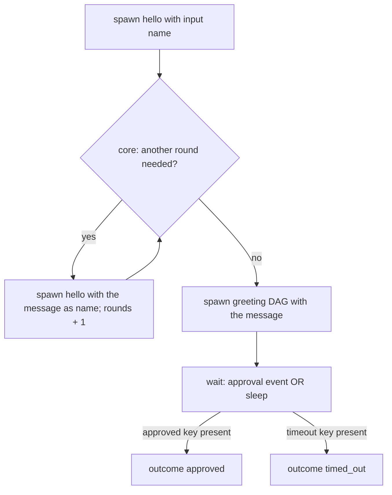

# Worker Skeleton U5 Greeting Rounds Durable Example - Plan

## Goal Capsule

- **Objective:** A contributor can copy a durable workflow that spawns a task and a DAG, loops on child results through a core decision, and waits for an approval event with a timeout.
- **Parent:** `docs/plans/2026-10-14-1724-feat-worker-tasks-workflows-skeleton-plan.md` holds the whole plan; this is part 5 of 5. This file is meant to be enough: open the parent only when something you need is missing here.
- **Depends on:** U4. **Blocks:** nothing; this is the last part.
- **Stop conditions:** stop and ask when the SDK behaves differently from this plan on hatchet-sdk 1.42.1 and engine v0.110.5, or when CI's 90% coverage floor cannot be held without excluding code.

## Builds on

Already in the stack below; read the code, not those plans.

- U4: the `greeting` DAG registered in `WORKFLOWS`, with `src/corvo/core/workflows/` in place; through U1 to U3, `hello`, the defaults module and the registration test.

## Product Contract

### Summary

Adds the durable example `greeting-rounds`: it spawns `hello`, loops on `hello` while `src/corvo/core/workflows/greeting_rounds.py` says another round is needed, spawns `greeting`, then waits for a `greeting:approved` event or a timeout and returns which one happened.

### Context

corvo's main flow, issue to production, has human gates and a review-and-fix loop of unknown length, which only a durable task can express. This part completes R2, R3, R6, R9, R10, R11 and R12: it is the last example to apply them.

### Key Decisions

- **Use Hatchet directly, with no corvo layer hiding it.** Tasks and workflows are declared with Hatchet's own API and live inside `corvo.worker`, so the ruff rule that only `corvo.worker` imports `hatchet_sdk` stays as it is. (session-settled: user-directed — chosen over a corvo layer of abstract base classes that hid Hatchet entirely: that layer had to rebuild DAGs, durable waits, a test executor and not-implemented interfaces Hatchet already provides, and grew too large.) Governs R1, R2.
- **Protect against engine lock-in through the hexagonal split, not a wrapper.** Business logic lives in corvo's core, which never imports Hatchet, and tasks stay thin shells that call it. Changing engines would mean rewriting the shells. The examples demonstrate it: each worker module has a core twin at the mirrored path. (session-settled: user-directed — chosen over examples that keep their logic inside the task and state the rule only as a comment: contributors copy the code, not the comment.) Governs R3, R12.
- **Tasks are reusable building blocks; workflows compose them.** (session-settled: user-directed — chosen over each workflow owning its steps, with a tasks area only for tasks that run alone.) Governs R1, R8, R9.
- **Both composition models from the start, each with an example, plus one example of mixing them.** (session-settled: user-directed — chosen over durable workflows now and DAGs added when the first fixed pipeline appears.) Governs R8, R9.
- **Every task and workflow declares its name explicitly.** A name derived from a class or module would change on a rename and break in-flight durable runs, registered triggers and by-name callers. (session-settled: user-directed — chosen over derived names guarded by a snapshot test.) Governs R2.
- **Tests use what Hatchet provides.** Every example body runs in-process under Hatchet's mock runs, with child runs and durable waits replaced in the test where they would need an engine, and workflow behavior is proven against the real Hatchet in compose. corvo builds no in-memory executor. (session-settled: user-approved — chosen over excluding the spawning and waiting bodies from coverage: CI's 90% coverage floor counts only in-process code.) Governs R10, R11.

### Requirements

**Layout and conventions**

- R2. Every task and workflow is declared with Hatchet's own API, with an explicit `name` and Pydantic input and output models.
- R3. The rule that business logic lives in the core and tasks stay thin shells is written at the top of each example file a contributor copies.
- R12. Each example's logic lives in a pure function under `corvo.core`, at the path that mirrors its worker module (`corvo.core.tasks` for tasks, `corvo.core.workflows` for workflow steps and decisions); the worker module only adapts Hatchet's input and output to it and orchestrates child runs and waits.

**Operation defaults**

- R6. corvo-wide defaults for retries and execution timeout are defined once and applied by every task and workflow declaration, which may override them.

**Living examples**

- R9. A durable example workflow spawns `hello` and the DAG example as children, repeats a child-spawning step until a condition holds or a maximum number of iterations is reached, waits for an event with a timeout, and takes a different path when the event arrives than when the timeout passes.

**Tests**

- R10. Each example task, DAG step, failure handler and durable workflow has a unit test that runs without a Hatchet engine, with child runs and durable waits replaced in the test; R11 proves that the composition works.
- R11. The integration suite runs every example on the real Hatchet in compose, including both paths of the durable example's wait.

### Acceptance Examples

- AE4. **Covers R9, R11.** **Given** the durable example waiting for its event, **when** the event is pushed before the timeout, **then** the workflow takes the event path; **when** no event arrives, **then** it takes the timeout path after the timeout.
- AE6. **Covers R9, R11.** **Given** the durable example's repeating step, **when** it runs on Hatchet, **then** the step is observed running more than once and the loop stops at its exit condition or its maximum.

Considered and not built:

- **A lint or test guarding durable determinism.** Hatchet provides none; the engine raises `NonDeterminismError` on replay, and the durable example states the rule in its header. Revisit when the first real durable flow lands.
- **Long human gates (hours or days).** The example's wait stays under the 15-minute eviction TTL. The timeout and eviction design for long gates is decided with the main flow.

## Planning Contract

### Key Technical Decisions

- KTD2. **A non-durable step that waits on a child run declares `retries=0` and `WAITING_EXECUTION_TIMEOUT`, and a durable task keeps `RETRIES`.** A non-durable step has no checkpoint, so its retry spawns a second child while the first may still run. A durable task's retry replays from its checkpoints and spawns nothing twice. `WAITING_EXECUTION_TIMEOUT` lives in `defaults.py` and covers one child declared with the defaults: `EXECUTION_TIMEOUT × (RETRIES + 1)` plus Hatchet's 5-minute scheduling timeout, 45 minutes in all. (session-settled: user-approved — chosen over the same defaults on parents and children: a parent's clock would run out before a retried child finishes.) Governs R6, R8.
- KTD4. **Unit tests replace child runs and the durable wait with pytest's `monkeypatch`, and use Hatchet's `aio_mock_run` for everything else.** A child's `aio_run` is replaced on the corvo object (`hello`, `greeting`). The durable wait is replaced on `DurableContext.aio_wait_for`, because the mock run builds its context internally. The replacement returns Hatchet's wait-result shape (`{"CREATE": {<readable_data_key>: [payload]}}`), which the integration suite proves against the engine. Governs R10.
- KTD6. **The durable example's approval is the arrival of a `greeting:approved` event that matches the run's `approval_key`.** The input requires an `approval_key` limited to lowercase letters, digits and hyphens, so it is safe to embed in the CEL expression. The wait is an or-group:
  - a `UserEventCondition` on `greeting:approved`, with `readable_data_key="approved"`, an expression matching `input.approval_key` against the run's key, scope `approval_key:<key>`, and a 5-minute lookback from `ctx.aio_now()`;
  - a `SleepCondition` of the input's `approval_timeout_seconds`, with `readable_data_key="timeout"`.

  The branch is `approved` when the `approved` key is present in the result, `timed_out` otherwise. Nothing else in the payload is read. An event arriving after the timeout matches nothing and is lost. The key must be unique per approval request: a reused key lets an older approval inside the lookback approve a new run. The header comment says so. The wait's signal key is a constant, so replay stays deterministic. (session-settled: user-approved — chosen over approving on any event with the key, or reading an approve/reject payload: the docs match events by expression and scope, and approve or reject is the main flow's decision.) Governs R9.
- KTD7. **The durable example is `greeting-rounds`.** Its input bounds keep it inside its own timeout:
  - `max_rounds` 1 to 10;
  - `target_length` 1 to 200;
  - `approval_timeout_seconds` 1 to 600, below the 15-minute eviction TTL.

  It declares `execution_timeout` of 30 minutes, because durable waits count toward the timeout. That covers the longest wait plus children that succeed on their first attempt. Every timeout or eviction choice for longer flows is left to the main flow (Risks). Governs R9.
- KTD8. **The loop spawns `hello` again with the previous message as the name.** `max_rounds` caps the total number of `hello` spawns, the first one included, and `rounds` in the output counts them all. The loop stops when the message reaches `target_length` or `rounds` reaches `max_rounds`. Each `Hello, ...!` grows the message, so the exit depends only on checkpoint outputs and input, as the determinism rule requires. A failed child raises `TaskRunError`, which fails the run. (session-settled: user-approved — chosen over catching the child failure in the example: the fix loop's handling belongs to the main flow.) Governs R9.
- KTD9. **Integration tests trigger every example by name through `hatchet.stubs`, as the existing hello test does.** Each await runs under `asyncio.timeout`, so a stuck run fails the test instead of the 20-minute CI job. The event-path test pushes the event with its scope before triggering, so the lookback is proven on purpose. Each durable test uses its own `approval_key`. The failure path polls the run's details with a deadline until the failure handler completes, as Hatchet's `on_failure/test_on_failure.py` does. Governs R11.
- KTD10. **Each example's header comment carries the rules a copier needs.** Every example states the thin-shell rule and the top-level declaration rule. Every example also says not to put by-name stubs in the two areas, since a stub is a `BaseWorkflow` the registration test would flag. The durable example adds the determinism rule from Hatchet's durable-tasks doc, the approval-key rule (KTD6) and the child-failure rule (KTD8). `defaults.py` states KTD1 and KTD2 in prose. Governs R3, R6.
- KTD11. **`src/corvo/core/` mirrors the worker's areas with pure functions over plain values.**
  - `core/tasks/hello.py` builds the greeting.
  - `core/workflows/greeting.py` shouts a message.
  - `core/workflows/greeting_rounds.py` decides whether another round is needed, from the message, `target_length`, the rounds so far and `max_rounds`.

  The core takes and returns `str`, `int` and `bool`. The Pydantic input and output models stay in the worker, because they are Hatchet's contract. Spawning children, waiting and reading Hatchet's result shapes are orchestration and stay in the worker. The durable example calls only pure core functions between checkpoints, which keeps replay deterministic. Nothing new enforces the boundary: ruff's banned-api rule already stops anything outside `corvo.worker`, `core` included, from importing `hatchet_sdk` or `corvo.worker`. Core tests live in `tests/core/` and call the functions directly, with no mock run. `tests/worker/` and `tests/core/` become packages with `__init__.py`, as `tests/integration/` already is, so mirrored test names such as `test_hello.py` do not collide in pytest or mypy. (session-settled: user-directed — chosen over examples holding their logic inside the task, with the rule stated only in a comment: logic in `core/tasks/` and `core/workflows/`, thin shells in `worker/tasks/` and `worker/workflows/`.) Governs R3, R12.

### High-Level Technical Design

The durable example's decision points:

### Assumptions

- hatchet-sdk 1.42.1, as pinned in `uv.lock`, supports everything R8 and R9 need: `wf.task(parents=...)`, `wf.on_failure_task()`, `hatchet.durable_task()`, child spawning and event waits with an or-group timeout.
- The unsigned-token shim in `tests/conftest.py` keeps working for every new module that declares tasks, since each one imports the client built at import time.
- Hatchet's mock runs execute a task body without an engine, but a child spawn inside one makes a real gRPC call, and a durable wait raises `ValueError("Durable task client is not available")`. Unit tests replace both (KTD4); only integration (R11) proves the composition.

### Risks

- **Durable waits count toward the execution timeout.** Evidence is engine source, not docs. The example is sized for it (KTD7); the main flow's long gates need their own design, likely an `EvictionPolicy`, `aio_refresh_timeout` or a larger timeout.
- **The replaced wait result can drift from the engine's shape.** The unit tests return `{"CREATE": {...}}` by hand; the two durable integration tests prove it on every CI run.
- **The shape of a DAG result spawned from a durable task is proven only by integration.** Inside a durable context, hatchet-sdk 1.42.1 returns the engine's child payload without normalizing it (`runnables/workflow.py:1182-1206`), and the SDK notes that durable callbacks may return a task's payload directly instead of keying it by task name. The unit test's replacement for `greeting.aio_run` copies the shape the `greeting-rounds` integration test observes.
- **Changing a durable task's loop bound, spawn order or wait while runs are in flight raises `NonDeterminismError` on replay.** The header rule warns copiers; nothing enforces it.
- **The integration suite grows inside a 20-minute CI job.** The new tests are short (sub-10-second waits, children that return at once) and bounded by `asyncio.timeout` (KTD9).
- **Lookback and scope on engine v0.110.5 are verified only by the integration test.** The SDK gates no engine version for them, and v0.110.5 is newer than the SDK release that added them.

### Deferred to Implementation

- Whether `hatchet.stubs.task` triggers the durable standalone by name, or the test needs `hatchet.stubs.workflow`.
- The exact `asyncio.timeout` values, sized to each test's inputs.

### Sources

- Durable tasks and determinism: https://docs.hatchet.run/v1/durable-tasks.md. A durable task's retry replays from its checkpoints instead of re-running completed work.
- Durable event waits and lookback: https://docs.hatchet.run/v1/durable-event-waits.md. Match the event with a CEL expression; a lookback needs the same scope on the wait and on the push.
- Hatchet examples in hatchet-dev/hatchet: `sdks/python/examples/durable/` (or-group waits at `worker.py:159-205`, lookback with scope at `worker.py:347-367`, push-before-trigger test at `test_durable.py:435-490`).

## Implementation Units

### U5. Durable example: greeting-rounds

- **Goal:** a contributor can copy a durable workflow that spawns a task and a DAG, loops on child results, and waits for an approval event with a timeout.
- **Requirements:** R2, R3, R9, R10, R11, R12, AE4, AE6; KTD4, KTD6, KTD7, KTD8, KTD9, KTD10, KTD11.
- **Dependencies:** U4.
- **Files:**
  - Create `src/corvo/core/workflows/greeting_rounds.py`.
  - Create `src/corvo/worker/workflows/greeting_rounds.py`.
  - Modify `src/corvo/worker/worker.py` (add to `WORKFLOWS`).
  - Create `tests/core/workflows/test_greeting_rounds.py`.
  - Create `tests/worker/workflows/test_greeting_rounds.py`.
  - Modify `tests/integration/worker/test_workflows.py`.
- **Approach:**
  1. Add the core function that decides whether another round is needed, from the message, `target_length`, the rounds so far and `max_rounds` (KTD8, KTD11).
  2. Declare `@hatchet.durable_task(name="greeting-rounds", ...)` with `retries=RETRIES` and a 30-minute `execution_timeout` (KTD2, KTD7).
  3. The input model holds `name`, `approval_key`, `target_length`, `max_rounds` and `approval_timeout_seconds`, with the bounds of KTD6 and KTD7.
  4. Spawn `hello`, loop while the core function says another round is needed (KTD8), then spawn `greeting` and validate its `shout` output into the model.
  5. Wait on the or-group of KTD6 and return `rounds`, `message`, the `shout` message and `outcome` (`approved` or `timed_out`).
  6. Header comment per KTD10, including the determinism and approval-key rules, the rule that the body calls only pure core functions between checkpoints, and the rule that a failed child run fails the durable run (KTD8).
- **Patterns to follow:** Hatchet's `examples/durable/worker.py` (or-group at lines 159-205, lookback with scope at lines 347-367); Hatchet's durable-tasks and durable-event-waits docs.
- **Test scenarios:**
  - The core decision returns true while the message is shorter than `target_length` and rounds are below `max_rounds`.
  - It returns false once the message reaches `target_length`.
  - It returns false at `max_rounds`, even with the message still short.
  - With `hello.aio_run` and `greeting.aio_run` replaced and the wait returning the `approved` key, the outcome is `approved` and the message passed through the loop.
  - The same setup with the wait returning the `timeout` key gives `timed_out`.
  - With `target_length` above what three rounds reach and `max_rounds=3`, `hello` runs three times in total and `rounds` is 3.
  - With a `target_length` the second `hello` reaches and `max_rounds=5`, `hello` runs twice and `rounds` is 2.
  - With a `target_length` the first `hello` already meets, the loop adds no spawn and `rounds` is 1.
  - The wait receives an event condition whose expression and scope carry the input's `approval_key`, and a sleep of `approval_timeout_seconds`.
  - A replaced child raising `TaskRunError` makes the run raise.
  - The input model rejects an `approval_key` with a quote or uppercase letter, a `max_rounds` of 0 or 11, and an `approval_timeout_seconds` of 0 or 601.
  - Covers AE4, AE6. Integration: after pushing `greeting:approved` with the run's key and scope, triggering `greeting-rounds` with a `target_length` that needs at least two rounds returns `approved` and `rounds >= 2`.
  - Covers AE4. Integration: with another key, no push and `approval_timeout_seconds` of a few seconds, the run returns `timed_out`.
- **Verification:** both durable integration tests pass on compose; coverage of `src` stays at or above 90% with branches.

## Verification Contract

- `uv run prek run --all-files`: ruff, format, mypy strict, lockfile.
- `uv run pytest tests/core tests/worker`: unit tests, no Docker.
- `uv run pytest tests/integration/worker`: integration on compose (needs Docker).
- `uv run --locked --with coverage==7.16.2 coverage run --branch --source=src -m pytest`, then `coverage report --fail-under=90` the same way: CI's coverage floor.

## Definition of Done

- Every gate above passes locally and in CI.
- U5 when its integration tests pass on compose.
- No abandoned attempt remains in the diff.

## Execution: gh stack

- **Stack, bottom to top:** `docs/worker-tasks-workflows-plan` → `feat/worker-u1-hello-core` → `feat/worker-u2-defaults` → `feat/worker-u3-registration` → `feat/worker-u4-greeting-dag` → `feat/worker-u5-greeting-rounds`.
- **This part:** branch `feat/worker-u5-greeting-rounds`, on top of `feat/worker-u4-greeting-dag`. Commit only this unit here; a fix a lower part needs goes on that part's branch, then `gh stack rebase`.
- **Start:** `gh stack init` with the branches above, in order, when the stack does not exist yet (it adopts the existing plans branch); otherwise `gh stack checkout` this branch.
- **Publish and merge:** `gh stack submit` opens one pull request per layer; `gh stack merge` merges bottom up.
