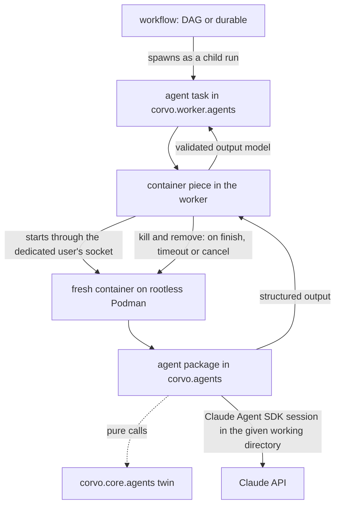

# Agents Skeleton - Plan

## Goal Capsule

- **Objective:** Adding an AI agent to corvo means copying a living example, filling it in, adding one line to the worker and writing its tests. The agent runs isolated in a container of its own from the first run.
- **Means:** the Claude Agent SDK, used with its own API in a Hatchet-free `corvo.agents` package. A thin Hatchet task starts each run in a fresh container on rootless Podman.
- **Product authority:** the repository owner, who settled every decision recorded under Key Decisions. The Product Contract wins on behavior.
- **Open blockers:** none.

---

## Product Contract

### Summary

`corvo.agents` gets one package per agent, written with the Claude Agent SDK's own API and blind to Hatchet. Its SDK-independent logic lives in a mirrored `corvo.core.agents` module. Each agent has a thin Hatchet task in `corvo.worker.agents`. The task starts a fresh, hardened container for each run on a rootless Podman of its own, reads the agent's structured output and removes the container. Three living examples show each shape. Other SDKs come later as agents written with their own native APIs.

### Problem Frame

corvo's workflows track will hand steps to agents: crew's own agents (product-manager, claude-developer) already plan, split and relate issues headless in a worktree. Today nothing in corvo says where an agent goes, what shape it takes, or how it meets Hatchet. The first agent would invent all three, and every later one would copy whatever it chose.

Where the agent runs matters as much as its shape. An agent with Bash inside the worker's container sees the worker's environment: the Hatchet token, the database password and the Claude credential. Hatchet provides no sandboxing and leaves it to infrastructure, so corvo has to decide it.

The tasks and workflows skeleton (`docs/plans/2026-10-14-1724-feat-worker-tasks-workflows-skeleton-plan.md`) solved the same problem for Hatchet code with living examples, mirrored core twins, explicit registration and an import rule. This work does the same for agents.

### Key Decisions

- **An agent is a Hatchet task that runs one agent session.** Workflows spawn it like any task. (session-settled: user-directed — chosen over an agent outside Hatchet that calls tasks as tools: both will exist, starting with this one.) Governs R6, R20.
- **Each agent uses its SDK's own API, with no corvo interface over SDKs.** Agents share a shape, not a contract: a thin task, a core twin, Pydantic models, defaults and registration. (session-settled: user-directed — chosen over one agent definition runnable on any SDK through corvo adapters, and over a common corvo contract every SDK adapter implements.) Governs R4.
- **Agent code lives in its own Hatchet-free package; the worker keeps only a thin task.** (session-settled: user-directed — chosen over an agents area inside `corvo.worker` that imports the SDK next to Hatchet.) Governs R1, R2, R6.
- **One package per agent, with `agent.py` and `prompts/`, plus `tools.py` when the agent has custom tools, mirrored by a core twin.** These are the names Google ADK, Anthropic's Agent SDK cookbooks and demos, and Hatchet's agent examples use. (session-settled: user-approved — chosen over a prompt held as a constant in code, and over SDK-named files such as `agent_claude.py`.) Governs R1, R3.
- **Prompts live with the agent, not in the core.** A prompt is tuned to its SDK and model. The core holds only logic that survives an SDK change. (session-settled: user-approved — chosen over prompts in the core: a prompt is tuned to its SDK and model.) Governs R1, R3.
- **Each run executes in a fresh, hardened container.** It keeps a prompt-injected agent away from the worker's credentials. Following the Agent SDK's own docs, the whole agent runs inside the boundary, not just its commands. (session-settled: user-directed — chosen over running the agent as a subprocess of the worker, and over the SDK's built-in sandbox.) Governs R13, R15, R17.
- **Rootless Podman under a dedicated host user, with its socket mounted into the worker's container.** The worker stays a compose service. (session-settled: user-directed — chosen over the host's `docker.sock` (a compromised worker is host root), the worker running on the host, Docker-in-Docker and a hosted sandbox.) (session-settled: user-approved — Podman chosen over rootless Docker: it runs beside the compose stack's rootful Docker on its documented path, GitLab Runner documents the same setup, and the CI runner ships it.) Governs R14.
- **The caller gives the agent its working directory.** Cloning a repository or creating a worktree per issue is the caller's job. (session-settled: user-directed — chosen over the task building a temporary directory from its input.) Governs R5.
- **The Claude credential is either an API key or a subscription OAuth token, chosen per environment.** (session-settled: user-directed — chosen over an API key only and over a subscription token only.) Governs R12.
- **No automated test calls Claude; a manual run on Haiku proves each example.** (session-settled: user-directed — chosen over an e2e job against real Claude on every push to main, and over an on-demand e2e job.) Governs R22, R25.
- **Hatchet does not retry agents.** A retry re-runs and re-pays the whole session, and the SDK already retries API errors itself. (session-settled: user-approved — chosen over corvo's `RETRIES` default, which assumes idempotent tasks.) Governs R7.
- **Three examples cover the four shapes.** Example 2 combines the working directory with a custom tool, as `greeting-rounds` combined spawning and waiting. (session-settled: user-approved — chosen over one example per shape.) Governs R18, R19, R20.
- **The container keeps network egress and receives the Claude credential, for now.** The SDK's docs recommend `--network none` behind a credential-injecting proxy; that is deferred. (session-settled: user-approved — chosen over building the proxy now.) Governs R15.

### Requirements

**Agent packages and boundaries**

- R1. `corvo.agents` holds one package per agent. `agent.py` builds the SDK options and runs the session, `tools.py` holds the agent's custom tools when it has any, and `prompts/` holds the prompt text files the agent reads and passes to the SDK.
- R2. Only `corvo.agents` imports `claude_agent_sdk`. `corvo.agents` imports neither Hatchet nor `corvo.worker`, and `corvo.core` imports neither `corvo.agents` nor the SDK. A check fails on each of these imports in every module, including `corvo.worker` and `corvo.server.api`, whose files ignore ruff's TID251 wholesale today.
- R3. Logic that must survive an SDK change, such as decisions on the agent's output and its tools' logic, lives in pure functions in `corvo.core.agents` at the mirrored path. The agent package only adapts that logic to the SDK.
- R4. Every agent is written with its SDK's own API, with no corvo layer between it and the SDK.
- R5. An agent takes its working directory as a parameter and gives it to the SDK as the session's working directory. The task accepts only working directories under one configured agent-workdir root that both the worker's user and the dedicated Podman user can read, resolving symlinks, and fails any other path before it starts a container.

**Hatchet integration**

- R6. Each agent has a thin Hatchet task in `corvo.worker.agents` with an explicit name and Pydantic input and output models. The task is registered in `WORKFLOWS`, and the registration test covers the area.
- R7. Agent tasks declare `retries=0`, an agent execution timeout and an agent schedule timeout sized for the queue behind R9's cap, all defined once in the worker's defaults. A step that waits on an agent child declares a timeout derived from the agent's schedule and execution timeouts, not `WAITING_EXECUTION_TIMEOUT`.
- R8. A run that ends without valid structured output fails its task. That covers an error result, the turn or budget limit, and a success result without `structured_output`. In every case the task logs the run's cost, turns and session ID.
- R9. The pattern caps how many agent runs execute at once across the worker pool.

**Agent execution**

- R10. Every agent declares its model, its turn limit and its budget limit.
- R11. Agents load no CLAUDE.md, skills, settings or auto memory, whether from the host or from the working directory. They use only tools they list explicitly, and every other tool call is denied.
- R12. The Claude credential comes from corvo's settings, as an API key or a subscription OAuth token, and each environment chooses which.

**Isolation**

- R13. Each agent run executes in a fresh container started for that run. The agent's code runs inside the container and hands its structured output to the task, which then removes the container.
- R14. Agent containers run on a rootless Podman under a dedicated host user, apart from the daemon that runs the compose stack. The worker stays a compose service and reaches Podman through that user's API socket, mounted into the worker's container and reachable by the worker's user through a shared group. When it starts, the worker checks that the host's cgroup controllers for memory, CPU and processes are available, and refuses agent runs when they are not.
- R15. The agent container drops every capability, has a read-only root filesystem, runs under the default seccomp profile, and is limited in memory, CPU and processes. Besides size-limited tmpfs mounts for `/tmp` and the agent user's home, it receives only the working directory mount and the Claude credential. The working directory is mounted read-only unless the agent declares that it writes to it, and a directory an agent may have written is untrusted output: the worker runs no hooks, config or code from it.
- R16. When Hatchet times out or cancels an agent task, the task kills and removes its container. Every container carries labels with its run's ID and its Hatchet deployment (server and tenant). A worker that starts removes only containers of its own deployment whose run Hatchet reports as finished, failed or cancelled.
- R17. One piece of the worker starts, waits on, reads and removes agent containers, and every agent task uses it.

**Living examples**

- R18. An agent with no tools turns a Pydantic input into a structured output.
- R19. An agent works in the directory it receives, with the SDK's read-only file tools and one custom tool whose logic lives in the core.
- R20. A workflow spawns both agents as child runs and uses their outputs.
- R21. Each example file opens with a header comment that carries the rules a copier needs, as the task and workflow examples do.

**Tests**

- R22. No automated test calls Claude, and a guard fails any test that tries.
- R23. Each agent has unit tests that run without Hatchet and without a container, with the SDK replaced. Agent tasks and the container piece have unit tests with the agent and the container client replaced.
- R24. The integration suite runs every example on the real Hatchet and a real rootless Podman, with the SDK replaced inside the container, including the kill and removal on timeout. It creates its working directories under the agent-workdir root (R5), not in pytest's temporary directories.
- R25. Each example is proven once against real Claude Haiku with a small prompt, through a documented manual command whose run is recorded in the pull request.

### How a run flows

Solid arrows cross a process or container boundary. The dotted arrow is a plain function call into code that imports no SDK and no Hatchet.

### Acceptance Examples

- AE1. **Covers R6.** **Given** a new agent task in `corvo.worker.agents`, **when** its line is missing from `WORKFLOWS`, **then** the registration test fails and names the task.
- AE2. **Covers R2.** **Given** a module outside `corvo.agents` that imports `claude_agent_sdk`, such as an agent task in `corvo.worker.agents`, or a module in `corvo.agents` that imports Hatchet, **when** the checks run, **then** they fail on that import.
- AE3. **Covers R8.** **Given** an agent that reaches its turn limit, **when** its task finishes, **then** the run is marked failed without a retry, and its log holds the cost, turns and session ID.
- AE4. **Covers R16, R24.** **Given** an agent run that is still working, **when** the task's execution timeout passes, **then** its container is killed and removed, and no container labelled with that run remains.
- AE5. **Covers R16.** **Given** a container of this worker's deployment whose run Hatchet reports as ended, and another whose run is still running on a second worker, **when** a worker starts, **then** it removes the first and leaves the second running.
- AE6. **Covers R11.** **Given** a working directory that holds a CLAUDE.md and `.claude/skills/`, **when** an agent runs in it, **then** the session loads neither.
- AE7. **Covers R20, R24.** **Given** the workflow example on Hatchet and Podman with the SDK replaced, **when** it runs, **then** it returns outputs derived from both agents' structured outputs.
- AE8. **Covers R22.** **Given** a unit test that runs an agent without replacing the SDK, **when** it runs, **then** the guard fails it before any request leaves.

### Success Criteria

- A contributor, human or LLM agent, adds a working agent by reading only the examples. That means an agent package, its core twin, a thin task, one line in `WORKFLOWS`, and their tests.
- The official Claude Agent SDK docs apply to corvo's agents unchanged, and Hatchet's task and workflow docs apply to their thin tasks.
- A compromised agent container cannot read worker-only credentials such as the Hatchet token and the database password; it reads only the Claude credential it is given. A compromised worker cannot reach host root or the compose stack's containers through the agents' Podman.

### Scope Boundaries

- Agents that call Hatchet tasks as tools, and agents that run outside Hatchet and trigger it. Hatchet's `mcp_tool` builds a tool that runs in the agent's own process with a Hatchet client and token, and the agent container holds neither, so tools backed by Hatchet will need a bridge from the container to the worker.
- Other agent SDKs (OpenAI Agents SDK and others). Each will be written with its own API when its first agent arrives.
- A credential-injecting proxy and `--network none` for agent containers. This must come before agents that process untrusted content.
- gVisor or another hardened runtime for agent containers. It costs 10 to 200 times on file I/O, and its pairing with rootless Podman is unverified.
- More than one host: Kubernetes Jobs or a hosted sandbox (E2B, Modal).
- An e2e job against real Claude, and evals. Evals belong to the question bank.
- Resumable sessions, session stores, multi-turn conversations, subagents, and approval callbacks (human in the loop).
- Porting crew's agents, and loading skills or CLAUDE.md into agent sessions, which those agents need. The main flow decides both.
- Creating working directories (clone or worktree per issue). The caller does that.
- No real business logic: the examples hold only trivial prompts and core functions.

### Dependencies / Assumptions

- hatchet-sdk 1.42.1 cancels a running async task's asyncio task on cancellation and timeout (`hatchet_sdk/worker/runner/runner.py:931`), so the task can kill its container in a `finally`. It also has a `claude` extra that installs `claude-agent-sdk` and `mcp`, and `mcp_tool` (`hatchet_sdk/runnables/workflow.py:831`).
- The Python Agent SDK's Linux wheels bundle the native `claude` binary, which needs no separate install (Agent SDK quickstart).
- The SDK's `ResultMessage` carries `subtype`, `structured_output`, `total_cost_usd`, `num_turns` and `session_id`. A Pydantic model's JSON Schema passed as `output_format` comes back validated in `structured_output` (Agent SDK Python reference and structured-outputs guide).
- Podman's Docker v1.40 compatibility API supports every call the container piece needs through the official `docker` Python SDK. Unverified; podman-py is the fallback.
- Hosts run cgroup v2 with systemd, without which rootless memory, CPU and process limits are silently ignored; R14's start check turns a missing controller into refused agent runs. Arch has it; the production host is unverified.
- The CI runner (GitHub `ubuntu-24.04`) ships Podman 4.9.3 (actions/runner-images `images/ubuntu/Ubuntu2404-Readme.md`). Development machines run Podman 5.x, whose default rootless network differs (`pasta` versus `slirp4netns`).
- The integration suite runs `corvo-worker` as a host subprocess of the pytest session, which inherits its environment (`tests/integration/worker/conftest.py`). The compose stack runs only Hatchet there, so that worker runs as the developer's or CI runner's user. It reaches the dedicated user's Podman through the shared-group socket (R14), since a rootless socket under `/run/user/<uid>` is private to its owner.
- The installed package may not include non-Python files such as `prompts/*.md`; `pyproject.toml` does not settle it. The Docker image is unaffected, since it installs from source.

### Outstanding Questions

**Deferred to Planning**

- Whether agent containers run the app's image with another entrypoint or an image of their own.
- How the container hands back its structured output (stdout or a file) and streams its log to the run's log.
- The official `docker` SDK over Podman's compatibility socket, or podman-py.
- How the integration suite replaces the SDK inside the container, for example a fake `claude` binary through the SDK's `cli_path`.
- The agent execution timeout, the concurrency cap, and the container's memory, CPU and process limits.
- How the dedicated user and its socket are provisioned in compose, on development machines and in CI, and documented.
- How the worker's container mounts working directories at their host paths, since Podman resolves bind mounts on the host.
- The examples' names and themes, and the split into stacked parts.

### Sources / Research

- Claude Agent SDK docs, each page served as markdown under https://code.claude.com/docs/en/agent-sdk/:
  - `overview.md`, `agent-loop.md` and `python.md`. These cover `query`, `ClaudeAgentOptions`, `ResultMessage` subtypes, `max_turns` and `max_budget_usd`, and the absence of a session timeout.
  - `permissions.md`: `dontAsk` with `allowed_tools` for headless agents.
  - `claude-code-features.md`: `setting_sources=[]`, `CLAUDE_CODE_DISABLE_AUTO_MEMORY`, and what `settingSources` does not control.
  - `structured-outputs.md`: Pydantic schemas and `error_max_structured_output_retries`.
  - `custom-tools.md`: `@tool`, `create_sdk_mcp_server` and `mcp__<server>__<tool>`.
  - `hosting.md`: the subprocess model, ephemeral sessions, about 1 GiB per agent, and the known limitations.
  - `secure-deployment.md`: isolation technologies, hardened `docker run` flags, and the credential proxy pattern.
- Hatchet docs:
  - https://docs.hatchet.run/cookbooks/hatchet-claude-agent-sdk-trusted-env.md and https://docs.hatchet.run/cookbooks/hatchet-and-mcp.md: `mcp_tool`, and "Hatchet does not provide native code sandboxing".
  - https://docs.hatchet.run/v1/cancellation.md and https://docs.hatchet.run/v1/timeouts.md.
  - https://docs.hatchet.run/v1/advanced-assignment/slot-cost.md and https://docs.hatchet.run/v1/concurrency.md.
  - https://docs.hatchet.run/v1/advanced-assignment/worker-affinity.md.
- Agent layouts:
  - google ADK project structure: https://adk.dev/get-started/python/.
  - anthropics/claude-cookbooks `claude_agent_sdk/`.
  - anthropics/claude-agent-sdk-demos `research-agent/` (`prompts/*.txt`).
  - hatchet-dev/hatchet `sdks/python/examples/support_agent_tools/`.
- Testing practice:
  - anthropics/claude-agent-sdk-python: mocked transport in `tests/`, and a separate `e2e-tests/` job.
  - openai/openai-agents-python `ScriptedModel`.
  - pydantic-ai `TestModel` and `ALLOW_MODEL_REQUESTS`.
  - https://www.anthropic.com/engineering/demystifying-evals-for-ai-agents.
- Container runtimes:
  - Docker security and rootless mode: https://docs.docker.com/engine/security/ and https://docs.docker.com/engine/security/rootless/.
  - Podman system service: https://docs.podman.io/en/latest/markdown/podman-system-service.1.html.
  - GitLab Runner Docker executor with rootless Podman: https://docs.gitlab.com/runner/executors/docker/.
  - GitLab on socket binding and DinD: https://docs.gitlab.com/ci/docker/using_docker_build/.
  - Testcontainers DinD patterns.
  - Tecnativa docker-socket-proxy `haproxy.cfg`, which filters by path and method only.
  - gVisor rootless and Docker guides.
- Repo:
  - `docs/plans/2026-10-14-1724-feat-worker-tasks-workflows-skeleton-plan.md`, the precedent this work mirrors.
  - `src/corvo/worker/worker.py`, `src/corvo/worker/defaults.py` and `src/corvo/worker/hatchet_client.py`.
  - `tests/worker/test_registration.py`, `ruff.toml`, `tests/conftest.py` and `tests/integration/worker/conftest.py`.
  - `Dockerfile`, `compose.yaml` and `.crew/config.yaml` (crew's agents).
