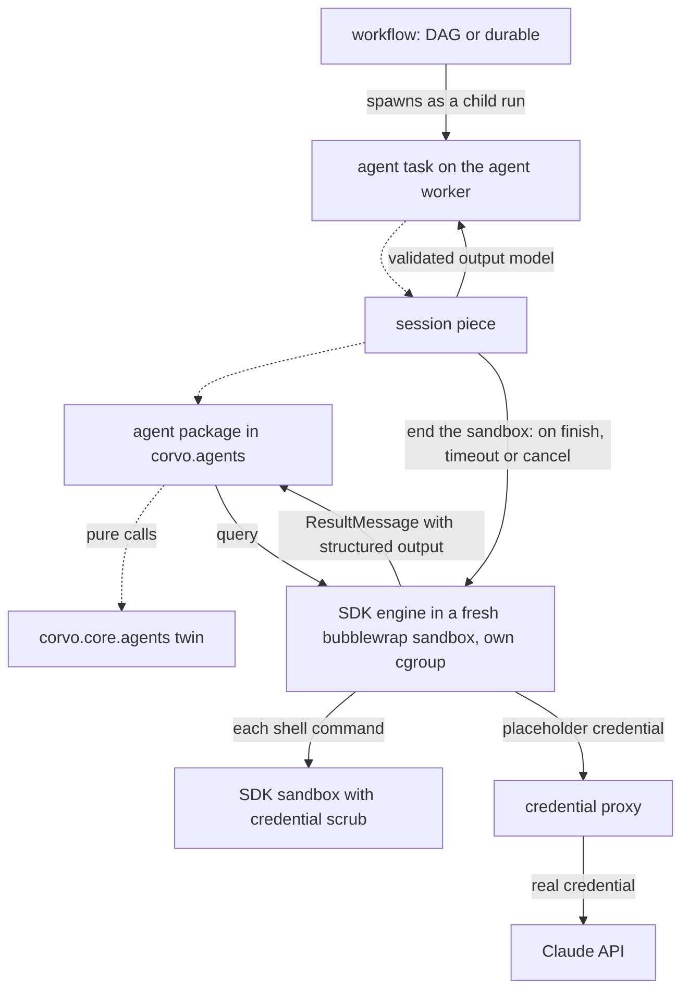
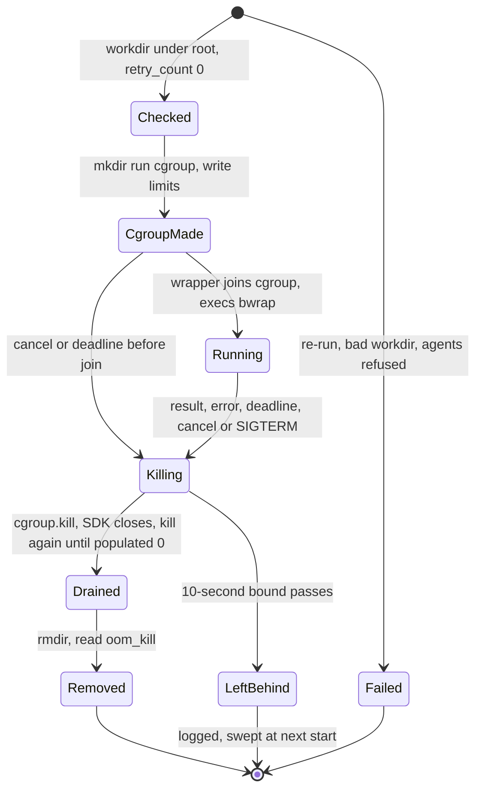
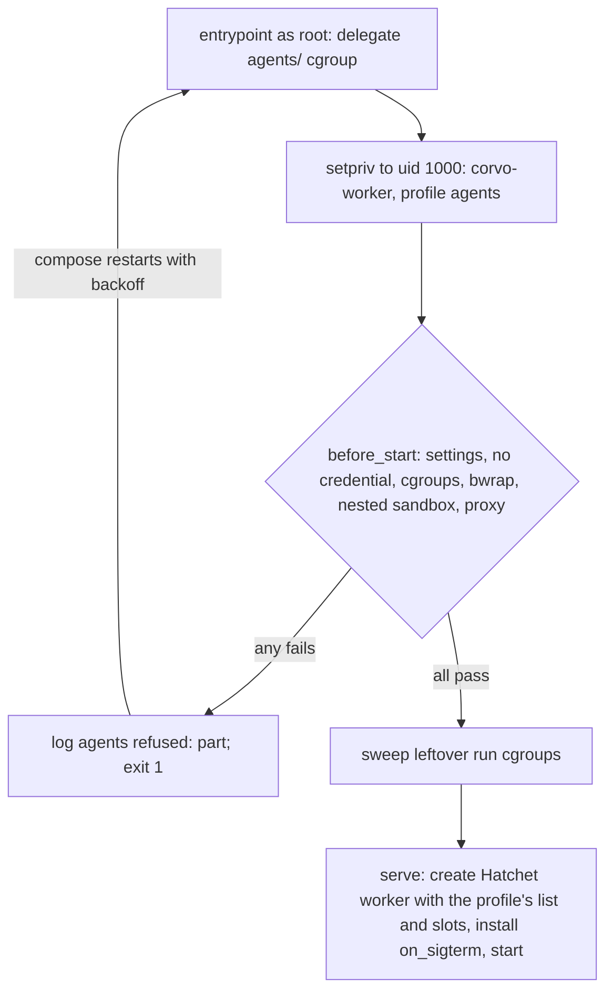

# Agents Skeleton - Plan

## Goal Capsule

- **Objective:** Adding an AI agent to corvo means copying a living example, filling it in, adding one line to the agent worker and writing its tests. From its first run, an agent whose shell commands follow a prompt injection cannot reach corvo's credentials, other runs, the host or the outside world.
- **Means:** the Claude Agent SDK, used with its own API in a Hatchet-free `corvo.agents` package (KTD1). A thin Hatchet task on a dedicated agent worker (KTD26) runs each session with the SDK's engine in a bubblewrap sandbox of its own (KTD20) and a cgroup of its own (KTD21), the SDK's sandbox around every shell command (KTD3), and the Claude credential held by a Caddy proxy outside (KTD22).
- **Product authority:** the repository owner, who settled every decision recorded under Key Decisions and the labeled KTDs. The Product Contract wins on behavior; a KTD wins on mechanism within its cited requirements.
- **Stop conditions:** stop and report, without working around it, when U1's gate shows on CI or on the Arch host that the SDK's sandbox cannot run nested in the outer bubblewrap, or that a run's cgroup limits do not apply. Stop the same way when any escape of AE5 succeeds in U8.
- **Execution profile:** one stacked pull request per part, in the order of Split into parts. Each part has its own part plan, cut from this file and listed there, and is carried through review and CI on its own.

---

## Product Contract

### Summary

`corvo.agents` gets one package per agent, written with the Claude Agent SDK's own API and blind to Hatchet. Its SDK-independent logic lives in a mirrored `corvo.core.agents` module. Each agent has a thin Hatchet task that runs only on a dedicated agent worker. The task runs each session with the SDK's engine in a fresh bubblewrap sandbox bounded by its own cgroup. Inside, the SDK's own sandbox isolates every shell command, and a proxy outside holds the Claude credential. Three living examples show each shape. Other SDKs come later as agents written with their own native APIs.

The plan builds this whole contract, plus what operating it needs: the agent worker's compose service and container settings, the credential proxy, and the repository's first operations doc, which covers the manual Haiku proofs.

### Problem Frame

corvo's workflows track will hand steps to agents: crew's own agents (product-manager, claude-developer) already plan, split and relate issues headless in a worktree. Today nothing in corvo says where an agent goes, what shape it takes, or how it meets Hatchet. The first agent would invent all three, and every later one would copy whatever it chose.

Where the agent runs matters as much as its shape. Every agent corvo plans will have Bash, and an agent with Bash in the worker's process sees the worker's environment: the Hatchet token, the database password and the Claude credential. Hatchet provides no sandboxing and leaves it to infrastructure, so corvo has to decide it.

A first design ran each session in a fresh rootless-Podman container driven from the worker. Each review round found another hole in it: a group-readable request file, then a result that any process in the container could forge, then the Claude credential in every child process's environment. Measured on 2026-10-15, a child process in that container wrote a forged result through `/proc/1/fd/1`, which the container's init held open, and the forgery reached the worker before the real result. Each fix added transport code over the container's streams, and the host still needed a Podman of its own.

The tasks and workflows skeleton (`docs/plans/2026-10-14-1724-feat-worker-tasks-workflows-skeleton-plan.md`) solved the same problem for Hatchet code with living examples, mirrored core twins, explicit registration and an import rule. This work does the same for agents.

### Key Decisions

- **An agent is a Hatchet task that runs one agent session.** Workflows spawn it like any task. (session-settled: user-directed — chosen over an agent outside Hatchet that calls tasks as tools: both will exist, starting with this one.) Governs R6, R20.
- **Each agent uses its SDK's own API, with no corvo interface over SDKs.** Agents share a shape, not a contract: a thin task, a core twin, Pydantic models, defaults and registration. (session-settled: user-directed — chosen over one agent definition runnable on any SDK through corvo adapters, and over a common corvo contract every SDK adapter implements.) Governs R4.
- **Agent code lives in its own Hatchet-free package; the worker keeps only a thin task.** (session-settled: user-directed — chosen over an agents area inside `corvo.worker` that imports the SDK next to Hatchet.) Governs R1, R2, R6.
- **One package per agent, with `agent.py` and `prompts/`, plus `tools.py` when the agent has custom tools, mirrored by a core twin.** These are the names Google ADK, Anthropic's Agent SDK cookbooks and demos, and Hatchet's agent examples use. (session-settled: user-approved — chosen over a prompt held as a constant in code, and over SDK-named files such as `agent_claude.py`.) Governs R1, R3.
- **Prompts live with the agent, not in the core.** A prompt is tuned to its SDK and model. The core holds only logic that survives an SDK change. (session-settled: user-approved — chosen over prompts in the core: a prompt is tuned to its SDK and model.) Governs R1, R3.
- **Each session's SDK engine runs in a fresh bubblewrap sandbox, and the SDK's sandbox with its credential scrub isolates every shell command inside it.** Measured together, the two layers stopped every escape a scripted shell command tried; either layer alone left some open. (session-settled: user-directed — chosen over the per-run Podman container, which left the forged result open, and over the SDK's sandbox alone, which leaves the worker's environment within every command's reach.) Governs R14, R15, R17, R26.
- **bubblewrap for both layers.** The SDK's sandbox already depends on it, and Flatpak, Claude Code and Codex use it. (session-settled: user-directed — chosen over runc, youki, nsjail and gVisor for the outer layer: each adds a second isolation tool without removing bubblewrap, and rootless gVisor drops cgroup limits and network namespaces.) Governs R14.
- **No VM.** The sessions share the host's kernel, as the Podman design did. (session-settled: user-directed — chosen over a dedicated VM for the agent worker and over a microVM per run.)
- **The agent worker is a compose service of its own.** (session-settled: user-approved — chosen over a systemd service on the host: it keeps one deploy path and the Hatchet engine's gRPC internal, at the cost of R27's container settings and a profile kept in step with Docker's.) Governs R13, R27.
- **The Claude credential lives in a proxy and the agent worker's egress is cut, from the first run.** Without both, a session that reads its own engine's credential could send it out. (session-settled: user-approved — chosen over deferring the proxy and `--network none`, as the Podman design did.) Governs R12, R16.
- **Every tool corvo runs or ships has its license read at the source before it is adopted.** bubblewrap's files are LGPL-2.0-or-later and LGPL-2.1-or-later, and socat is GPL-2.0-only. Both run as separate, unmodified programs from distribution packages, which their licenses leave unrestricted. (session-settled: user-approved — chosen over permissive-only tools for the outer layer, after the license texts were read.)
- **The caller gives the agent its working directory.** Cloning a repository or creating a worktree per issue is the caller's job. (session-settled: user-directed — chosen over the task building a temporary directory from its input.) Governs R5.
- **The Claude credential is either an API key or a subscription OAuth token, chosen per environment.** (session-settled: user-directed — chosen over an API key only and over a subscription token only.) Governs R12.
- **No automated test calls Claude; a manual run on Haiku proves each example.** (session-settled: user-directed — chosen over an e2e job against real Claude on every push to main, and over an on-demand e2e job.) Governs R22, R25.
- **Hatchet does not retry agents.** A retry re-runs and re-pays the whole session, and the SDK already retries API errors itself. (session-settled: user-approved — chosen over corvo's `RETRIES` default, which assumes idempotent tasks.) Governs R7.
- **Three examples cover the four shapes.** Example 2 combines the working directory with a custom tool, as `greeting-rounds` combined spawning and waiting. (session-settled: user-approved — chosen over one example per shape.) Governs R18, R19, R20.

### Requirements

**Agent packages and boundaries**

- R1. `corvo.agents` holds one package per agent. `agent.py` builds the SDK options and runs the session, `models.py` holds the agent's Pydantic models and imports no SDK, `tools.py` holds the agent's custom tools when it has any, and `prompts/` holds the prompt text files the agent reads and passes to the SDK.
- R2. Only `corvo.agents` imports `claude_agent_sdk`. `corvo.agents` imports neither Hatchet nor `corvo.worker`, and `corvo.core` imports neither `corvo.agents` nor the SDK. A check fails on each of these imports in every module, including `corvo.worker` and `corvo.server.api`, whose files ignore ruff's TID251 wholesale today.
- R3. Logic that must survive an SDK change, such as decisions on the agent's output and its tools' logic, lives in pure functions in `corvo.core.agents` at the mirrored path. The agent package only adapts that logic to the SDK.
- R4. Every agent is written with its SDK's own API, with no corvo layer between it and the SDK.
- R5. An agent takes its working directory as a parameter and gives it to the SDK as the session's working directory. The task accepts only working directories strictly below `<root>/workdirs` (the `workdirs` directory under `CORVO_AGENT_ROOT`), resolving symlinks, and fails any other path before it starts a session.

**Hatchet integration**

- R6. Each agent has a thin Hatchet task in `corvo.worker.agents` with an explicit name and Pydantic input and output models. Agent tasks are registered only in the agent worker's list, which holds nothing else, and the registration test covers both workers.
- R7. Agent tasks declare `retries=0`, an agent execution timeout and an agent schedule timeout sized for the queue behind R9's cap, all defined once in the worker's defaults. A step that waits on an agent child declares a timeout derived from the agent's schedule and execution timeouts, not `WAITING_EXECUTION_TIMEOUT`.
- R8. A run that ends without valid structured output fails its task. That covers an error result, the turn or budget limit, and a success result without `structured_output`. In every case the task logs the run's cost, turns and session ID.
- R9. The pattern caps how many agent runs execute at once across the worker pool.

**Agent execution**

- R10. Every agent declares its model, its turn limit and its budget limit.
- R11. Agents load no CLAUDE.md, skills, settings or auto memory, whether from the host or from the working directory. They use only tools they list explicitly, and every other tool call is denied.
- R12. The Claude credential is set in the deployment's environment, as an API key or a subscription OAuth token, and each environment chooses which. Only the proxy of R16 receives it; corvo's settings hold only which kind it is.

**Isolation**

- R13. Agent tasks run only on a dedicated agent worker, which holds the Hatchet token but neither the database password nor the Claude credential.
- R14. Each session's SDK engine runs in a fresh bubblewrap sandbox started for its run and ended with it, in a process namespace of its own and an environment that holds only what the session needs.
- R15. Every shell command a session runs goes through the SDK's sandbox with its subprocess credential scrub, and a command that cannot be sandboxed does not run. Command network reaches only an allowlist, which is empty for every example.
- R16. A proxy outside the agent worker holds the Claude credential, puts it in place of the placeholder each session sends, and forwards only to the Claude API. The agent worker's network reaches only the proxy and the Hatchet engine.
- R17. One piece of the agent worker starts, bounds and ends each session's sandbox, and every agent task uses it. When Hatchet times out or cancels an agent task, no process of that run survives.
- R26. A session sees only its run's working directory, a temporary home and read-only system files, and its own cgroup limits its memory, CPU and processes. The working directory is read-only unless the agent declares that it writes to it.
- R27. The agent worker's container keeps a syscall filter: Docker's default profile plus only the calls bubblewrap needs. The profile is generated from the upstream one, and a CI check fails when the generated and the committed profiles differ.
- R28. When the agent worker starts and its isolation cannot apply in full, it logs which part failed (bubblewrap, the SDK's sandbox, the cgroup delegation or the proxy) and exits without registering agent tasks, so its runs wait for an agent worker that can isolate them.
- R29. What a session hands back, and whatever it writes into its working directory, is untrusted output: the task validates the output (R8), and the worker runs no hooks, config or code from the directory.
- R30. Custom tools run in the agent worker's process, outside the sandbox, so each one treats its input as untrusted.

**Living examples**

- R18. An agent with no tools turns a Pydantic input into a structured output.
- R19. An agent works in the directory it receives, with the SDK's read-only file tools and one custom tool whose logic lives in the core.
- R20. A workflow spawns both agents as child runs and uses their outputs.
- R21. Each example file opens with a header comment that carries the rules a copier needs, as the task and workflow examples do.

**Tests**

- R22. No automated test calls Claude, and a guard fails any test that tries.
- R23. Each agent has unit tests that run without Hatchet and without a sandbox, with the SDK replaced. Agent tasks and the session piece have unit tests with the agent and the sandbox replaced.
- R24. The integration suite runs every example on the real Hatchet and real bubblewrap with the SDK's engine replaced, including the end of a run on timeout. It creates its working directories below `<root>/workdirs` (R5), not in pytest's temporary directories.
- R25. Each example is proven once against real Claude Haiku with a small prompt, through a documented manual command whose run is recorded in the pull request.
- R31. An automated test runs the real SDK engine in the real sandbox against a scripted Messages API that makes a session try each escape of AE5, and fails when any succeeds.

### How a run flows



Solid arrows cross a process, sandbox or network boundary. Dotted arrows are calls inside the agent worker's process, where custom tools also run.

### Acceptance Examples

- AE1. **Covers R6.** **Given** a new agent task in `corvo.worker.agents`, **when** its line is missing from the agent worker's list, **then** the registration test fails and names the task.
- AE2. **Covers R2.** **Given** a module outside `corvo.agents` that imports `claude_agent_sdk`, such as an agent task in `corvo.worker.agents`, or a module in `corvo.agents` that imports Hatchet, **when** the checks run, **then** they fail on that import.
- AE3. **Covers R8.** **Given** an agent that reaches its turn limit, **when** its task finishes, **then** the run is marked failed without a retry, and its log holds the cost, turns and session ID.
- AE4. **Covers R17, R24.** **Given** an agent run that is still working, **when** the task's execution timeout passes, **then** its sandbox ends and no process of that run remains.
- AE5. **Covers R13, R14, R15, R16, R26, R31.** **Given** a session whose shell command follows a prompt injection, **when** it tries to read the Hatchet token or the Claude credential from any process, write a result into its engine's output, list another run's or the host's files, or reach the internet, **then** every attempt fails and the task returns only the session's real output.
- AE6. **Covers R11.** **Given** a working directory that holds a CLAUDE.md and `.claude/skills/`, **when** an agent runs in it, **then** the session loads neither.
- AE7. **Covers R20, R24.** **Given** the workflow example on Hatchet and bubblewrap with the SDK's engine replaced, **when** it runs, **then** it returns outputs derived from both agents' structured outputs.
- AE8. **Covers R22.** **Given** a unit test that runs an agent without replacing the SDK, **when** it runs, **then** the guard fails it before any request leaves.
- AE9. **Covers R26.** **Given** a session that allocates memory past its limit, **when** the limit is reached, **then** that run fails, and the agent worker and the other runs keep going.
- AE10. **Covers R27, R28.** **Given** an agent worker whose container lacks R27's profile, so bubblewrap cannot create its namespaces, **when** it starts, **then** it logs that bubblewrap failed and exits without registering agent tasks, and an agent run triggered meanwhile stays queued.

### Success Criteria

- A contributor, human or LLM agent, adds a working agent by reading only the examples. That means an agent package, its core twin, a thin task, one line in the agent worker's list, and their tests.
- The official Claude Agent SDK docs apply to corvo's agents unchanged, and Hatchet's task and workflow docs apply to their thin tasks.
- AE5 holds with the operating system enforcing every part of it (R14, R15, R16, R26), not the SDK's permission rules.
- A compromised agent worker finds no database password and no Claude credential to take (R13).

### Scope Boundaries

- Agents that call Hatchet tasks as tools, and agents that run outside Hatchet and trigger it. Custom tools run in the agent worker's process, which holds the tenant-wide Hatchet token, so a Hatchet-backed tool would put that authority behind the model's tool calls.
- Other agent SDKs (OpenAI Agents SDK and others). Each will be written with its own API when its first agent arrives.
- Shell network allowlist entries. The first agent whose commands need a host, such as GitHub, brings its entry.
- runc, youki, nsjail or gVisor for the outer layer, and a VM or a microVM per run (Key Decisions).
- More than one host: Kubernetes Jobs or a hosted sandbox (E2B, Modal).
- An e2e job against real Claude, and evals. Evals belong to the question bank.
- Resumable sessions, session stores, multi-turn conversations, subagents, and approval callbacks (human in the loop).
- Porting crew's agents, and loading skills or CLAUDE.md into agent sessions, which those agents need. The main flow decides both.
- Creating working directories (clone or worktree per issue). The caller does that.
- No real business logic: the examples hold only trivial prompts and core functions.

Considered and not built:

- A systemd service on the host for the agent worker. It needs no relaxed container settings, but it adds a second deploy path and publishes the Hatchet engine's gRPC outside compose (Key Decisions).
- A check that the credential's prefix matches its configured kind. A mismatch fails the first run at once with an `api_error` result and zero cost, which the run log shows.
- Ending a session when the worker loses its connection to the Hatchet engine. The session's own budget and `max_budget_usd` bound what it spends, and its re-queued attempt fails (R7).

#### Deferred to Follow-Up Work

- An integration scenario for the writable working directory, and the permission checks around it, when the first agent that writes arrives.
- A second agent worker profile, with another network or volume, when the first agent that needs one arrives: a module with its own agent list and a compose service (KTD26).
- A network namespace of each session engine's own, reaching only the proxy over a unix socket (#38). Until then the engine shares the agent worker's network, whose reach U8 asserts is harmless (KTD24, KTD25).

### Dependencies / Assumptions

- hatchet-sdk 1.42.1 cancels a running async task's asyncio task on cancellation and timeout (`hatchet_sdk/worker/runner/runner.py:920-944`). It sets the context's cancellation flag, sleeps one second, cancels the task, and frees the task's slot without waiting for its `finally`. Engine timeout and cancel reach the worker as the same `CANCEL_STEP_RUN` action. The SDK also has an unpinned `claude` extra and `mcp_tool` (`hatchet_sdk/runnables/workflow.py:831`), neither used here.
- The engine re-queues a task whose worker misses heartbeats for 30 seconds as an internal failure, up to `MaxInternalRetryCount` times, which is 10, whatever its `retries` (engine v0.110.5 `pkg/repository/task.go`, `pkg/repository/sqlcv1/tasks.sql`). `ctx.retry_count` is above zero on such a re-run.
- Hatchet API tokens are scoped per tenant, with no per-worker or narrower token (Hatchet security docs). A task goes only to workers that registered it, and worker labels attract tasks without keeping others away (Hatchet worker and worker-affinity docs). In hatchet-sdk 1.42.1, `DesiredWorkerLabel.required` defaults to `False` (`hatchet_sdk/types/labels.py:69`), so isolation by registration is the only exclusion this plan relies on.
- claude-agent-sdk 0.2.167 (2026-10-14, bundling CLI 2.1.300) ships only `manylinux_2_17` wheels, which `python:3.14.7-slim` satisfies, and bundles a native `claude` binary of about 250 MB. It releases almost daily. `query()` runs that engine as a subprocess over stdio, and `ClaudeAgentOptions.env` is merged over the inherited environment (`_internal/transport/subprocess_cli.py`), so only a sandbox that starts from an empty environment keeps the worker's variables out of the engine.
- The SDK's `ResultMessage` carries `subtype`, `is_error`, `structured_output`, `total_cost_usd`, `num_turns` and `session_id`. An error result is yielded, then raised as `ResultError`. An API failure arrives as `subtype="success"` with `is_error=True`. A Pydantic model's JSON Schema passed as `output_format` comes back in `structured_output` (Agent SDK Python reference and structured-outputs guide).
- `allowed_tools` with `permission_mode="dontAsk"` still lets read-only Bash, the Agent tool and reads inside the working directory run. Restricting the tool set takes the `tools` option (Agent SDK `permissions.md`).
- Per the Claude Code sandboxing doc, the SDK's sandbox covers only the commands of Bash, PowerShell and Monitor, and file tools follow permission rules. The Python SDK runs commands unsandboxed when the sandbox cannot start, unless `failIfUnavailable` is set. Per the env-vars doc, `CLAUDE_CODE_SUBPROCESS_ENV_SCRUB=1` strips credentials from commands' environments and runs them in their own PID namespace.
- Measured on 2026-10-15 with the bundled engine against a local stand-in for the Messages API that scripted Bash and Read calls (Arch, kernel 7.2, bubblewrap 0.12.0, Docker 29.7.2):
  - Without a sandbox, and with the outer bubblewrap alone, a shell command forged a `ResultMessage` that the SDK yielded before the real one. With the SDK's sandbox alone, the command still read the Hatchet token and the Claude credential in its environment and listed other checkouts. With both layers and the scrub, every attempt failed.
  - The scrub forces `permission_mode` from `dontAsk` to `default`; with explicit `allowed_tools`, every other call was still denied. On the development host, the scrub's own bubblewrap fails outside an outer sandbox because `/run/containerd` exists but is unreadable, and it then runs nothing.
  - The Read tool refuses `/proc/*/environ` as a device file. That is an engine check, not an OS boundary.
  - The engine refuses to run with no credential. With a placeholder it sends `x-api-key: <placeholder>` for an API key, or `Authorization: Bearer <placeholder>` with `anthropic-beta: oauth-2025-04-20` for an OAuth token, to `ANTHROPIC_BASE_URL` alone, with `CLAUDE_CODE_DISABLE_NONESSENTIAL_TRAFFIC=1`.
  - Docker's default seccomp profile refuses the user namespaces bubblewrap needs. That profile plus `clone`, `unshare`, `mount`, `umount2`, `pivot_root` and `setns` lets bubblewrap start, while `keyctl`, `add_key`, `request_key`, `perf_event_open`, `kexec_load` and `open_by_handle_at` stay refused.
  - A fresh `/proc` also needs Docker's `/proc` masks lifted (`systempaths=unconfined`). uid 1000 then still cannot read `/proc/kcore` or `/proc/timer_list` and gains no write.
  - With `writable-cgroups=true`, a root entrypoint delegated a cgroup subtree to uid 1000 and dropped root. A session in a child cgroup stopped at its process limit and was killed at its memory limit, while the worker's cgroup was untouched.
- Ubuntu 24.04 and later restrict unprivileged user namespaces through AppArmor (`kernel.apparmor_restrict_unprivileged_userns`), and the sandboxing doc says bubblewrap needs an AppArmor profile there. Whether that blocks bubblewrap on CI's `ubuntu-latest` runner, on the host or inside Docker there is unverified.
- CI runs the organization's reusable `python.yml`, which allows no services and no setup steps. It runs `uv run --locked … pytest` in a 20-minute job, with passwordless `sudo` on GitHub-hosted runners. Any sandbox setup in CI happens inside pytest.
- uv_build packages every file under `src/corvo/`, so `prompts/*.md` reaches the wheel with no configuration (checked by building one). `.dockerignore` excludes `tests/`.
- The subscription OAuth token is, by Anthropic's terms, for ordinary individual use by the subscriber. Products and services built on the Agent SDK must use API keys (`legal-and-compliance.md`; Agent SDK `overview.md`). A `claude setup-token` token lasts one year.

### Sources / Research

- Claude Agent SDK and Claude Code docs, each page served as markdown under https://code.claude.com/docs/en/:
  - `agent-sdk/overview.md`, `agent-sdk/agent-loop.md` and `agent-sdk/python.md`: `query`, `ClaudeAgentOptions` (`cli_path`, `sandbox`, `env`), `ResultMessage` subtypes, `max_turns` and `max_budget_usd`.
  - `agent-sdk/permissions.md`: `dontAsk`, `allowed_tools`, and the `tools` option that restricts the set.
  - `agent-sdk/claude-code-features.md`: `setting_sources=[]`, `CLAUDE_CODE_DISABLE_AUTO_MEMORY`, and what `settingSources` does not control.
  - `agent-sdk/structured-outputs.md` and `agent-sdk/custom-tools.md`.
  - `agent-sdk/hosting.md`: the subprocess model, one subprocess per session, about 1 GiB per agent.
  - `agent-sdk/secure-deployment.md`: isolation technologies and their ratings, and the credential proxy pattern.
  - `sandboxing.md`: what the sandbox covers, bubblewrap and socat on Linux, `failIfUnavailable`, `allowUnsandboxedCommands`, nested containers.
  - `env-vars.md`: `CLAUDE_CODE_SUBPROCESS_ENV_SCRUB` and the isolation and credential variables.
  - `llm-gateway-protocol.md` and `network-config.md`: the paths and headers a gateway must pass (`/v1/messages?beta=true`, every `anthropic-*` header, the OAuth beta value), the 300-second idle watchdogs, and the hosts the engine calls outside `ANTHROPIC_BASE_URL`.
- anthropics/claude-agent-sdk-python at `v0.2.167`: `tests/test_run_end_subprocess.py` (the fake-CLI pattern), `_internal/query.py` (the control protocol and `mcp_message`), `_internal/transport/subprocess_cli.py` (CLI discovery, flags and the child environment).
- anthropics/claude-code-action `base-action/src/run-claude-sdk.ts`: result checks.
- Hatchet docs:
  - https://docs.hatchet.run/cookbooks/hatchet-claude-agent-sdk-trusted-env.md and https://docs.hatchet.run/cookbooks/hatchet-and-mcp.md: `mcp_tool`, and "Hatchet does not provide native code sandboxing".
  - https://docs.hatchet.run/v1/workers.md, https://docs.hatchet.run/v1/advanced-assignment/worker-affinity.md and https://docs.hatchet.run/v1/security/index.md: registration, labels, and tenant-scoped tokens.
  - https://docs.hatchet.run/v1/cancellation.md, https://docs.hatchet.run/v1/timeouts.md and https://docs.hatchet.run/v1/logging.md (1000 log lines per task).
  - https://docs.hatchet.run/v1/concurrency.md and https://docs.hatchet.run/v1/advanced-assignment/slot-cost.md.
- Isolation tools and their licenses:
  - containers/bubblewrap: `COPYING` and `LICENSE` (LGPL 2.1), the SPDX headers of its sources, and its Debian packaging.
  - GNU GPL FAQ, https://www.gnu.org/licenses/gpl-faq.html, entries `#MereAggregation` and `#GPLPlugins`.
  - moby/profiles `seccomp/default.json` and its history, vendored in moby at `docker-v29.7.2`.
  - opencontainers/runc README (libseccomp), google/nsjail `Makefile`, the gVisor rootless guide (https://gvisor.dev/docs/user_guide/rootless/), youki-dev/youki, google/minijail, anthropic-experimental/sandbox-runtime.
  - caddyserver/caddy: `LICENSE` (Apache-2.0), the v2.11.7 release notes and the repository's security advisories.
  - util-linux/util-linux `sys-utils/setpriv.c` (GPL-2.0-or-later), shipped in `python:3.14.7-slim`'s util-linux package.
  - actions/runner-images `images/ubuntu/Ubuntu2404-Readme.md`: no bubblewrap and no socat on the runner.
  - Claude Code issues 48304, 43454, 81799 and 55585: the SDK's sandbox failing nested, or on Ubuntu with AppArmor.
- Agent layouts:
  - google ADK project structure: https://adk.dev/get-started/python/.
  - anthropics/claude-cookbooks `claude_agent_sdk/`.
  - anthropics/claude-agent-sdk-demos `research-agent/` (`prompts/*.txt`).
  - hatchet-dev/hatchet `sdks/python/examples/support_agent_tools/`.
- Testing practice:
  - anthropics/claude-agent-sdk-python: mocked transport in `tests/`, and a separate `e2e-tests/` job.
  - openai/openai-agents-python `ScriptedModel`.
  - pydantic-ai `TestModel` and `ALLOW_MODEL_REQUESTS`.
  - https://www.anthropic.com/engineering/demystifying-evals-for-ai-agents.
- Repo:
  - `docs/plans/2026-10-14-1724-feat-worker-tasks-workflows-skeleton-plan.md`, the precedent this work mirrors.
  - `src/corvo/worker/worker.py`, `src/corvo/worker/defaults.py` and `src/corvo/worker/hatchet_client.py`.
  - `src/corvo/agents/tone/agent.py`, the first agent, and `src/corvo/settings.py`.
  - `tests/worker/test_registration.py`, `ruff.toml`, `tests/conftest.py` (the guard) and `tests/integration/worker/conftest.py`.
  - `Dockerfile`, `.dockerignore`, `compose.yaml` and `.crew/config.yaml` (crew's agents).

---

## Planning Contract

Product Contract preservation: changed. R12 now says the credential is set in the deployment's environment, because the proxy the owner chose (Caddy, KTD22) reads it there and corvo's settings keep only its kind; who receives it is unchanged. R28 and AE10 now say a worker whose isolation is incomplete exits without registering agent tasks, instead of failing each run it takes: with more than one agent worker, a worker that fails every run would drain the shared queue (owner-approved in this session). R5 and R24 now name `<root>/workdirs` where they said "agent-workdir root", a clarification KTD7 already implied. Scope Boundaries lost the "preparing again" line with that change, and gained one considered-and-not-built line and two deferred items, one of them the engine's own network namespace (#38). The questions deferred to planning are answered by KTD22 (the proxy), KTD13 and U1 (CI), Builds on (what survives), KTD21 (leftover cgroups) and KTD14 (the guard), so their section was removed. No other requirement changed.

### Builds on

The stacked pull requests #32 to #36 hold the Podman design. This plan keeps what does not depend on a container and replaces the rest. #32 and #36 close (Split into parts), so what this table keeps from them is carried into a new part: the Linux-only lock (19840cd, #32) into U1, and the agent defaults (48b88db) and the `tone` task's decorator (d044538), both from #36, into U4. `claude-agent-sdk`'s pin (5ee4c09) moves from #34 down into U1, whose gate runs the bundled engine.

| Piece | Today | Under this plan |
|---|---|---|
| `src/corvo/agents/tone/` (`agent.py`, `models.py`, `prompts/system.md`) and `src/corvo/core/agents/tone.py` | the first agent and its core twin | **Kept.** `agent.py` gains the session's values (KTD1, KTD3); `models.py` loses its container wording. |
| `src/corvo/agents/session.py` (`consume`) | the result rule over `query()`'s messages | **Extended.** It gains the `Session` carrier and a log callback in place of its `sys.stderr` line (KTD1). |
| `src/corvo/agents/envelope.py` | `RunReport`, `AgentRunFailed` and the container's wire types | **Changed.** Renamed `report.py` and trimmed to `RunReport` and `AgentRunFailed`. |
| `src/corvo/agents/runner.py`, `frame.py`, `fingerprint.py`; the `corvo-agent` script | the container's entrypoint, its stdio framing and the stale-image check | **Removed.** No process boundary carries a corvo protocol any more. The runner's "only the budget's own timeout" check moves to the session piece. |
| `src/corvo/worker/agent_runtime/containers.py` | docker-py container piece | **Replaced** by `sessions.py` (KTD8). It keeps `AgentFailed`, `printable`, the stderr prefix and caps, the shielded bounded cleanup and the in-flight set. The enable/disable state shrinks to KTD19's stopping flag, since a refused worker now exits (KTD10). Cleanup's bound drops from 30 to 10 seconds: 30 covered a container's removal. |
| `src/corvo/worker/agent_runtime/spec.py` | container spec and pure checks | **Split.** `check_workdir` and `session_budget` move into `sessions.py` (KTD7, KTD9); the container spec, labels, sweep and probe comparison go. |
| `src/corvo/worker/agent_runtime/startup.py` | preparation through a probe container, sweep, SIGTERM hook | **Changed.** It keeps `Disabled` as the refusal's reason, the bounded `prepare` and the SIGTERM hook, and checks the sandbox instead (KTD10, KTD19). `prepare_until_stopped` goes: it removed the probe container on SIGTERM, and a container restart now drops every cgroup. |
| `src/corvo/worker/agents/tone.py` | the thin `tone` task | **Changed.** Its decorator stays; its body hands `run` to the session piece. |
| `src/corvo/worker/defaults.py` (agent part) | timeouts, cap and container limits | **Kept values**, sandbox wording (KTD9). |
| `src/corvo/worker/worker.py` | one worker serving everything | **Changed.** Its list moves to the `main` profile, and its `main()` serves the profile `CORVO_WORKER_PROFILE` names; `tone` and the preparation go to the `agents` profile (KTD26). |
| `src/corvo/settings.py` (agent fields) | socket, root, image, kind, credential, egress flag | **Changed** (KTD12). |
| `tests/test_import_boundaries.py` | the AST import rules | **Changed.** The transitive rule is narrowed to the main profile (KTD2). |
| `tests/conftest.py` guard, `tests/agents/scripted.py`, `tests/agents/fake_claude.py` and its contract test | the no-Claude guard, the unit seam, the fake engine | **Kept**; the fake CLI gains a scenario and its reports (KTD14). |
| `tests/worker/test_registration.py` | one area list against `WORKFLOWS` | **Changed.** One area pair per profile, walked through `PROFILES`, plus the stubs check (KTD26). |
| `Dockerfile` `agent` stage, `tests/agents/fake/Containerfile` | the agent image and its test image | **Replaced** by the `agent-worker` stage (KTD13). |
| `tests/integration/worker/podman.py`, `test_podman.py`; `docker` and `types-docker` | the suite's rootless Podman | **Removed.** Their shape, a gate that proves the isolation on the real runner first, is U1's. |
| `pyproject.toml` `[tool.uv] environments` | the Linux-only lock | **Kept**, with its Podman wording removed. |

### Key Technical Decisions

- KTD1. **An agent package exposes one coroutine, `run(input, session)`, in `agent.py`, and keeps everything the worker reads in `models.py`.**
  - `session` is a `Session` from `corvo.agents.session`: the per-run values the session piece supplies, which are `cli_path`, `cwd`, `env`, `sandbox`, and the `stderr` and `log` callbacks. `run` passes them into `ClaudeAgentOptions` itself, under the SDK's own names (R4), next to the options it owns (KTD3). For an agent with no working directory, `cwd` is `None` and the wrapper starts the engine in its tmpfs home (KTD20).
  - `run` returns its output model together with a `RunReport` (subtype, turns, cost and session ID), or raises `AgentRunFailed` carrying the same report. Both live in `corvo.agents.report`, which imports only Pydantic.
  - `run` hands the iterator `query()` returned to `consume(messages, schema, log)`. The result rule is unchanged: the run succeeds only when the result is not an error, its subtype is `success`, and its `structured_output` validates. `consume` reports the session ID through `log` as soon as the init message arrives.
  - `models.py` holds the input model, the schema model, the output model and `WRITES_WORKDIR`, and imports only Pydantic and the standard library.

  Governs R1, R3, R4, R8.
- KTD2. **R2 stays an AST test over `src/corvo`, with its transitive rule narrowed to the main profile.** Three rules stay: no module outside `corvo.agents` imports `claude_agent_sdk`; `corvo.agents` imports neither `hatchet_sdk` nor `corvo.worker`; `corvo.core` imports neither `corvo.agents` nor the SDK. The fourth rule now reads: no module the main profile imports reaches a module that imports the SDK. The main profile means `corvo.worker.worker`, `corvo.worker.profiles`, `corvo.worker.profiles.main`, `corvo.worker.tasks`, `corvo.worker.workflows`, `corvo.worker.agent_calls` and everything they import (KTD26); `corvo.server`, which will trigger agents through the same stubs, is held to the same rule. `corvo.worker.agents`, `corvo.worker.agent_runtime` and `corvo.worker.profiles.agents` reach the SDK through `corvo.agents`, and never import it themselves. A fifth rule keeps `corvo.worker.agent_runtime.sandbox`, and anything it imports, to the standard library: it runs as the wrapper process before it has joined its cgroup (KTD20). Governs R2, R6.
- KTD3. **Each agent sets the options it owns; the session supplies the isolation it does not.**
  - The agent passes `tools=[…]`, `allowed_tools` (its file tools as rules scoped to `session.cwd`, its other built-ins by name, its `mcp__<server>__<tool>` names), `permission_mode="dontAsk"`, `setting_sources=[]`, `skills=[]`, `strict_mcp_config=True`, `model`, `max_turns` and `max_budget_usd`.
  - The session supplies `cli_path`, `cwd`, `env` (KTD20) and `sandbox`. `sandbox` is `enabled`, `autoAllowBashIfSandboxed`, `allowUnsandboxedCommands: false`, `failIfUnavailable: true`, and a network allowlist that is empty for every example.
  - SDK 0.2.167's `SandboxSettings` type lacks `failIfUnavailable`, which the bundled engine reads. `corvo.agents.session` builds that one dictionary, with the one typed cast it needs. A fake-CLI test asserts the key reaches the engine's `--settings`.
  - `tests/agents/isolation.py` asserts both halves on every agent's options, which keeps a corvo options builder out of the runtime code (R4). It also rejects `WebFetch` and `WebSearch` until a network decision covers what the engine itself may reach (KTD24). An agent that leaves out a session value still cannot run unsandboxed: KTD13 moves the engine out of the SDK's package, and the wrapper checks the sandbox settings itself (KTD20).

  Governs R10, R11, R15.
- KTD7. **One setting, `CORVO_AGENT_ROOT`, holds the working directories, and a task's input names one relative to `<root>/workdirs`.**
  - The task resolves the name, symlinks included, to an existing directory strictly below `<root>/workdirs`. It refuses `<root>/workdirs` itself, absolute names, names that leave it, and missing paths, before any session starts.
  - The wrapper opens the directory without following a final symlink. It checks that the opened descriptor's real path is still strictly below `<root>/workdirs`, and gives bubblewrap that descriptor (`--ro-bind-fd`, or `--bind-fd` when the agent writes). A symlink swapped in after the task's check, by another run that can write under the root, therefore cannot redirect the mount.
  - The caller creates the directory, readable by the agent worker's uid 1000 (writable too when the agent writes). It keeps credentials out of it, such as a token in `.git/config`, and deletes it afterwards. `docs/agents.md` and the examples' headers state these rules.
  - The main worker never reads a working directory, so only the agent worker mounts the root.

  Governs R5, R26, R29.
- KTD8. **Re-runs fail, and a session's end kills its cgroup before anything else.**
  - **Re-runs.** A run whose `ctx.retry_count` is above zero fails before any session. Its message names the re-run and says to trigger a new run, or to replay the parent step, which spawns a fresh child. (session-settled: user-directed — chosen over accepting every re-run: in-process, the engine's re-queue after a lost worker and a dashboard replay look the same, and accepting them re-pays sessions nobody asked for, up to the engine's 10 internal retries.)
  - **The session piece** (`corvo.worker.agent_runtime.sessions.run_agent`) checks the working directory, then creates the run's cgroup (KTD21). It builds the `Session` and starts the agent's `run` as a child task. It waits on that task with `asyncio.wait`, bounded by `session_budget`, which forwards neither the piece's own cancellation nor the deadline into the child. Awaiting the child directly would let a cancel reach the SDK's transport first, whose close can take up to 15 seconds before the kill below. The deadline is that wait ending with the child not done.
  - **The end.** On result, error, budget, Hatchet timeout or cancel, the piece first writes `cgroup.kill`, with no `await` before it. Only then does it cancel the child task and await it, which lets the SDK close the transport. It then polls until `cgroup.events` shows `populated 0`, writing `cgroup.kill` again on every poll, and removes the cgroup. The repeated kill catches a wrapper that joined just after the first one. All of that runs shielded and bounded to 10 seconds. A cgroup it cannot remove is logged and left for the next start's sweep (KTD10).
  - Hatchet frees the slot about a second after a cancel without waiting for this cleanup (Dependencies), which is why the kill comes first.

  Governs R7, R17.
- KTD9. **The agent defaults stay in `src/corvo/worker/defaults.py`, with sandbox wording.**

  | Constant | Value | Why |
  |---|---|---|
  | `AGENT_EXECUTION_TIMEOUT` | 15 minutes | The longest example session plus the sandbox's start. |
  | `AGENT_DEADLINE_MARGIN` | 60 seconds | The session budget ends this long before Hatchet's timeout, which leaves time to report and clean up. |
  | `AGENT_SCHEDULE_TIMEOUT` | 60 minutes | Waiting behind the cap, or for an agent worker that can isolate (R28), counts against it. |
  | `AGENT_WAITING_EXECUTION_TIMEOUT` | 80 minutes | One attempt queued and run (`retries=0`), plus a 5-minute detection margin. |
  | `AGENT_CONCURRENCY` | `max_runs=2` | A `ConcurrencyExpression` named `corvo-agents`, constant key, `GROUP_ROUND_ROBIN`, `is_tenant_scoped=True`. |
  | `AGENT_MEMORY` | 2 GiB | Anthropic's 1 GiB floor, doubled for the engine and its tools; swap 0. |
  | `AGENT_CPUS` | 1 | Anthropic's starting point, written to `cpu.max` (renamed from `AGENT_NANO_CPUS`). |
  | `AGENT_PIDS_LIMIT` | 256 | Above the engine's threads. Measured in the Haiku proof. |
  | `AGENT_TMPFS_SIZE` | 512 MiB | Each of a session's `/tmp` and home; charged to its cgroup's memory. |

  - Every agent task passes `retries=0` with these values; `CANCEL_IN_PROGRESS` is avoided because it kills paid runs.
  - The cap is per tenant, so every agent worker and deployment on one tenant shares it. Scaling out means raising it.
  - The `agents` profile's Hatchet slots equal the cap's `max_runs` (KTD26). Because a cancelled run's slot frees before its cleanup ends, a host still holds memory for cap + 1 sessions (`docs/agents.md`).

  Governs R7, R9, R26.
- KTD10. **Before the agent worker registers, the `agents` profile's `before_start` checks its isolation within 45 seconds, and a failure exits the process.**
  - **The checks, in order:**
    1. Settings: `CORVO_AGENT_ROOT` and the proxy address are set.
    2. Credentials: none of `ANTHROPIC_API_KEY`, `ANTHROPIC_AUTH_TOKEN` or `CLAUDE_CODE_OAUTH_TOKEN` is in the worker's environment (R13). Sessions get their placeholder through `options.env` alone.
    3. Cgroup delegation: the cgroup2 mount carries `nsdelegate`, so a session that mounts its own cgroup namespace cannot rewrite its limits; then create a probe cgroup under `CORVO_AGENT_CGROUP_ROOT`, write its limits, and remove it.
    4. bubblewrap: the wrapper's sandbox, in a probe cgroup, runs a check. Every `/proc/*/environ` it can read holds only the allowed names, bubblewrap's own pid 1 included. Its `/proc` shows only its own processes, `/sys` is absent, and the worker's files are absent.
    5. The SDK's sandbox: inside that sandbox, a nested `bwrap` with user and network namespaces starts, and `socat` is present.
    6. The proxy: a TCP connect to it succeeds, retried within the bound, since compose may start it later.
  - **Then:** kill and remove every `run-*` cgroup a previous run left (KTD21), log the result, and return to `serve`, which creates the Hatchet worker and starts it (KTD26).
  - **On failure:** log `agents refused: <part>: <detail>`, with the part named as R28 lists it plus `settings` and `credential in environment`, and exit with status 1 before the Hatchet worker exists. Compose restarts the service with backoff, so a passing cause clears on its own and a lasting one shows as a restarting container.
  - **What it does not prove:** step 5 is weaker than a real engine's sandbox start. U1's gate and U8's probe prove that with the real engine on CI.

  Governs R13, R14, R15, R28; AE10.
- KTD12. **Agent settings are `CORVO_AGENT_*` fields for the root, the kind, the proxy, the cgroup root and the engine.**
  - Removed: `agent_podman_socket`, `agent_image`, `agent_require_egress_block` and `agent_credential`. The credential moves to the proxy's environment (R12).
  - Kept: `agent_root` and `agent_credential_kind: Literal["api_key", "oauth_token"]`.
  - Added: `agent_proxy_url` (the sessions' `ANTHROPIC_BASE_URL`), `agent_cgroup_root` (default `/sys/fs/cgroup/agents`) and `agent_engine`, the engine's path. The `agent-worker` image sets it to the engine KTD13 moved; the integration overlay points it at the fake CLI, and KTD10 logs it at start.
  - Each session gets a fixed placeholder as `ANTHROPIC_API_KEY` for `api_key`, or as `CLAUDE_CODE_OAUTH_TOKEN` for `oauth_token`, never both. The engine then sends `x-api-key` or `Authorization: Bearer`, which the proxy replaces (KTD22).
  - The settings comment and `docs/agents.md` carry the OAuth terms (Dependencies).

  Governs R12, R13.
- KTD13. **The agent worker's image is an `agent-worker` stage of the repository's `Dockerfile`, entered as root only to delegate cgroups.**
  - The stage builds `FROM app`. It installs Debian trixie's `bubblewrap` and `socat`, creates the user `agent` with uid 1000, and strips every setuid and setgid bit from the image. It moves the SDK's bundled engine out of the SDK's package to `/opt/corvo/engine/claude`, which `CORVO_AGENT_ENGINE` names. That path is off `PATH` and outside every place the SDK's CLI discovery looks, `/usr/local/bin/claude` and `~/.local/bin/claude` among them. An agent that forgets `cli_path` then fails with the SDK's `CLINotFoundError` instead of starting the engine outside any sandbox with the worker's environment. Its entrypoint is `src/corvo/worker/agent_runtime/entrypoint.sh`, and `CMD ["corvo-worker"]`; compose sets `CORVO_WORKER_PROFILE=agents` (KTD26).
  - The entrypoint runs as root and does five things:
    1. moves the container's processes into an `init` cgroup;
    2. enables `+cpu +memory +pids` for the subtree;
    3. creates `agents/`, giving uid 1000 only the directory, `cgroup.procs`, `cgroup.threads` and `cgroup.subtree_control`, with `agents/worker` inside;
    4. moves itself into `agents/worker`;
    5. runs `exec setpriv --reuid=1000 --regid=1000 --clear-groups --no-new-privs` with every capability dropped, on its arguments.
  - Compose runs the service with `init: true`, so tini reaps the processes a cancelled session leaves. It also sets the container's own memory and pids limits for cap + 1 sessions plus the worker, a backstop under the per-run cgroups. Its healthcheck runs as uid 1000.
  - The file still ends with a closing `FROM app`, so `docker build .` and compose's `build: .` still produce the app image.
  - `claude-agent-sdk==0.2.167` stays an exact-pinned runtime dependency; `docker` and `types-docker` never enter this stack.
  - `setpriv` comes from the base image's util-linux, GPL-2.0-or-later, and is run, not linked. bubblewrap's and socat's licenses are covered by the Key Decision.

  Governs R13, R14, R26, R27.
- KTD14. **Tests replace the SDK at the same seams, and the compose stack is the guard for the agent worker.**
  - **The pytest guard** in `tests/conftest.py` is unchanged. It removes the credential variables, points `ANTHROPIC_BASE_URL` at a closed port, and fails any unreplaced transport `connect`, except in `fake_cli` tests (R22, AE8).
  - **Unit seam.** `ScriptedQuery` replaces `query` on an agent's module and records the options (R23).
  - **Fake CLI.** `tests/agents/fake_claude.py` stays the engine stand-in. It gains a `fake:hog` scenario that allocates past its memory limit. It reports the environment names, the processes `/proc` lists, and whether its working directory is writable, all to stderr. In integration, the overlay bind-mounts it read-only into the agent worker and points `CORVO_AGENT_ENGINE` at it; `tests/agents/fake/Containerfile` goes.
  - **The out-of-process guard.** The agent worker in compose runs the real transport, outside pytest's guard. What keeps it from Claude is the test stack itself: no service holds a real credential, every upstream is `tests/agents/scripted_api.py`, and the `agents` network has no route out. A test asserts the scripted API received only the dummy credential. R31's real engine runs in that stack alone, so the pytest guard admits nothing new.

  Governs R22, R23, R24, R31.
- KTD15. **The integration suite runs the agent worker in its compose service, on the stack the session fixture already starts.**
  - The fixture adds `agent-worker` (built), `claude-proxy` and `scripted-api` to the services it brings up. The overlay `tests/integration/worker/compose.yaml` does four things: points the proxy's upstream at `scripted-api`, mounts a `tempfile.mkdtemp` agent root, mounts the fake CLI, and sets `CORVO_AGENT_ENGINE`. Directories the tests create there are made readable by uid 1000, since the CI runner's user is uid 1001.
  - The main worker stays a host subprocess, as today.
  - **CI-only branch.** When the agent worker logs `agents refused: bubblewrap` and the host reports `kernel.apparmor_restrict_unprivileged_userns=1`, the fixture sets it to 0 through `sudo`. If Docker's `docker-default` AppArmor profile still blocks bubblewrap, the overlay adds `apparmor=unconfined`. U1 decides which is needed, and production on Arch needs neither.
  - Agent integration tests fail when `CI` is set and the stack cannot isolate, and skip locally without Docker.
  - AE4 is driven by `hatchet.runs.aio_cancel`, the engine's own timeout action, because a 15-minute timeout does not fit the 20-minute CI job.

  Governs R24, R27, R31.
- KTD17. **The examples are `tone`, `dir-summary` and `dir-review`, all on `claude-haiku-5-5`.**
  - **`tone`** (R18) has no tools, `max_turns=3` and `max_budget_usd=0.05`. It classifies a text as `friendly`, `neutral` or `unfriendly`, and its output adds `friendly: bool` from `corvo.core.agents.tone`.
  - **`dir-summary`** (R19) works in its directory read-only, with `Read`, `Glob`, `Grep` and the custom tool `count_words`, at `max_turns=15` and `max_budget_usd=0.25`. Its output is a summary and a word count.
  - `count_words` takes a text and never a path. Custom tools run in the agent worker's process, where a symlink in a working directory resolves against the worker's own files (R30). The tool is async and does no blocking work, because a blocked event loop starves the worker's heartbeats.
  - **`dir-review`** (R20) is a DAG on the main worker. Step `summarize` spawns `dir-summary`, and step `judge`, with parent `summarize`, spawns `tone` on the summary, both through stubs (KTD26). A core twin builds the review line.

  Governs R10, R18, R19, R20, R21, R30.
- KTD18. **Agents come with the stack: `compose.yaml` runs the agent worker and the proxy, and `docs/agents.md` is the repository's first operations doc.**
  - Compose services:
    - `agent-worker`: the `agent-worker` stage with `CORVO_WORKER_PROFILE=agents` (KTD26), KTD23's security options, `init: true`, the agent root volume, the Hatchet token and no database variable;
    - `claude-proxy`: the credential and its kind, required with `:?`;
    - an internal `agents` network (KTD24).
  - `docs/agents.md` covers, in order:
    - what agents need from the host: cgroup v2, a Docker at or past the profile's tag, and on Ubuntu the AppArmor settings U1 found;
    - credentials and their terms: an API key from a Console workspace with a spend limit, and for an OAuth token the data terms that apply to the code it sends;
    - that a session's output and run log carry repository content by design, so a workflow that publishes them treats them as confidential;
    - keeping the host kernel patched, since sessions may create user namespaces;
    - the first deployment, when the engine has never seen an agent task registered (U9 checks how a run triggered then behaves);
    - sizing, at cap + 1 sessions of `AGENT_MEMORY` plus the worker;
    - what each refusal reason means and its fix;
    - how an OOM or a dead proxy shows in the run log;
    - the re-run rule and its recovery (KTD8);
    - the working-directory rules (KTD7);
    - refreshing the seccomp profile (KTD23);
    - the manual Haiku proof runbook and its evidence: cost, turns, session ID, peak processes, and what the session reached.

  Governs R12, R13, R16, R25, R27.
- KTD19. **When the agent worker gets SIGTERM, the `agents` profile's `on_sigterm` stops taking runs, then kills its in-flight sessions, then hands over to Hatchet's graceful exit.**
  - The hook first marks agents refused, so a run assigned in the gap fails at once with "worker stopping". It then writes `cgroup.kill` for every in-flight run.
  - Those runs fail while the worker is alive, so the engine records a failure instead of re-queuing them. `stop_grace_period` is 30 seconds.
  - A SIGKILL, an OOM kill of the worker or a host crash skips the hook; KTD8's re-run rule covers those.
  - (session-settled: user-directed — chosen over sizing host memory for twice the cap plus one: a redeploy must not leave paid sessions running.)

  Governs R17.
- KTD20. **The wrapper `corvo-agent-sandbox` is the SDK's `cli_path`, and it starts the engine in a fresh bubblewrap of its own.**
  - It lives in `corvo.worker.agent_runtime.sandbox`, which imports only the standard library (KTD2): a pure function builds bubblewrap's arguments, and `main` only checks and execs.
  - It reads its run's values from variables the session piece puts in `options.env`: `CORVO_SANDBOX_CGROUP`, `CORVO_SANDBOX_WORKDIR` (empty for an agent without one), `CORVO_SANDBOX_WRITES`, `CORVO_SANDBOX_ENGINE` and `CORVO_SANDBOX_TMPFS`. A call without them exits non-zero.
  - It refuses to start unless the `--settings` argument the SDK passes holds `sandbox.enabled`, `failIfUnavailable: true` and `allowUnsandboxedCommands: false`, and no `excludedCommands` or `enableWeakerNestedSandbox`. An agent that left out `session.sandbox` therefore never runs.
  - It writes its PID into the run's `cgroup.procs`, and exits non-zero if it cannot, so nothing starts outside the cgroup.
  - It then execs `bwrap` with an **empty environment**. bubblewrap's own pid 1 inside the sandbox is a fork that never execs, so the environment `bwrap` was started with stays readable at `/proc/1/environ`; `--clearenv` alone would leave the worker's Hatchet token there. Its arguments:
    - `--unshare-all --unshare-cgroup --share-net --die-with-parent --new-session --clearenv`. `--unshare-cgroup` is explicit, because `--unshare-all` only tries it;
    - each allowed variable by `--setenv`: the placeholder's variable, which is the credential variable holding the fixed placeholder `corvo.worker.agent_runtime.sandbox.PLACEHOLDER` (KTD12), `ANTHROPIC_BASE_URL`, `HOME`, `CLAUDE_CONFIG_DIR`, `PATH`, the SDK's own `CLAUDE_CODE_ENTRYPOINT`, `CLAUDE_AGENT_SDK_VERSION` and `CLAUDE_CODE_SDK_READS_SESSION_STATE`, and the isolation flags, which the wrapper sets itself whatever `options.env` held;
    - `/usr` and `/etc` read-only, with their symlinks; a fresh `/proc` and `/dev`, and no `/sys`; `/tmp` and the home as tmpfs of `CORVO_SANDBOX_TMPFS`;
    - the engine's directory read-only, and the working directory by descriptor (KTD7) at the same path, or `--chdir` to the home when there is none.
  - The isolation flags are `CLAUDE_CODE_SUBPROCESS_ENV_SCRUB=1`, `CLAUDE_CODE_DISABLE_AUTO_MEMORY=1`, `CLAUDE_CODE_DISABLE_CLAUDE_MDS=1`, `CLAUDE_CODE_DISABLE_NONESSENTIAL_TRAFFIC=1`, `CLAUDE_CODE_SKIP_PROMPT_HISTORY=1` and `ENABLE_CLAUDEAI_MCP_SERVERS=false`. `HOME` and `CLAUDE_CONFIG_DIR` point into the tmpfs home.
  - The agent worker sets `CLAUDE_AGENT_SDK_SKIP_VERSION_CHECK=1` in its own environment, so the SDK never runs the wrapper with `-v`.
  - These are the arguments measured on 2026-10-15 (Dependencies), whose wrapper ran `env -i` before `bwrap`. The variable filter is tightened from a prefix match to an allowlist.

  Governs R11, R14, R15, R26.
- KTD21. **Each run gets a cgroup, `<agent_cgroup_root>/run-<task_run_id>`, made before the session and removed after it.**
  - It sets `memory.max` to `AGENT_MEMORY`, `memory.swap.max` to 0, `memory.oom.group` to 1, `cpu.max` from `AGENT_CPUS` and `pids.max` to `AGENT_PIDS_LIMIT`.
  - After the end, the piece reads `memory.events`. A non-zero `oom_kill` turns the failure's reason into `out of memory`, in the error and in the run log (AE9).
  - The worker owns each `run-*` cgroup's files, and a session runs as the same uid. What keeps a session from rewriting its own limits is the cgroup namespace bubblewrap gives it, under `nsdelegate` (KTD10), and the absence of `/sys` in its sandbox. U8 tries both ways around them.
  - Leftovers come only from a cleanup that failed while the worker lived, because a worker restart is a container restart and drops the subtree. KTD10 sweeps them at start.

  Governs R17, R26.
- KTD22. **Caddy 2.11.7 holds the Claude credential, as the `claude-proxy` service.**
  - It runs from the official `caddy:2.11.7-alpine` image with `src/corvo/agents/Caddyfile`, and its admin API is off.
  - It accepts only `POST /v1/messages` and `POST /v1/messages/count_tokens`, with their query, and answers 404 to anything else, `HEAD /api/hello` included.
  - It removes the incoming `x-api-key` and `Authorization`, and sets `CORVO_AGENT_CREDENTIAL` in the header `CORVO_AGENT_CREDENTIAL_KIND` names: `x-api-key`, or `Authorization: Bearer`. Every `anthropic-*` header and the body pass unchanged, including the OAuth beta value without which the API answers 401.
  - It refuses an `anthropic-beta` value naming `mcp-client` or `web-fetch`, which would let a request make the API itself fetch from an address the request names, and it caps the request body at 32 MiB. Web search needs no beta header, so `docs/agents.md` requires web search and web fetch turned off in the API key's Console organization. It also states that an `oauth_token` deployment cannot turn them off.
  - The upstream is `CORVO_AGENT_UPSTREAM`, `https://api.anthropic.com` by default, with `Host` set to it. Responses stream as they arrive, with no total timeout and idle limits above the engine's 300-second watchdogs. Its log never holds headers or bodies.
  - The Caddyfile expands no value that comes from a request, only `{env.…}` of its own configuration, which keeps GHSA-wwhq-w58m-w29c's class of leak out.
  - It is pinned at 2.11.7 or later, because 2.11.6 cut streams opened by a `POST` 60 seconds after the request body was read.
  - Apache-2.0, read at the source.
  - (session-settled: user-directed — chosen over a corvo-owned Python proxy and Envoy: no corvo code sits on the credential's path, and Caddy's streaming is mature.)

  Governs R12, R16.
- KTD23. **The agent worker's seccomp profile is generated from Docker's, vendored at a pinned tag, and checked in CI.**
  - `src/corvo/worker/agent_runtime/seccomp-moby-default.json` is moby's `vendor/github.com/moby/profiles/seccomp/default.json` at `docker-v29.7.2`, with its Apache-2.0 license beside it in `seccomp-moby-default.LICENSE`. `corvo.worker.agent_runtime.seccomp` adds `clone`, `unshare`, `mount`, `umount2`, `pivot_root` and `setns` to its allow rule, and writes `seccomp.json` beside it.
  - It also denies `socket(AF_NETLINK, …, NETLINK_NETFILTER)`, and takes `socketcall` off the allow rule: 32-bit x86 would open the same socket through it, with arguments no filter reads. Allowing user namespaces opens nf_tables to every command, the kernel area most unprivileged-namespace exploits have used, such as CVE-2024-1086. bubblewrap needs only `NETLINK_ROUTE`, and U1 confirms the SDK's sandbox needs nothing more. This is narrower than R27's floor, never wider.
  - `tests/worker/agent_runtime/test_seccomp.py` regenerates the profile in memory and fails on any difference from the committed one. It also fails when `keyctl`, `add_key`, `request_key`, `perf_event_open`, `kexec_load` or `open_by_handle_at` become allowed, or when the netfilter rule is gone.
  - Compose sets `seccomp=src/corvo/worker/agent_runtime/seccomp.json`, `systempaths=unconfined` and `writable-cgroups=true` on `agent-worker` only. Refreshing the vendored copy when the host's Docker moves to a new major is a step in `docs/agents.md`.

  Governs R27.
- KTD24. **The `agents` compose network is internal, and only the proxy also reaches the outside.**
  - Its members are `agent-worker`, `claude-proxy` and `hatchet-engine`, and `scripted-api` in tests. `claude-proxy` also joins the default network for its upstream.
  - The engine shares the agent worker's network namespace (`--share-net`). It reaches those services, and on loopback the worker's healthcheck and other runs' sandbox proxies. (session-settled: user-directed — chosen over a network namespace of the engine's own: none of that reach gives an engine anything usable, which U8 asserts, and the separate namespace is follow-up work in #38.) Shell commands get their own namespace from the SDK's sandbox, with an empty allowlist (R15).
  - The engine also calls `api.anthropic.com` directly for its fast-mode check, and its other hosts are off by KTD20's flags. With no route out, those calls fail; U1's gate asserts they fail fast and never stall a session.
  - The engine's own reach is measured, not assumed: U8's engine-layer probe records it (KTD25).

  Governs R15, R16.
- KTD25. **R31's probe runs the real engine on a test-only agent worker built from the same image and settings, against a scripted Messages API, through Hatchet.**
  - The overlay's service `agent-probe` runs the `agent-worker` image with the same entrypoint, security options, network, Hatchet token and healthcheck. Its command starts `tests/agents/probe/worker.py`, which calls `serve` with the `agents` profile's hooks and slots and one test-only task, `agent-probe`, whose agent has `Bash`, `Read` and `Grep`. The task stays off every profile. The test triggers it by name, so the task layer and the worker's healthcheck listener are both present.
  - `tests/agents/scripted_api.py`, grown from the Messages API stand-in measured on 2026-10-15, scripts the turns:
    - a Bash call running `tests/agents/probe/probe.sh`;
    - Read and Grep calls on `/proc/self/environ`, `/proc/1/environ`, a working-directory symlink to `/proc/1/environ`, and a path outside the working directory.
  - **The shell layer.** The Bash probe tries every escape of AE5:
    - reading the Hatchet token or a credential from any process's environment;
    - writing a forged result into the engine's output;
    - listing another run's or the host's files;
    - reaching the internet;
    - mounting cgroup2 in a new namespace, writing its own limits, or writing another run's `cgroup.kill`;
    - finding `/sys`;
    - opening a netfilter socket in a nested namespace;
    - writing the engine's home, its `CLAUDE_CONFIG_DIR` or its `/tmp`, so that the engine would later run what it wrote. The probe asserts nothing it wrote ran.
  - **The engine layer.** A second probe runs `probe.sh` straight through the wrapper, without the SDK's sandbox, to measure what an escape into the engine would reach. It expects no token and no writable cgroup file. Because the engine shares the agent worker's network (KTD24), it expects to reach the proxy, the Hatchet engine's gRPC, the worker's healthcheck and other runs' SDK-sandbox proxies on loopback, and nothing else. It asserts that each of those gives nothing usable: the healthcheck serves only health and metrics, another run's sandbox proxy forwards nowhere under the empty allowlist, and the gRPC refuses calls without the token. Any other reach is a failure.
  - Two runs execute at once, so each probe has another run to try.
  - The test fails when any attempt succeeds, or when a session's result differs from the scripted one. U5 runs it again with `claude-proxy` in the path, adding attempts on its other paths and its admin API.

  Governs R31; AE5.
- KTD26. **One `corvo-worker` serves the permission profile that `CORVO_WORKER_PROFILE` names, and the main profile reaches agent tasks only through stubs.**
  - `corvo.worker.profiles` holds the `Profile` type and `PROFILES`, which maps each profile's name to its module's dotted path: `main` to `corvo.worker.profiles.main`, `agents` to `corvo.worker.profiles.agents`. It imports no profile module.
  - A profile module exposes one `PROFILE`, a frozen `Profile` with the Hatchet worker's name, its `workflows`, its `slots` (Hatchet's default when unset) and two optional hooks, `before_start` and `on_sigterm`:
    - `main`: `corvo-worker`, every task and workflow, no hooks. Its list is today's `WORKFLOWS`, moved out of `corvo.worker.worker`.
    - `agents`: `corvo-agent-worker`, every agent task and nothing else, `slots` equal to the cap's `max_runs` (KTD9), `before_start` running KTD10's checks and sweep, and `on_sigterm` running KTD19's hook.
  - `corvo.worker.worker.main()` runs logging, reads `worker_profile` (`CORVO_WORKER_PROFILE`, default `main`) from the settings, and imports that profile's module by name with `importlib`. An unknown name exits with status 1, naming the known ones. It then calls `serve(profile)`, which runs `before_start`, creates `hatchet.worker(name, slots=…, workflows=…)`, installs `on_sigterm` after Hatchet's own handler, and starts. The console script stays `corvo-worker`, and no second one exists.
  - Because the profile is imported by name, nothing the main profile imports reaches an agent task, and KTD2's fourth rule checks that.
  - `corvo.worker.agent_calls` declares one `hatchet.stubs.task` per agent task, with the same name and the same input and output model classes. The output models come from the agents' `models.py`. A directory agent's task input, its agent input plus `workdir` (KTD7), is declared in `agent_calls` itself, and the task imports it from there, so stub and task share one class. Workflows on the main profile spawn agents through these stubs, so the main profile never imports an agent task.
  - `tests/worker/test_registration.py` maps each area to its profile: tasks and workflows to `main`, agents to `agents`. It walks `PROFILES`, and fails when an area's definition is missing from its profile's list, when a definition sits on two profiles, or when a name repeats across profiles. It collects `agent_calls`' stubs apart from the areas' definitions, so a stub imported into a workflow module counts neither as unregistered nor as a name clash. Each stub must match an agent task's name and its input and output classes, and a stub on any profile's list fails, since it would take runs and raise.
  - A later permission profile, such as one with database access or a GitHub bot's, is a module with its `PROFILE`, a line in `PROFILES`, an area pair in the registration test and a compose service, with no new worker code. #37 adds `CORVO_WORKER_NAME` over the profile's name, and a compose test that every service names a known profile and every profile has a service.
  - (session-settled: user-directed — chosen over a second worker module with its own `main()`, list and console script, which copied the worker's start for what differs only in configuration.)

  Governs R6, R13, R20, R28; AE1.
- KTD27. **The run log carries the engine's stderr behind a fixed prefix and always ends with the run's report.**
  - The SDK's `stderr` callback sends each line to `ctx.log` behind `agent stderr: `, cut to 500 characters with control characters stripped, up to 900 lines. That leaves Hatchet's 1000-line budget room for the worker's own lines.
  - The report line (subtype, turns, cost, session ID, and `out of memory` when it applies) is logged to `ctx.log` and to the worker's stdout. After a cancel, `ctx.log` may no longer reach the run.
  - Nothing a session returns or prints is echoed unsanitized (R29).

  Governs R8, R29.

### High-Level Technical Design

Where each piece runs, and the boundaries between them:

```mermaid
flowchart TB
  subgraph main worker
    WF[dir-review workflow] -->|by name| ST[corvo.worker.agent_calls stubs]
  end
  ST -.->|child run through Hatchet| T
  subgraph agent-worker container, uid 1000
    T[agent task] --> SP[session piece: sessions.run_agent]
    SP --> AG[corvo.agents.tone.agent.run]
    AG --> CK[corvo.core.agents.tone]
    AG -->|query with cli_path| W[corvo-agent-sandbox wrapper]
    W -->|joins run cgroup, execs| BW
    subgraph per-run bubblewrap and cgroup
      BW[engine: bundled claude CLI] -->|each Bash call| SB[SDK sandbox with scrub]
    end
  end
  BW -->|placeholder credential, agents network| PX[claude-proxy: Caddy]
  PX -->|real credential| API[Claude API]
  SP -->|cgroup.kill on every end| BW
```

Solid arrows inside the agent worker are calls or process starts; the arrow from the main worker crosses Hatchet. What the engine reaches on the network is KTD24's list.

One run's lifecycle, with the edges KTD8 and KTD21 decide:



A wrapper that finds its cgroup gone exits non-zero before starting `bwrap`. One that joins after the first kill is caught by the next one, since the piece kills on every poll. Either way, the edge from `CgroupMade` to `Killing` never leaves an unbounded process.

Agent worker start (KTD10, KTD13):



### Output Structure

```text
src/corvo/agents/
  Caddyfile
  report.py
  session.py
  tone/            (agent.py, models.py, prompts/system.md)
  dir_summary/     (agent.py, models.py, tools.py, prompts/system.md)
src/corvo/core/agents/
  tone.py
  dir_summary.py
src/corvo/core/workflows/
  dir_review.py
src/corvo/worker/
  agent_calls.py
  defaults.py
  worker.py
  profiles/        (__init__.py, main.py, agents.py)
  agent_runtime/
    sandbox.py
    entrypoint.sh, seccomp.py, seccomp.json, seccomp-moby-default.json and .LICENSE
    cgroups.py
    sessions.py
    startup.py
  agents/          (tone.py, dir_summary.py)
  workflows/       (dir_review.py)
tests/
  test_import_boundaries.py
  agents/
    fake_claude.py
    scripted_api.py
    isolation.py
    probe/         (worker.py, agent.py, probe.sh)
  worker/agent_runtime/  (test_sandbox.py, test_seccomp.py, test_cgroups.py, test_sessions.py, test_startup.py)
  worker/test_profiles.py
  integration/worker/
    compose.yaml
    test_isolation_gate.py
    test_agents.py
    test_proxy.py
    test_isolation_probe.py
compose.yaml
docs/agents.md
```

The tree is the expected shape; each unit's **Files** list is authoritative.

### System-Wide Impact

- **The main worker** keeps its console script and its tasks, now as the `main` profile: no agent task, no preparation, no SDK reachable from what it imports (KTD2, KTD26). The `worker` compose service and the integration suite's host subprocess keep working unchanged, since the profile defaults to `main`.
- **The compose stack** gains `agent-worker`, `claude-proxy` and the `agents` network. `docker compose up` now needs `CORVO_AGENT_CREDENTIAL` and its kind set (KTD18).
- **The host** must offer cgroup v2 and accept the agent worker's three security options. These are the repository's first host-level requirements, and `docs/agents.md` lists them.
- **CI.** The integration job builds the `agent-worker` image and may adjust the runner's AppArmor through `sudo` (KTD15). The seccomp diff runs with the unit tests.
- **Images.** The app image carries the SDK's bundled engine, about 250 MB, and the `agent-worker` stage adds bubblewrap and socat.
- **Settings and environment.** `.env.example` gains the `CORVO_AGENT_*` variables, each with a comment in its existing style.

### Risks

- **The SDK's sandbox nested inside the outer bubblewrap on Ubuntu.** Claude Code issues report `apply-seccomp` and loopback setup failing nested or under AppArmor. It worked on Arch, kernel 7.2, bubblewrap 0.12 and Debian's packaged bubblewrap. U1's gate runs it on CI first, and the Goal Capsule stops on failure. `enableWeakerNestedSandbox` is not a fallback, because it gives the engine the outer `/proc`.
- **Sessions share the host's kernel and may create user namespaces.** A kernel bug reachable from an unprivileged user namespace would defeat every layer above it, which is the price of no VM. KTD23 closes the netfilter route most such exploits used, and `docs/agents.md` asks for a patched kernel.
- **AppArmor on `ubuntu-latest`**, including its move to 26.04. U1 finds which of KTD15's two CI adjustments is needed. The runner image is the canary when it moves.
- **The seccomp profile goes stale.** Moby's profile changes a few times a year, and a stale copy silently misses new blocks. The vendored tag, the diff test and the doc's refresh step make a refresh deliberate, not automatic.
- **SDK churn.** Releases come almost daily, and Dependabot bumps the lock weekly. The exact pin, the fake-CLI contract test and the failIfUnavailable assertion catch protocol drift. The integration gate catches a moved bundled binary. `docs/agents.md` asks for a new Haiku proof when the engine's minor version changes.
- **Caddy regressions on streaming.** 2.11.6 broke exactly the engine's request shape. A stream longer than 60 seconds in `test_proxy.py` guards every bump.
- **The cap over-commits for a moment.** A cancelled run's slot frees before its cleanup ends, so cap + 1 sessions can briefly coexist. The cgroup kill comes first (KTD8) and the sizing allows for it (KTD9).
- **A timed-out parent step does not cancel its child.** The session budget bounds the child at `AGENT_EXECUTION_TIMEOUT`.
- **CI time.** Building the `agent-worker` image and running a real engine against the scripted API add minutes to the 20-minute integration job; the image caches within a session but not across runs.

### Deferred to Implementation

- How the Caddyfile picks the header from `CORVO_AGENT_CREDENTIAL_KIND`: an environment-chosen snippet or two matchers. Both kinds are tested either way.
- Which CI adjustment KTD15 needs, if any. U1 decides.
- Whether Glob and Grep need an executable `/tmp`. bubblewrap's tmpfs is executable unless remounted, so this only matters if a later hardening adds `noexec`.
- The SDK's exact close behavior after `cgroup.kill`, and the bound on awaiting it inside KTD8's 10 seconds.
- How KTD19's hook runs ahead of the SIGTERM handler that Hatchet's `Worker.start()` installs: by wrapping that handler, or through the worker's lifespan.
- The fake CLI's canned outputs per schema title, and the exact `asyncio.timeout` of each integration test.
- Whether the engine queues or rejects a run of a task name no worker has registered yet. U9 checks it; AE10's "stays queued" is tested after one successful start, and `docs/agents.md` states the first-deployment case.
- How the wrapper opens the working directory without following a symlink at any step: per-component `O_NOFOLLOW` opens, or a check of the opened descriptor's real path.

---

## Implementation Units

### U1. The agent worker's image, its seccomp profile, the sandbox wrapper and the isolation gate on CI

- **Goal:** the `agent-worker` image exists. On the CI runner and on Arch, a gate proves four things inside it under compose's security options: the wrapper's bubblewrap starts clean, the real engine's sandbox runs a Bash call nested in it, a run's cgroup limits apply, and calls to other hosts fail fast.
- **Requirements:** R14, R15, R26, R27; KTD2, KTD13, KTD15, KTD20, KTD23, KTD24.
- **Dependencies:** none.
- **Files:**
  - Modify `pyproject.toml` and `uv.lock`: `claude-agent-sdk==0.2.167`, the Linux-only `[tool.uv] environments` block without its Podman wording, and the `corvo-agent-sandbox` script.
  - Modify `Dockerfile` (`agent-worker` stage).
  - Create, in `src/corvo/worker/agent_runtime/`, `entrypoint.sh`, `seccomp.py`, `seccomp.json`, `seccomp-moby-default.json` and `seccomp-moby-default.LICENSE`.
  - Create `src/corvo/worker/agent_runtime/__init__.py` and `src/corvo/worker/agent_runtime/sandbox.py`.
  - Create `tests/worker/agent_runtime/__init__.py`, `test_sandbox.py` and `test_seccomp.py`.
  - Create `tests/agents/__init__.py`, `tests/agents/scripted_api.py`, `tests/agents/test_scripted_api.py`, `tests/integration/worker/test_isolation_gate.py` and the gate's driver under `tests/integration/worker/gate/`.
  - Modify `.github/python.yml`: a Trunk collection `corvo-agents` for `tests/agents`, which this unit creates, and its `--ignore` in the last collection, since the file keeps one collection per directory of `tests/`. The collection exists in Trunk, as `YJ9od0SO`. `tests/agents/test_scripted_api.py` keeps it from running empty on `main`.
- **Approach:**
  1. The `agent-worker` stage and its entrypoint per KTD13, with the closing `FROM app` kept.
  2. The profile generator and its diff test per KTD23.
  3. The wrapper per KTD20, its argument builder a pure function over the standard library.
  4. The gate builds the image, then runs it with KTD23's options and the gate driver as its command, with the tests directory mounted read-only. The driver does four things:
     - creates a run cgroup;
     - runs a probe command through the wrapper;
     - runs one real-engine session whose scripted turn is a Bash `echo`;
     - runs a memory and fork hog in a run cgroup.
  5. The gate applies KTD15's CI-only branch when bubblewrap is refused, and logs which branch it used.
- **Execution note:** this unit is mostly an environment proof. Push it first, read the CI run's output before starting U2, and stop per the Goal Capsule when the nested sandbox or the limits fail.
- **Patterns to follow:** the removed `tests/integration/worker/test_podman.py`, a module-scoped proof with a session log line that describes the environment; `tests/integration/worker/conftest.py`'s `docker_available`.
- **Test scenarios:**
  - The generated profile equals the committed one, and changing the vendored copy's allow list makes the test fail.
  - The generated profile allows `unshare` and `pivot_root`. It still denies `keyctl`, `add_key`, `request_key`, `perf_event_open`, `kexec_load` and `open_by_handle_at`, and denies a `NETLINK_NETFILTER` socket.
  - The wrapper's arguments carry `--unshare-all`, `--unshare-cgroup`, `--share-net`, `--die-with-parent`, `--new-session` and `--clearenv`, no `/sys`, and only the allowlisted variables by `--setenv`. A stray `ANTHROPIC_API_KEY` or `CLAUDE_CODE_SYNC_PLUGIN_INSTALL` in its input environment is left out, and the placeholder's variable is kept.
  - The isolation flags are set to KTD20's values even when the input environment sets them otherwise.
  - The environment the wrapper hands to `bwrap`'s exec is empty.
  - The working directory is bound read-only by descriptor, or read-write when `CORVO_SANDBOX_WRITES` is set. With no working directory, the engine starts in its home. No other host path is writable.
  - A working directory replaced by a symlink to `/proc` after the task's check is refused, with no exec.
  - The wrapper exits non-zero, with no exec, when its per-run variables are missing, when its cgroup cannot be joined, or when `--settings` lacks `failIfUnavailable: true` or sets `allowUnsandboxedCommands`.
  - Gate: inside the sandbox, every `/proc/*/environ`, `/proc/1/environ` included, holds only the allowed names, `/proc` lists only the sandbox's own processes, and `/sys` is absent.
  - Gate: the real engine's session, against the scripted API, completes with the Bash call's output in its result and the call sandboxed. It finishes within 30 seconds, with the internal network giving it no route out.
  - Gate: a hog in a run cgroup stops at `pids.max` and is killed at `memory.max`, with `oom_kill` counted, while the driver's own cgroup is untouched.
  - Gate: the cgroup2 mount carries `nsdelegate`.
  - Gate: inside the image as uid 1000, `query()` with options that leave out `cli_path` raises `CLINotFoundError`.
- **Verification:** the gate passes on the CI runner and on Arch. The pull request notes the bubblewrap version, the kernel, and which CI adjustment, if any, each host needed.

### U2. Agent boundaries, settings, the guard and the worker's profiles

- **Goal:** the import rules, the settings and the no-Claude guard hold for the profile shape before any agent exists. `corvo-worker` serves the profile it is given, and the `agents` profile's empty list is registered and tested.
- **Requirements:** R2, R6, R12, R13, R22; AE2, AE8; KTD2, KTD12, KTD14, KTD26.
- **Dependencies:** U1.
- **Files:**
  - Create `src/corvo/agents/__init__.py`, `src/corvo/core/agents/__init__.py` and `src/corvo/worker/agents/__init__.py`.
  - Create `src/corvo/worker/profiles/__init__.py`, `src/corvo/worker/profiles/main.py`, `src/corvo/worker/profiles/agents.py` and `tests/worker/test_profiles.py`.
  - Modify `src/corvo/worker/worker.py` and `tests/worker/test_worker.py`.
  - Modify `src/corvo/settings.py` and `tests/test_settings.py`.
  - Create `tests/test_import_boundaries.py` and `tests/agents/test_guard.py`.
  - Modify `tests/worker/test_registration.py`.
- **Approach:** this is #34 reworked on top of U1, without its SDK pin, which U1 now holds.
  1. Narrow the boundary test's fourth rule and add the fifth per KTD2, keeping its pure checker and its fixtures for the other rules.
  2. Trim and extend the settings per KTD12, and add `worker_profile` per KTD26.
  3. Keep the guard as it is.
  4. `corvo.worker.profiles` per KTD26. `main` takes today's `WORKFLOWS`. `agents` holds an empty list, its name and its slots; its hooks come in U9. `corvo.worker.worker.main()` resolves the profile and calls `serve`.
  5. The registration test walks `PROFILES` per KTD26.
- **Patterns to follow:** the existing `tests/worker/test_registration.py` and `tests/worker/test_worker.py`; `src/corvo/settings.py` field style.
- **Test scenarios:**
  - Covers AE2. A declared `corvo.worker.agents.x` importing `claude_agent_sdk` directly yields a problem naming it.
  - Covers AE2. A declared `corvo.agents.x.agent` importing `hatchet_sdk` yields a problem, and so does one importing `corvo.worker.defaults`.
  - A declared `corvo.worker.workflows.x` importing `corvo.worker.agents.y`, which imports an agent that imports the SDK, yields a transitive problem naming the chain. The same chain from `corvo.server.api.x` does too.
  - The same chain from `corvo.worker.agents.y` itself yields none.
  - A declared `corvo.worker.agent_calls` importing `corvo.agents.x.models`, which imports only Pydantic, yields none.
  - A declared `corvo.worker.agent_runtime.sandbox` importing `corvo.worker.defaults` yields a problem.
  - The real tree yields no problems.
  - Covers AE8. A test that calls `claude_agent_sdk.query` unreplaced fails with the guard's message, and no subprocess starts.
  - Settings read `CORVO_AGENT_CREDENTIAL_KIND=oauth_token` and reject `token`. They default the cgroup root to `/sys/fs/cgroup/agents`, and no longer accept a credential field.
  - A definition listed on both the `main` and the `agents` profile fails the registration test, and so does a name shared across the two lists.
  - Every name in `PROFILES` imports a module whose `PROFILE` is a `Profile`, and importing `corvo.worker.profiles` imports no profile module.
  - `main()` with `CORVO_WORKER_PROFILE` unset serves `main` as `corvo-worker` with every task and workflow. With `agents`, it serves `corvo-agent-worker` with the `agents` list and the cap's slots. With an unknown name, it exits with status 1, naming `main` and `agents`, before a Hatchet worker exists.
  - `serve` runs `before_start` before creating the Hatchet worker, and installs `on_sigterm` after it. A profile without hooks starts the same as today's worker.
- **Verification:** the unit suite and `prek` pass. Adding `import claude_agent_sdk` to `src/corvo/worker/worker.py` fails the boundary test by name, and so does importing `corvo.worker.profiles.agents` from it.

### U3. The `tone` agent on the session carrier, with the container pieces removed

- **Goal:** a contributor can copy an agent with no tools that turns a Pydantic input into a structured output, written against the `Session` the agent worker supplies.
- **Requirements:** R1, R3, R4, R8, R10, R11, R18, R21, R22, R23; KTD1, KTD3, KTD14, KTD17.
- **Dependencies:** U2.
- **Files:**
  - Create `src/corvo/core/agents/tone.py`, `tests/core/agents/__init__.py` and `tests/core/agents/test_tone.py`.
  - Create `src/corvo/agents/tone/__init__.py`, `models.py`, `agent.py` and `prompts/system.md`.
  - Create `src/corvo/agents/report.py` and `src/corvo/agents/session.py`.
  - Create `tests/agents/isolation.py`, `tests/agents/scripted.py`, `tests/agents/fake_claude.py`, `tests/agents/test_fake_claude_contract.py`, `tests/agents/test_session.py`, `tests/agents/tone/__init__.py` and `tests/agents/tone/test_agent.py`.
- **Approach:** this is #35 reworked on top of U2.
  1. Drop the commits that add `runner.py`, `frame.py`, `fingerprint.py`, the `agent` Dockerfile stage, the `corvo-agent` script and `tests/agents/fake/Containerfile`, with their tests.
  2. Rename `envelope.py` to `report.py`, trimmed per the Builds on table.
  3. Add `Session` and the sandbox settings to `session.py` per KTD1 and KTD3, and turn `consume`'s stderr line into its `log` callback.
  4. `tone/agent.py` passes the session's values next to its own options. Its header states the native-API rule, why each isolation option is there, the result rule, and that logic belongs in the core twin.
  5. Extend the isolation helper to both halves of KTD3, and to its refusal of `WebFetch` and `WebSearch`.
  6. The fake CLI gains `fake:hog` and its reports per KTD14.
- **Patterns to follow:** the existing tone agent, its tests and the fake CLI on the `feat/agents-u3-tone-agent` branch; `src/corvo/worker/tasks/hello.py` for headers.
- **Test scenarios:**
  - The core twin returns true for `friendly` and false for `neutral` and `unfriendly`.
  - With `query` replaced by a script yielding a success result whose structured output is `{"tone": "friendly"}`, `run` returns `ToneOutput(tone="friendly", friendly=True)` and a report with the script's cost, turns and session ID.
  - The options it built pass the isolation helper. They carry `tools == []`, `dontAsk`, no setting sources or skills, `strict_mcp_config`, the model, positive limits, and the session's `cli_path`, `cwd` and `env`. The sandbox has `failIfUnavailable` true and unsandboxed commands off, and `output_format` equals `ToneVerdict`'s schema.
  - The isolation helper rejects options whose `tools` include `WebFetch` or `WebSearch`.
  - Covers AE3. A scripted `error_max_turns` result followed by `ResultError` makes `run` raise `AgentRunFailed` carrying the subtype, turns, cost and session ID.
  - A `success` result with `is_error=True` is a failure. So is a `success` result without `structured_output`, and one whose structured output does not validate.
  - `consume` calls its `log` callback with the session ID when the init message arrives, before any result.
  - The fake CLI, run through the real SDK via `cli_path`, returns the canned structured output within the timeout. With `fake:max-turns` it returns an error result and `ResultError`. Its reported `--settings` holds `sandbox.failIfUnavailable: true`.
- **Verification:** the unit suite passes with the guard active, and no module named `runner`, `frame`, `fingerprint` or `envelope` remains under `src/corvo/agents/`.

### U4. The session piece, the per-run cgroup and the `tone` task

- **Goal:** the agent worker's in-process side runs a session from start to cleanup, proven with the agent and the cgroup tree replaced.
- **Requirements:** R5, R6, R7, R8, R9, R17, R21, R23, R26, R29; AE1, AE3; KTD7, KTD8, KTD9, KTD21, KTD27.
- **Dependencies:** U1, U3.
- **Files:**
  - Modify `src/corvo/worker/defaults.py` and `tests/worker/test_defaults.py`.
  - Create `src/corvo/worker/agent_runtime/cgroups.py` and `src/corvo/worker/agent_runtime/sessions.py`.
  - Create `src/corvo/worker/agents/tone.py`, and modify `src/corvo/worker/profiles/agents.py` (its list).
  - Create `tests/worker/agent_runtime/test_cgroups.py` and `tests/worker/agent_runtime/test_sessions.py`.
  - Create `tests/worker/agents/__init__.py` and `tests/worker/agents/test_tone.py`.
- **Approach:**
  1. Defaults per KTD9, re-created from 48b88db with prose comments in sandbox wording.
  2. `cgroups.py` holds the cgroup operations of KTD21 behind a root path, so unit tests drive them on a fake directory tree.
  3. `sessions.py` runs one agent per KTD7, KTD8 and KTD27, with `check_workdir` and `session_budget` moved in from `spec.py`. It keeps `containers.py`'s error and cleanup patterns.
  4. The `tone` task, re-created from d044538, keeps its decorator and hands `corvo.agents.tone.agent.run` to the session piece. Its header carries R21's rules for a copier: thin shell, the agent named once, the retries rule and why, the agent list, no stubs in this area.
- **Patterns to follow:** `src/corvo/worker/agent_runtime/containers.py` on `feat/agents-u4-container-piece` for cleanup and the in-flight set; `tests/worker/workflows/test_greeting.py` for declaration tests and mock runs.
- **Test scenarios:**
  - The `tone` task declares `retries == 0`, `AGENT_EXECUTION_TIMEOUT`, `AGENT_SCHEDULE_TIMEOUT` and the `corvo-agents` concurrency.
  - `AGENT_WAITING_EXECUTION_TIMEOUT` is at least `AGENT_SCHEDULE_TIMEOUT + AGENT_EXECUTION_TIMEOUT + DETECTION_LAG`.
  - The working-directory check accepts a name strictly below `<root>/workdirs`. It rejects the empty name, an absolute path, `../other`, a symlink pointing outside, and a missing directory, before any cgroup exists.
  - With a replaced agent returning an output and a report, the piece returns the output and logs the report line. The run's cgroup was created with every KTD21 limit, then removed.
  - With a replaced agent raising `AgentRunFailed`, the task fails with the reason, and the log holds the report.
  - With `oom_kill` set in the fake tree's `memory.events`, the failure's reason is `out of memory`.
  - A cancel delivered while the agent is running writes `cgroup.kill` before the agent's own cleanup runs, and the cgroup is removed within the bound.
  - A cancel delivered right after the cgroup is made, before the agent starts, still removes the cgroup.
  - A process that joins the cgroup after the first `cgroup.kill` is killed by a later poll, and the cgroup is removed.
  - A cgroup that never empties is logged and left after the 10-second bound, and the run keeps its own failure.
  - With `ctx.retry_count` of 1, the task fails before creating a cgroup, with the re-run message.
  - Stderr lines reach `ctx.log` behind `agent stderr: `, cut to 500 characters, stopping after 900 lines, and the report line still lands after the cap.
  - A stderr line or a failure reason holding control characters or terminal escapes reaches the log with them stripped.
  - Covers AE1. Removing `tone` from the `agents` profile's list makes the registration test fail, naming it.
- **Verification:** the unit suite passes, and coverage of `src` stays at 90% or above.

### U9. The agent worker's start, its compose service and `tone` end to end

- **Goal:** `tone` runs end to end on Hatchet in the `agent-worker` container. Timeout, cancel, SIGTERM, an OOM and a missing profile each end as the Product Contract says, and leave no process behind.
- **Requirements:** R13, R14, R17, R24, R26, R28; AE3, AE4, AE9, AE10; KTD10, KTD15, KTD18, KTD19, KTD24, KTD26.
- **Dependencies:** U4.
- **Files:**
  - Create `src/corvo/worker/agent_runtime/startup.py` and `tests/worker/agent_runtime/test_startup.py`.
  - Modify `src/corvo/worker/profiles/agents.py` (`before_start` and `on_sigterm`) and `tests/worker/test_profiles.py`.
  - Modify `compose.yaml`:
    - the `agent-worker` service, with `CORVO_WORKER_PROFILE=agents`, its healthcheck as uid 1000, `HATCHET_CLIENT_WORKER_HEALTHCHECK_ENABLED` and `HATCHET_CLIENT_HOST_PORT=hatchet-engine:7070`;
    - the `agents` network;
    - `hatchet-engine` on both `default` and `agents`.
  - Modify `.env.example` with every variable the new service interpolates.
  - Modify `tests/integration/worker/compose.yaml` (`scripted-api`, the agent root, the fake CLI, the agent worker's proxy address on `scripted-api`).
  - Modify `tests/integration/worker/conftest.py` (services, `write_env_file`'s new variables, the agent root, KTD15's CI-only branch) and create `tests/integration/worker/test_agents.py`.
- **Approach:**
  1. `startup.py` checks and sweeps per KTD10, and installs KTD19's hook, keeping `Disabled` as the refusal's reason.
  2. The `agents` profile's `before_start` runs the checks and the sweep, and its `on_sigterm` installs the hook; `serve` from U2 runs both in order (KTD26).
  3. The `agent-worker` compose service per KTD13 and KTD18, with the scripted API standing in for the proxy until U5.
  4. The session fixture waits on the agent worker's healthcheck, so `up --wait` returns only after its checks and its registration.
- **Patterns to follow:** `src/corvo/worker/agent_runtime/startup.py` on `feat/agents-u4-container-piece`; `tests/integration/worker/test_workflows.py` for triggering by name and `finished_tasks` polling.
- **Test scenarios:**
  - Each failing check logs `agents refused: <part>` and exits with status 1 before a Hatchet worker exists. That holds for the missing `nsdelegate` and for a credential variable in the environment, which refuses as `credential in environment`.
  - All checks passing sweeps two leftover `run-*` cgroups, and an unreachable proxy is retried within the bound.
  - The SIGTERM hook marks agents refused before it kills, kills every in-flight cgroup and none other, then hands over to the previous handler.
  - Integration: `tone` triggered by name returns the fake's canned verdict with `friendly` true, and no `run-*` cgroup remains.
  - Covers AE3. Integration: `tone` with `fake:max-turns` fails without a retry, and its run log holds the cost, turns and session ID.
  - Covers AE4. Integration: `tone` with `fake:hang`, cancelled through `aio_cancel` once running, leaves no process of that run within 5 seconds.
  - Covers AE9. Integration: `tone` with `fake:hog` fails as `out of memory`, and a second run started alongside completes.
  - Integration: SIGTERM to the agent worker during a `fake:hang` run ends that run `FAILED`, and the run is not re-queued.
  - Covers AE10. Integration, after one successful start: an agent worker restarted without the seccomp profile logs `agents refused: bubblewrap`, exits, and registers nothing. A `tone` run triggered meanwhile stays queued.
  - Integration: the engine's behavior for a run of an agent task triggered before any agent worker ever registered is recorded, for `docs/agents.md`.
- **Verification:** the unit and integration suites pass on compose, and coverage of `src` stays at 90% or above.

### U8. The isolation probe: the real engine against a scripted Messages API

- **Goal:** CI proves AE5 with the operating system enforcing it: a session whose shell commands follow a scripted prompt injection gets nothing it tries, and what an escape into the engine would reach is measured.
- **Requirements:** R13, R14, R15, R16, R26, R31; AE5; KTD14, KTD20, KTD21, KTD23, KTD24, KTD25.
- **Dependencies:** U9.
- **Files:**
  - Create `tests/agents/probe/__init__.py`, `tests/agents/probe/worker.py`, `tests/agents/probe/agent.py` and `tests/agents/probe/probe.sh`.
  - Modify `tests/agents/scripted_api.py` (the probe's turns and the record of tool results) and `tests/integration/worker/compose.yaml` (`agent-probe`).
  - Create `tests/integration/worker/test_isolation_probe.py`.
- **Approach:**
  1. The probe's service, worker, agent and script per KTD25. The script prints one line per attempt, `blocked` or `LEAKED <what>`, and never the value it found.
  2. The working directory holds a symlink to `/proc/1/environ` for the Read and Grep calls.
  3. The test triggers two `agent-probe` runs at once, then reads the tool results the scripted API recorded, each run's result and the engine-layer probe's lines.
- **Execution note:** stop per the Goal Capsule on any `LEAKED` line from the shell layer, rather than weakening the probe. An engine-layer reach beyond KTD25's list, or a listed one that gives something usable, goes to the owner before the plan moves on, since it bears on the shared network (KTD24, #38).
- **Patterns to follow:** the brainstorm's measured `probe.sh` and Messages API stand-in (Dependencies), on which this probe's attempts are modeled.
- **Test scenarios:**
  - Covers AE5. The Bash probe finds no Hatchet token and no credential in its own environment or in any `/proc/*/environ` it can read.
  - Covers AE5. A result the probe writes to every descriptor it can reach never appears among the session's messages, and the session returns the scripted result.
  - Covers AE5. The probe cannot list the agent root's other working directories, the worker's files or the host's.
  - Covers AE5. The probe reaches no outside address.
  - The probe's nested cgroup2 mount gives it no writable limit, its write to the other run's `cgroup.kill` fails, `/sys` is absent, and its netfilter socket is refused.
  - A file the probe writes under the engine's home, its `CLAUDE_CONFIG_DIR` or its `/tmp` is never run by the engine.
  - The Read and Grep calls on `/proc/self/environ`, `/proc/1/environ`, the symlink to it, and a path outside the working directory return nothing secret.
  - The engine-layer probe finds no token and no writable cgroup file. It reaches the proxy, the Hatchet engine's gRPC, the worker's healthcheck and the other run's sandbox proxy, and nothing else. The healthcheck returns only health and metrics, the other run's sandbox proxy refuses every destination, and the gRPC refuses an unauthenticated call.
  - The scripted API received only the placeholder as a credential.
- **Verification:** the probe passes on CI and on Arch with every shell-layer attempt `blocked` and the engine layer's reach as expected.

### U5. Operations: the credential proxy, the operations doc and the `tone` proof

- **Goal:** an operator runs agents from `compose.yaml` and one document. The credential sits only in the proxy, and `tone` is proven once against real Haiku.
- **Requirements:** R12, R13, R16, R25, R27, R31; KTD18, KTD22, KTD23, KTD24, KTD25.
- **Dependencies:** U8.
- **Files:**
  - Create `src/corvo/agents/Caddyfile`.
  - Modify `compose.yaml` (`claude-proxy`, its networks, the agent worker's proxy address) and `.env.example` (the credential and its kind).
  - Modify `tests/integration/worker/compose.yaml` (the proxy's upstream on `scripted-api`, `agent-probe` through the proxy) and `tests/integration/worker/conftest.py` (`write_env_file`'s dummy credential).
  - Create `tests/integration/worker/test_proxy.py`, and modify `tests/agents/probe/probe.sh` (the attempts on the proxy).
  - Create `docs/agents.md`; modify `README.md` (one line pointing at the doc).
- **Approach:**
  1. The Caddyfile per KTD22, with a header comment in `compose.yaml`'s style.
  2. In the stack, the agent worker's and the probe's proxy address move from `scripted-api` to `claude-proxy`.
  3. The probe gains attempts on the proxy's other paths and its admin API.
  4. `docs/agents.md` in KTD18's order.
- **Execution note:** the proxy's behavior is proven by integration against the scripted upstream; the doc is proven by following it with the Haiku runbook.
- **Patterns to follow:** `compose.yaml`'s and `.env.example`'s comment style.
- **Test scenarios:**
  - With kind `api_key`, a request carrying the placeholder in `x-api-key` reaches the upstream with the dummy credential in `x-api-key` and no `Authorization`.
  - With kind `oauth_token`, a request carrying `Authorization: Bearer <placeholder>` and the OAuth beta value reaches the upstream with `Authorization: Bearer <dummy>` and the beta value unchanged.
  - `GET /v1/models`, `HEAD /api/hello` and `POST /v1/files` get 404 and never reach the upstream.
  - A request whose `anthropic-beta` names `mcp-client` or `web-fetch` is refused, and so is a body over 32 MiB.
  - A request header holding `{env.CORVO_AGENT_CREDENTIAL}` reaches the upstream unexpanded.
  - An upstream SSE stream that pauses between events and lasts more than 60 seconds after the request body reaches the client whole, event by event.
  - Integration: `tone` through `claude-proxy` returns the fake's verdict, and the scripted upstream saw only the dummy credential.
  - Covers AE5. Integration: the isolation probe, through `claude-proxy`, still has every shell-layer attempt `blocked`, and its attempts on the proxy's other paths and admin API fail.
- **Verification:** the suites pass. `docker compose config` validates. Following `docs/agents.md` on Arch gives an agent worker that logs its checks as passed. The pull request records `tone`'s Haiku run with KTD18's evidence.

### U6. The `dir-summary` agent: working directory and a custom tool

- **Goal:** a contributor can copy an agent that works in a directory it is given, with read-only file tools and one custom tool whose logic lives in the core.
- **Requirements:** R1, R3, R5, R10, R11, R19, R21, R23, R24, R25, R30; AE6; KTD1, KTD3, KTD7, KTD17, KTD26.
- **Dependencies:** U5.
- **Files:**
  - Create `src/corvo/core/agents/dir_summary.py` and `tests/core/agents/test_dir_summary.py`.
  - Create `src/corvo/agents/dir_summary/__init__.py`, `models.py`, `agent.py`, `tools.py` and `prompts/system.md`.
  - Create `tests/agents/dir_summary/__init__.py`, `test_agent.py` and `test_tools.py`.
  - Create `src/corvo/worker/agent_calls.py` (the task's input model) and `src/corvo/worker/agents/dir_summary.py`, with `tests/worker/agents/test_dir_summary.py`.
  - Modify `src/corvo/worker/profiles/agents.py` (its list).
  - Modify `tests/agents/fake_claude.py` (canned output and the tool call) and `tests/integration/worker/test_agents.py`.
- **Approach:**
  1. The core twin counts the words in a text over plain `str`.
  2. `tools.py` declares `count_words` with the SDK's `@tool`, takes a text and calls the core twin (KTD17).
  3. `agent.py` uses `session.cwd`, `tools=["Read", "Glob", "Grep"]`, those three as rules scoped to the working directory, and `mcp__dir_summary__count_words`.
  4. `agent_calls.py` declares the task's input model, the agent's input plus `workdir`, and the task imports it from there (KTD26).
  5. The fake drives `count_words` through `mcp_message` and puts the tool's result into its structured output.
  6. The headers add the custom-tool rules (logic in the core twin; no path from the model; async, no blocking work) and the working-directory rules (KTD7).
- **Patterns to follow:** U3's `tone` agent and U4's task.
- **Test scenarios:**
  - The core twin counts `"one two  three\n"` as 3 and an empty text as 0.
  - The `count_words` handler returns the core twin's count in the SDK's tool-result shape.
  - With `query` replaced, `run` passes the session's `cwd`. Its options pass the isolation helper with exactly the three built-ins, scoped to that directory, and the one custom tool.
  - The isolation helper rejects options whose `allowed_tools` holds an unscoped `Read`, `Glob` or `Grep`.
  - The task rejects a `workdir` that leaves `<root>/workdirs` before any cgroup exists.
  - Integration: `dir-summary` on a working directory holding two small files returns the fake's summary and the word count the core twin computed in the worker. The fake reports its working directory as read-only.
- **Verification:** the suites pass. The pull request records the Haiku proof, including AE6 and tool denial: the session ignores a planted CLAUDE.md and `.claude/skills/`, and a request for a tool outside its list is denied.

### U7. The `dir-review` workflow that spawns both agents

- **Goal:** a contributor can copy a workflow whose steps spawn agents as child runs and combine their outputs, from the main worker.
- **Requirements:** R7, R20, R21, R24, R25; AE7; KTD9, KTD17, KTD26.
- **Dependencies:** U6.
- **Files:**
  - Create `src/corvo/core/workflows/dir_review.py` and `tests/core/workflows/test_dir_review.py`.
  - Modify `src/corvo/worker/agent_calls.py` (the stubs of `tone` and `dir-summary`) and `tests/worker/test_registration.py` (the stubs check).
  - Create `src/corvo/worker/workflows/dir_review.py` and `tests/worker/workflows/test_dir_review.py`.
  - Modify `src/corvo/worker/profiles/main.py` (its list) and `tests/integration/worker/test_agents.py`.
- **Approach:**
  1. The core twin builds the review line from the word count and the tone over plain values.
  2. The stubs and their registration check per KTD26.
  3. `hatchet.workflow(name="dir-review")` holds two steps that spawn through the stubs: `summarize` spawns `dir-summary`, and `judge`, with parent `summarize`, spawns `tone` on the summary.
  4. Both steps declare `retries=0` and `AGENT_WAITING_EXECUTION_TIMEOUT`.
  5. The header adds the agent-waiting rule, why a waiting step holds a main-worker slot but no agent slot, and that agents are reached through stubs only.
- **Patterns to follow:** `src/corvo/worker/workflows/greeting.py` and its tests.
- **Test scenarios:**
  - The core twin's line names the tone and the word count.
  - `summarize`, mock-run with the `dir-summary` stub's `aio_run` replaced, passes the workflow's `workdir` and returns the replacement's output.
  - `judge`, mock-run with the parent output and the `tone` stub's `aio_run` replaced, passes the summary as the text and returns the core twin's line.
  - Both steps declare `retries == 0` and `AGENT_WAITING_EXECUTION_TIMEOUT`.
  - A stub whose output model differs from its task's fails the registration test, and so does a stub placed on either profile's list. A stub imported into `workflows/dir_review.py` counts neither as unregistered nor as a name clash.
  - Covers AE7. Integration: `dir-review` triggered by name on a working directory returns a review derived from both fakes' outputs. The main worker served the workflow and the agent worker served both children.
- **Verification:** the suites pass. The pull request records the workflow's Haiku proof, and the registration test passes with `dir-review` on the `main` profile and both agents on the `agents` profile.

---

## Verification Contract

| Gate | Command | Proves |
|---|---|---|
| Lint, format, types, lockfile | `uv run prek run --all-files` | ruff, ruff format, mypy strict over `src` and `tests`, `uv lock --check`, zizmor, actionlint |
| Unit tests, no Docker | `uv run pytest tests/test_import_boundaries.py tests/test_settings.py tests/agents tests/core tests/worker` | R2, R3, R6 to R12, R17, R22, R23, R27; AE1, AE2, AE3, AE8 |
| Integration on compose | `uv run pytest tests/integration/worker` (needs Docker) | R5, R13 to R17, R19, R20, R24, R26, R28, R31; AE3, AE4, AE5, AE7, AE9, AE10 |
| Coverage floor, as CI runs it | `uv run --locked --with coverage==7.16.2 coverage run --branch --source=src -m pytest`, then `uv run --locked --with coverage==7.16.2 coverage report --fail-under=90` | the in-process tests reach the agents, the session piece, the wrapper's argument builder and startup |
| Images and stack | `docker build --target agent-worker .`; `docker build .` still runs uvicorn by default; `docker compose config` | KTD13, KTD18, and that compose's plain builds are unchanged |
| CI | the org workflow `tnmn.io: python` on each pull request | the same gates with CI's pinned ruff and mypy, on `ubuntu-latest` |
| Manual Haiku proof | the runbook in `docs/agents.md`, once per example | R11 (AE6), R16, R25 |

For a failing or stuck run, `skills/hatchet-cli/references/debug-run.md` and `trigger-and-watch.md` describe inspecting runs with the Hatchet CLI. `docker compose logs agent-worker` shows the startup checks and every refusal. Both are debugging aids, not gates.

---

## Definition of Done

- Every gate in the Verification Contract passes locally, and CI passes on each pull request.
- `corvo-worker` with the `main` profile registers `hello`, `greeting`, `greeting-rounds` and `dir-review`, and with the `agents` profile registers `tone` and `dir-summary`, each through its profile's list.
- No module outside `corvo.agents` imports `claude_agent_sdk`, and nothing the main worker or `corvo.server` imports reaches it, as the boundary test proves.
- Each example file opens with the header comment R21 asks for, and `defaults.py` states KTD9's values with their reasons.
- No `run-*` cgroup and no session process remains after the test suite or after a proof.
- Each example's pull request records its Haiku proof with KTD18's evidence.
- No abandoned attempt remains in the diff: no Podman, docker-py, runner, framing or fingerprint code, no unused helpers, no commented-out code, and no leftover tests or images.
- Per unit:
  - U1: the gate passes on CI and Arch;
  - U2: an SDK import in the main worker fails the suite by name;
  - U3: the contract test passes and no container-era module remains;
  - U4: the session piece's unit tests pass;
  - U9: `tone`'s integration tests pass;
  - U8: every shell-layer attempt is `blocked` and the engine layer reaches only what KTD25 expects;
  - U5: the proxy's tests pass, the probe passes through it, and `tone`'s proof is recorded;
  - U6 and U7: their integration tests pass and their proofs are recorded.

---

## Split into parts

Each part has its own plan, cut from this file, which is meant to be enough to deliver its part alone; this file stays the whole picture, and wins when the two differ. The Podman-era part plans and `docs/plans/2026-10-15-1030-fix-agent-request-stdin-plan.md` are removed with this revision.

The parts ship as one `gh stack` stack, bottom to top:

| Part | Plan (`docs/plans/2026-10-15-0020-feat-agents-skeleton-…`) | Branch | Pull request | Depends on |
|---|---|---|---|---|
| The plans | this file | `docs/agents-skeleton-plan` | #31, carrying this revision | none |
| U1 image, seccomp profile, wrapper, gate | `u1-isolation-gate-plan.md` | `feat/agents-u1-isolation-gate` | new | none |
| U2 boundaries, settings, guard, worker profiles | `u2-boundaries-plan.md` | `feat/agents-u2-boundaries` | #34, reworked | U1 |
| U3 `tone` agent | `u3-tone-agent-plan.md` | `feat/agents-u3-tone-agent` | #35, reworked | U2 |
| U4 session piece and `tone` task | `u4-session-piece-plan.md` | `feat/agents-u4-session-piece` | new | U1, U3 |
| U9 agent worker start, compose, `tone` end to end | `u9-agent-worker-plan.md` | `feat/agents-u9-agent-worker` | new | U4 |
| U8 isolation probe | `u8-isolation-probe-plan.md` | `feat/agents-u8-isolation-probe` | new | U9 |
| U5 proxy, operations doc, `tone` proof | `u5-operations-plan.md` | `feat/agents-u5-operations` | new | U8 |
| U6 `dir-summary` agent | `u6-dir-summary-plan.md` | `feat/agents-u6-dir-summary` | new | U5 |
| U7 `dir-review` workflow | `u7-dir-review-plan.md` | `feat/agents-u7-dir-review` | new | U6 |

#32 (the Podman fixture) and #36 (the container piece and the request over stdin) are closed, each with a comment pointing at this plan. Their review history stays there, and their branches stay on the remote until U4 and U9 merge, because those parts re-create pieces from them.
