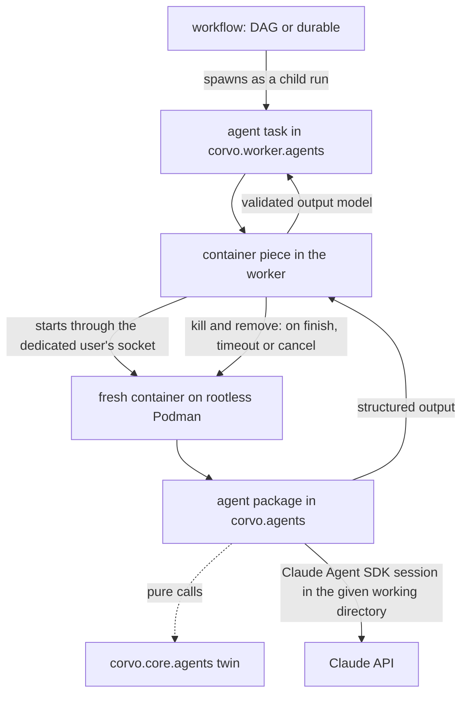
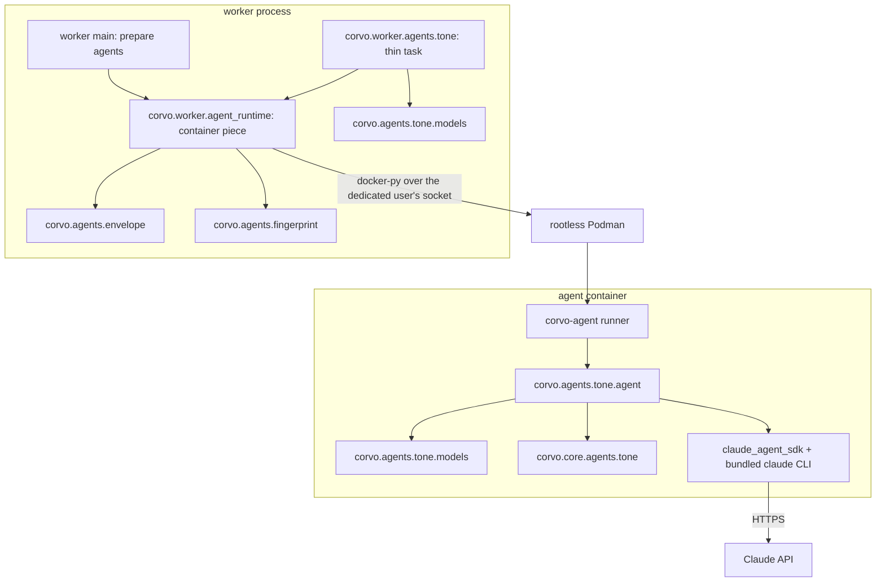
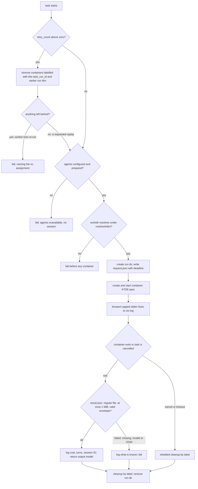
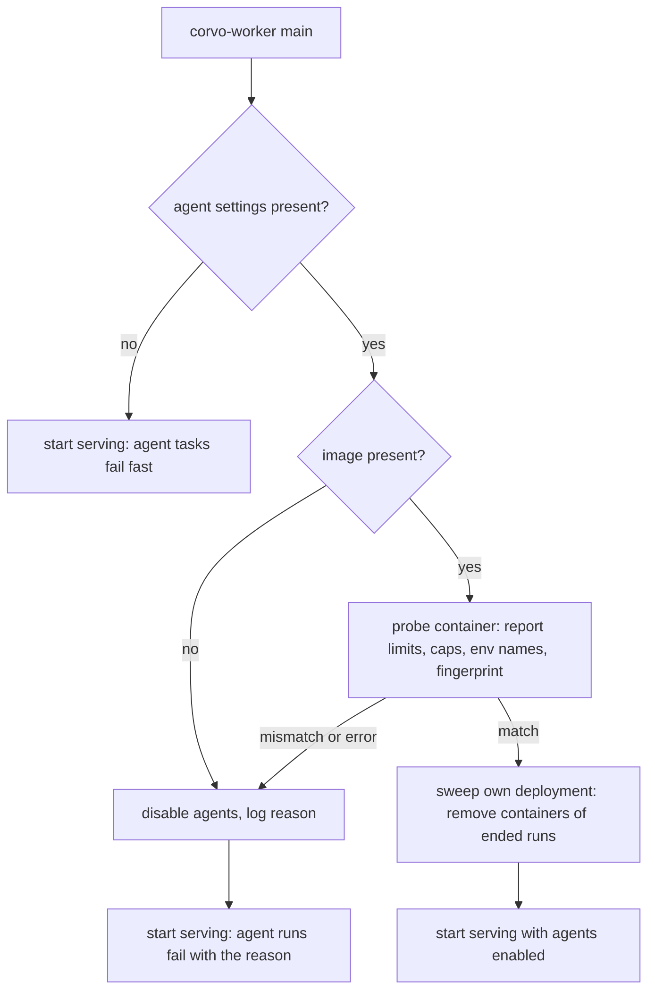

# Agents Skeleton - Plan

## Goal Capsule

- **Objective:** Adding an AI agent to corvo means copying a living example, filling it in, adding one line to the worker and writing its tests. The agent runs isolated in a container of its own from the first run.
- **Means:** the Claude Agent SDK, used with its own API in a Hatchet-free `corvo.agents` package (KTD1). A thin Hatchet task starts each run in a fresh container on rootless Podman through docker-py (KTD5, KTD8).
- **Product authority:** the repository owner, who settled every decision recorded under Key Decisions and every labeled Key Technical Decision. The Product Contract wins on behavior; a KTD wins on mechanism within its cited requirements.
- **Execution profile:** seven units in dependency order, each landing as one commit with the tests that prove it. U1 runs first because it proves, on the CI runner, the environment every later unit depends on.
- **Stop conditions:** stop and ask when any of these holds:
  - rootless Podman on the GitHub runner cannot apply memory, CPU and process limits, even with the CI-only `sudo` branch of KTD15;
  - Podman's Docker-compatible API on 4.9.3 or 6.1 rejects or silently drops a field of KTD6's container spec;
  - the bundled `claude` CLI fails under KTD6's read-only root and `noexec` tmpfs in a manual proof, and `CLAUDE_CODE_TMPDIR` on an exec-allowed tmpfs does not fix it;
  - engine v0.110.5 rejects KTD9's tenant-scoped named concurrency strategy;
  - CI's 90% coverage floor cannot be held without excluding code.
- **Finishes and ships:** a `gh stack` stack, one layer per unit, each built from its part plan (Split into parts, below), whose bottom layer is `docs/agents-skeleton-plan`, holding the plans.
- **Open blockers:** none.

---

## Product Contract

### Summary

`corvo.agents` gets one package per agent, written with the Claude Agent SDK's own API and blind to Hatchet. Its SDK-independent logic lives in a mirrored `corvo.core.agents` module. Each agent has a thin Hatchet task in `corvo.worker.agents`. The task starts a fresh, hardened container for each run on a rootless Podman of its own, reads the agent's structured output and removes the container. Three living examples show each shape. Other SDKs come later as agents written with their own native APIs.

The plan builds this whole contract, plus what operating it needs: a dedicated agent image built from the repository's `Dockerfile`, a compose overlay that switches agents on, and the repository's first operations doc, which covers provisioning and the manual Haiku proofs.

### Problem Frame

corvo's workflows track will hand steps to agents: crew's own agents (product-manager, claude-developer) already plan, split and relate issues headless in a worktree. Today nothing in corvo says where an agent goes, what shape it takes, or how it meets Hatchet. The first agent would invent all three, and every later one would copy whatever it chose.

Where the agent runs matters as much as its shape. An agent with Bash inside the worker's container sees the worker's environment: the Hatchet token, the database password and the Claude credential. Hatchet provides no sandboxing and leaves it to infrastructure, so corvo has to decide it.

The tasks and workflows skeleton (`docs/plans/2026-10-14-1724-feat-worker-tasks-workflows-skeleton-plan.md`) solved the same problem for Hatchet code with living examples, mirrored core twins, explicit registration and an import rule. This work does the same for agents.

### Key Decisions

- **An agent is a Hatchet task that runs one agent session.** Workflows spawn it like any task. (session-settled: user-directed — chosen over an agent outside Hatchet that calls tasks as tools: both will exist, starting with this one.) Governs R6, R20.
- **Each agent uses its SDK's own API, with no corvo interface over SDKs.** Agents share a shape, not a contract: a thin task, a core twin, Pydantic models, defaults and registration. (session-settled: user-directed — chosen over one agent definition runnable on any SDK through corvo adapters, and over a common corvo contract every SDK adapter implements.) Governs R4.
- **Agent code lives in its own Hatchet-free package; the worker keeps only a thin task.** (session-settled: user-directed — chosen over an agents area inside `corvo.worker` that imports the SDK next to Hatchet.) Governs R1, R2, R6.
- **One package per agent, with `agent.py` and `prompts/`, plus `tools.py` when the agent has custom tools, mirrored by a core twin.** These are the names Google ADK, Anthropic's Agent SDK cookbooks and demos, and Hatchet's agent examples use. (session-settled: user-approved — chosen over a prompt held as a constant in code, and over SDK-named files such as `agent_claude.py`.) Governs R1, R3.
- **Prompts live with the agent, not in the core.** A prompt is tuned to its SDK and model. The core holds only logic that survives an SDK change. (session-settled: user-approved — chosen over prompts in the core: a prompt is tuned to its SDK and model.) Governs R1, R3.
- **Each run executes in a fresh, hardened container.** It keeps a prompt-injected agent away from the worker's credentials. Following the Agent SDK's own docs, the whole agent runs inside the boundary, not just its commands. (session-settled: user-directed — chosen over running the agent as a subprocess of the worker, and over the SDK's built-in sandbox.) Governs R13, R15, R17.
- **Rootless Podman under a dedicated host user, with its socket mounted into the worker's container.** The worker stays a compose service. (session-settled: user-directed — chosen over the host's `docker.sock` (a compromised worker is host root), the worker running on the host, Docker-in-Docker and a hosted sandbox.) (session-settled: user-approved — Podman chosen over rootless Docker: it runs beside the compose stack's rootful Docker on its documented path, GitLab Runner documents the same setup, and the CI runner ships it.) Governs R14.
- **The caller gives the agent its working directory.** Cloning a repository or creating a worktree per issue is the caller's job. (session-settled: user-directed — chosen over the task building a temporary directory from its input.) Governs R5.
- **The Claude credential is either an API key or a subscription OAuth token, chosen per environment.** (session-settled: user-directed — chosen over an API key only and over a subscription token only.) Governs R12.
- **No automated test calls Claude; a manual run on Haiku proves each example.** (session-settled: user-directed — chosen over an e2e job against real Claude on every push to main, and over an on-demand e2e job.) Governs R22, R25.
- **Hatchet does not retry agents.** A retry re-runs and re-pays the whole session, and the SDK already retries API errors itself. (session-settled: user-approved — chosen over corvo's `RETRIES` default, which assumes idempotent tasks.) Governs R7.
- **Three examples cover the four shapes.** Example 2 combines the working directory with a custom tool, as `greeting-rounds` combined spawning and waiting. (session-settled: user-approved — chosen over one example per shape.) Governs R18, R19, R20.
- **The container keeps network egress and receives the Claude credential, for now.** The SDK's docs recommend `--network none` behind a credential-injecting proxy; that is deferred. (session-settled: user-approved — chosen over building the proxy now.) Governs R15.

### Requirements

**Agent packages and boundaries**

- R1. `corvo.agents` holds one package per agent. `agent.py` builds the SDK options and runs the session, `models.py` holds the agent's Pydantic models and imports no SDK, `tools.py` holds the agent's custom tools when it has any, and `prompts/` holds the prompt text files the agent reads and passes to the SDK.
- R2. Only `corvo.agents` imports `claude_agent_sdk`. `corvo.agents` imports neither Hatchet nor `corvo.worker`, and `corvo.core` imports neither `corvo.agents` nor the SDK. A check fails on each of these imports in every module, including `corvo.worker` and `corvo.server.api`, whose files ignore ruff's TID251 wholesale today.
- R3. Logic that must survive an SDK change, such as decisions on the agent's output and its tools' logic, lives in pure functions in `corvo.core.agents` at the mirrored path. The agent package only adapts that logic to the SDK.
- R4. Every agent is written with its SDK's own API, with no corvo layer between it and the SDK.
- R5. An agent takes its working directory as a parameter and gives it to the SDK as the session's working directory. The task accepts only working directories under one configured agent-workdir root that both the worker's user and the dedicated Podman user can read, resolving symlinks, and fails any other path before it starts a container.

**Hatchet integration**

- R6. Each agent has a thin Hatchet task in `corvo.worker.agents` with an explicit name and Pydantic input and output models. The task is registered in `WORKFLOWS`, and the registration test covers the area.
- R7. Agent tasks declare `retries=0`, an agent execution timeout and an agent schedule timeout sized for the queue behind R9's cap, all defined once in the worker's defaults. A step that waits on an agent child declares a timeout derived from the agent's schedule and execution timeouts, not `WAITING_EXECUTION_TIMEOUT`.
- R8. A run that ends without valid structured output fails its task. That covers an error result, the turn or budget limit, and a success result without `structured_output`. In every case the task logs the run's cost, turns and session ID.
- R9. The pattern caps how many agent runs execute at once across the worker pool.

**Agent execution**

- R10. Every agent declares its model, its turn limit and its budget limit.
- R11. Agents load no CLAUDE.md, skills, settings or auto memory, whether from the host or from the working directory. They use only tools they list explicitly, and every other tool call is denied.
- R12. The Claude credential comes from corvo's settings, as an API key or a subscription OAuth token, and each environment chooses which.

**Isolation**

- R13. Each agent run executes in a fresh container started for that run. The agent's code runs inside the container and hands its structured output to the task, which then removes the container.
- R14. Agent containers run on a rootless Podman under a dedicated host user, apart from the daemon that runs the compose stack. The worker stays a compose service and reaches Podman through that user's API socket, mounted into the worker's container and reachable by the worker's user through a shared group. When it starts, the worker checks that the host's cgroup controllers for memory, CPU and processes are available, and refuses agent runs when they are not.
- R15. The agent container drops every capability, has a read-only root filesystem, runs under the default seccomp profile, and is limited in memory, CPU and processes. Besides size-limited tmpfs mounts for `/tmp` and the agent user's home, it receives only the run directory mount that carries the request and the result, the working directory mount, and the Claude credential. The working directory is mounted read-only unless the agent declares that it writes to it, and a directory an agent may have written is untrusted output: the worker runs no hooks, config or code from it.
- R16. When Hatchet times out or cancels an agent task, the task kills and removes its container. Every container carries labels with its run's ID and its Hatchet deployment (server and tenant). A worker that starts removes only containers of its own deployment whose run Hatchet reports as finished, failed or cancelled.
- R17. One piece of the worker starts, waits on, reads and removes agent containers, and every agent task uses it.

**Living examples**

- R18. An agent with no tools turns a Pydantic input into a structured output.
- R19. An agent works in the directory it receives, with the SDK's read-only file tools and one custom tool whose logic lives in the core.
- R20. A workflow spawns both agents as child runs and uses their outputs.
- R21. Each example file opens with a header comment that carries the rules a copier needs, as the task and workflow examples do.

**Tests**

- R22. No automated test calls Claude, and a guard fails any test that tries.
- R23. Each agent has unit tests that run without Hatchet and without a container, with the SDK replaced. Agent tasks and the container piece have unit tests with the agent and the container client replaced.
- R24. The integration suite runs every example on the real Hatchet and a real rootless Podman, with the SDK replaced inside the container, including the kill and removal on timeout. It creates its working directories under the agent-workdir root (R5), not in pytest's temporary directories.
- R25. Each example is proven once against real Claude Haiku with a small prompt, through a documented manual command whose run is recorded in the pull request.

### How a run flows



Solid arrows cross a process or container boundary. The dotted arrow is a plain function call into code that imports no SDK and no Hatchet.

### Acceptance Examples

- AE1. **Covers R6.** **Given** a new agent task in `corvo.worker.agents`, **when** its line is missing from `WORKFLOWS`, **then** the registration test fails and names the task.
- AE2. **Covers R2.** **Given** a module outside `corvo.agents` that imports `claude_agent_sdk`, such as an agent task in `corvo.worker.agents`, or a module in `corvo.agents` that imports Hatchet, **when** the checks run, **then** they fail on that import.
- AE3. **Covers R8.** **Given** an agent that reaches its turn limit, **when** its task finishes, **then** the run is marked failed without a retry, and its log holds the cost, turns and session ID.
- AE4. **Covers R16, R24.** **Given** an agent run that is still working, **when** the task's execution timeout passes, **then** its container is killed and removed, and no container labelled with that run remains.
- AE5. **Covers R16.** **Given** a container of this worker's deployment whose run Hatchet reports as ended, and another whose run is still running on a second worker, **when** a worker starts, **then** it removes the first and leaves the second running.
- AE6. **Covers R11.** **Given** a working directory that holds a CLAUDE.md and `.claude/skills/`, **when** an agent runs in it, **then** the session loads neither.
- AE7. **Covers R20, R24.** **Given** the workflow example on Hatchet and Podman with the SDK replaced, **when** it runs, **then** it returns outputs derived from both agents' structured outputs.
- AE8. **Covers R22.** **Given** a unit test that runs an agent without replacing the SDK, **when** it runs, **then** the guard fails it before any request leaves.

### Success Criteria

- A contributor, human or LLM agent, adds a working agent by reading only the examples. That means an agent package, its core twin, a thin task, one line in `WORKFLOWS`, and their tests.
- The official Claude Agent SDK docs apply to corvo's agents unchanged, and Hatchet's task and workflow docs apply to their thin tasks.
- A compromised agent container cannot read worker-only credentials such as the Hatchet token and the database password; it reads only the Claude credential it is given. A compromised worker cannot reach host root or the compose stack's containers through the agents' Podman.

### Scope Boundaries

- Agents that call Hatchet tasks as tools, and agents that run outside Hatchet and trigger it. Hatchet's `mcp_tool` builds a tool that runs in the agent's own process with a Hatchet client and token, and the agent container holds neither, so tools backed by Hatchet will need a bridge from the container to the worker.
- Other agent SDKs (OpenAI Agents SDK and others). Each will be written with its own API when its first agent arrives.
- A credential-injecting proxy and `--network none` for agent containers. This must come before agents that process untrusted content.
- gVisor or another hardened runtime for agent containers. It costs 10 to 200 times on file I/O, and its pairing with rootless Podman is unverified.
- More than one host: Kubernetes Jobs or a hosted sandbox (E2B, Modal).
- An e2e job against real Claude, and evals. Evals belong to the question bank.
- Resumable sessions, session stores, multi-turn conversations, subagents, and approval callbacks (human in the loop).
- Porting crew's agents, and loading skills or CLAUDE.md into agent sessions, which those agents need. The main flow decides both.
- Creating working directories (clone or worktree per issue). The caller does that.
- No real business logic: the examples hold only trivial prompts and core functions.

Considered and not built:

- A periodic sweep. The in-container deadline (KTD4) ends every orphan's session, so a leftover container is a stopped one, which the next start's sweep removes. A host that runs for weeks without a worker restart while stopped containers pile up would change this.
- Removing containers whose run Hatchet does not know. A 404 can come from a live run on another stack or from a read model that has not caught up, so the sweep keeps such a container and logs it. Evidence that these pile up on a real host would change this.
- An age rule in the sweep. A just-exited container may still be read by the worker that started it, so removing by age races a live run. The deadline already bounds how long a session runs.
- A check that the credential's prefix matches its configured kind. A mismatch fails the first run at once with an `api_error` result and zero cost, which the run log shows.
- Preparing again when a run finds agents disabled. The run fails at once with the logged reason, and a worker restart prepares again. A host where the socket regularly comes up after the worker would change this.
- A worker-local semaphore against the moment Hatchet frees a slot before the container is gone. Memory is sized for the cap plus one (Risks).
- Podman's own `--timeout` kill switch. It exists only in the libpod API, which docker-py does not speak (KTD5).

#### Deferred to Follow-Up Work

- An integration scenario for the writable working directory, and the permission checks around it, when the first agent that writes arrives. The skeleton implements the read-write mount (KTD6) and unit-tests it.

### Dependencies / Assumptions

- hatchet-sdk 1.42.1 cancels a running async task's asyncio task on cancellation and timeout (`hatchet_sdk/worker/runner/runner.py:920-944`). It sets the context's cancellation flag, sleeps one second, cancels the task, and frees the task's slot without waiting for its `finally`. Engine timeout and cancel reach the worker as the same `CANCEL_STEP_RUN` action. The SDK also has a `claude` extra (unpinned) and `mcp_tool` (`hatchet_sdk/runnables/workflow.py:831`), neither used here.
- The engine re-queues a task whose worker misses heartbeats for 30 seconds as an internal failure, up to `MaxInternalRetryCount` (10) times, whatever its `retries` (engine v0.110.5 `pkg/repository/task.go`, `pkg/repository/sqlcv1/tasks.sql`). `ctx.retry_count` is above zero on such a re-run.
- claude-agent-sdk 0.2.167 (2026-10-14, bundling CLI 2.1.300) ships only `manylinux_2_17` wheels, which `python:3.14.7-slim` satisfies, and bundles a native `claude` binary of about 250 MB. It releases almost daily.
- The SDK's `ResultMessage` carries `subtype`, `is_error`, `structured_output`, `total_cost_usd`, `num_turns` and `session_id`. An error result is yielded, then raised as `ResultError`. An API failure arrives as `subtype="success"` with `is_error=True`. A Pydantic model's JSON Schema passed as `output_format` comes back in `structured_output` (Agent SDK Python reference and structured-outputs guide).
- `allowed_tools` with `permission_mode="dontAsk"` still lets read-only Bash, the Agent tool and reads inside the working directory run. Restricting the tool set takes the `tools` option (Agent SDK `permissions.md`).
- Podman's Docker-compatible API translates labels, mounts, tmpfs, `CapDrop`, `SecurityOpt`, `ReadonlyRootfs`, `PidsLimit`, `Memory` and `NanoCPUs` (Podman `pkg/api/handlers/compat/containers_create.go`). It forces read-write tmpfs mounts on `/run` and `/var/tmp` under a read-only root, which the memory cgroup bounds. docker-py refuses to send a user-namespace mode other than `host`, so `keep-id` is out of reach. Running on 4.9.3 and 6.1 is unverified until U1.
- On cgroup v2, a rootless container that asks for a limit whose controller is not delegated fails to start. Only cgroup v1 drops limits with a warning, and Podman 6 refuses cgroup v1. systemd 252 or later delegates memory, CPU and processes to user sessions by default. A user without lingering has no session, and Podman then falls back to cgroupfs.
- Versions differ by machine. Arch ships Podman 6.1.4, which has pasta only, Docker API 1.44 and positive-only label filter semantics, and Podman is not yet installed on this development machine. CI runs on `ubuntu-latest`: today Ubuntu 24.04 with Podman 4.9.3 (slirp4netns, API 1.41), from November 2026 Ubuntu 26.04 with Podman 5.7 (pasta).
- CI runs the organization's reusable `python.yml`, which allows no services and no setup steps. It runs `uv run --locked … pytest` in a 20-minute job, with passwordless `sudo` on GitHub-hosted runners. Any Podman setup in CI happens inside pytest.
- The integration suite runs `corvo-worker` as a host subprocess of the pytest session, which inherits its environment (`tests/integration/worker/conftest.py`). The compose stack runs only Hatchet there, so the worker runs as the developer's or the CI runner's user, the same user that owns the test Podman (KTD15).
- uv_build packages every file under `src/corvo/`, so `prompts/*.md` reaches the wheel with no configuration (checked by building one). `.dockerignore` excludes `tests/`.
- The subscription OAuth token is, by Anthropic's terms, for ordinary individual use by the subscriber. Products and services built on the Agent SDK must use API keys (`legal-and-compliance.md`; Agent SDK `overview.md`). A `claude setup-token` token lasts one year.
- The default rootless network relays traffic through sockets the dedicated user opens on the host. The container therefore reaches the LAN, the cloud metadata endpoint and the compose stack's bridge addresses, not only the internet (passt and Podman network docs).

### Sources / Research

- Claude Agent SDK docs, each page served as markdown under https://code.claude.com/docs/en/agent-sdk/:
  - `overview.md`, `agent-loop.md` and `python.md`. These cover `query`, `ClaudeAgentOptions`, `ResultMessage` subtypes, `max_turns` and `max_budget_usd`, and the absence of a session timeout.
  - `permissions.md`: `dontAsk`, `allowed_tools`, and the `tools` option that restricts the set.
  - `claude-code-features.md`: `setting_sources=[]`, `CLAUDE_CODE_DISABLE_AUTO_MEMORY`, and what `settingSources` does not control.
  - `structured-outputs.md`: Pydantic schemas and `error_max_structured_output_retries`.
  - `custom-tools.md`: `@tool`, `create_sdk_mcp_server` and `mcp__<server>__<tool>`.
  - `hosting.md`: the subprocess model, ephemeral sessions, about 1 GiB per agent, and the known limitations.
  - `secure-deployment.md`: isolation technologies, hardened `docker run` flags, and the credential proxy pattern.
  - https://code.claude.com/docs/en/env-vars.md and `authentication.md`: the isolation and credential variables KTD3 and KTD12 set.
- anthropics/claude-agent-sdk-python at `v0.2.167`: `tests/test_run_end_subprocess.py` (the fake-CLI pattern of KTD14), `_internal/query.py` (the control protocol and `mcp_message`), `_internal/transport/subprocess_cli.py` (CLI discovery and flags).
- anthropics/claude-code-action `base-action/src/run-claude-sdk.ts`: the result checks KTD4 copies.
- Hatchet docs:
  - https://docs.hatchet.run/cookbooks/hatchet-claude-agent-sdk-trusted-env.md and https://docs.hatchet.run/cookbooks/hatchet-and-mcp.md: `mcp_tool`, and "Hatchet does not provide native code sandboxing".
  - https://docs.hatchet.run/v1/cancellation.md, https://docs.hatchet.run/v1/timeouts.md and https://docs.hatchet.run/v1/logging.md (1000 log lines per task).
  - https://docs.hatchet.run/v1/concurrency.md: shared, tenant-scoped strategies (engine 0.106 or later).
  - https://docs.hatchet.run/v1/advanced-assignment/slot-cost.md.
- Agent layouts:
  - google ADK project structure: https://adk.dev/get-started/python/.
  - anthropics/claude-cookbooks `claude_agent_sdk/`.
  - anthropics/claude-agent-sdk-demos `research-agent/` (`prompts/*.txt`).
  - hatchet-dev/hatchet `sdks/python/examples/support_agent_tools/`.
- Testing practice:
  - anthropics/claude-agent-sdk-python: mocked transport in `tests/`, and a separate `e2e-tests/` job.
  - openai/openai-agents-python `ScriptedModel`.
  - pydantic-ai `TestModel` and `ALLOW_MODEL_REQUESTS`.
  - https://www.anthropic.com/engineering/demystifying-evals-for-ai-agents.
- Container runtimes:
  - Docker security and rootless mode: https://docs.docker.com/engine/security/ and https://docs.docker.com/engine/security/rootless/.
  - Podman system service: https://docs.podman.io/en/latest/markdown/podman-system-service.1.html, and Podman's `troubleshooting.md` on rootless cgroup delegation.
  - GitLab Runner Docker executor with rootless Podman: https://docs.gitlab.com/runner/executors/docker/, and its labels and stop-and-wait code (`executors/docker/internal/labels`, `internal/wait`).
  - GitLab on socket binding and DinD: https://docs.gitlab.com/ci/docker/using_docker_build/.
  - Testcontainers DinD patterns (same-path mounts) and the Ryuk reaper.
  - Tecnativa docker-socket-proxy `haproxy.cfg`, which filters by path and method only.
  - gVisor rootless and Docker guides.
  - nftables `meta skuid` matching: https://wiki.nftables.org/wiki-nftables/index.php/Matching_packet_metainformation.
- Repo:
  - `docs/plans/2026-10-14-1724-feat-worker-tasks-workflows-skeleton-plan.md`, the precedent this work mirrors.
  - `src/corvo/worker/worker.py`, `src/corvo/worker/defaults.py` and `src/corvo/worker/hatchet_client.py`.
  - `tests/worker/test_registration.py`, `ruff.toml`, `tests/conftest.py` and `tests/integration/worker/conftest.py`.
  - `Dockerfile`, `.dockerignore`, `compose.yaml` and `.crew/config.yaml` (crew's agents).

---

## Planning Contract

Product Contract preservation: changed: R1 adds `models.py`, an agent's SDK-free Pydantic module. The worker validates the agent's input and output without importing the SDK (R2), so the models need a home the worker can import. R15 names the run directory mount among what the container receives, since the envelope (KTD4) travels through it (user-approved in review). Dependencies / Assumptions was corrected and extended with research findings: the Podman versions, cgroup v2 behavior, the engine's internal re-queue, the SDK's result and tool semantics, CI's limits, the OAuth terms and the network's reach. The uv_build packaging question is closed there. The questions deferred to planning are answered by KTD5 to KTD18, so their section was removed. Scope Boundaries gained the considered-and-not-built list and one deferred item. No requirement's behavior changed.

### Key Technical Decisions

- KTD1. **An agent package exposes one coroutine, `run`, in `agent.py`, and keeps everything the worker reads in `models.py`.**
  - `run` takes the agent's input model and its working directory (`None` for an agent without one). It returns its output model together with a `RunReport`: the subtype, turns, cost and session ID.
  - A failed session raises `AgentRunFailed`, which carries the same report. Both types live in `corvo.agents.envelope`, which imports only Pydantic.
  - Inside, `run` builds `ClaudeAgentOptions` and calls `query()` itself, with the SDK's own names (R4). It hands the iterator `query()` returned to `corvo.agents.session.consume`, which applies KTD4's result rule and returns the structured output and the report, or raises. The helper consumes the SDK's stream, and does not wrap or replace any of its calls.
  - `models.py` holds the input model, the model whose JSON Schema becomes `output_format`, the output model, and a `WRITES_WORKDIR` flag. It imports only Pydantic and the standard library.
  - The worker imports `models.py` and the SDK-free shared modules `envelope` and `fingerprint`, never `agent.py`, `tools.py` or `session.py`.

  The container's entrypoint, `corvo-agent` (`corvo.agents.runner`), imports `corvo.agents.<package>.agent`, validates the request's input with the input model, awaits `run`, and writes the envelope from what `run` returned or raised. The entrypoint sits outside the agent, not between the agent and the SDK. The agent's output model wraps the session's structured output and any field its core twin derives from it (R3). Governs R1, R3, R4, R8, R17.
- KTD2. **R2 is enforced by an AST test over `src/corvo`, not by ruff.** `tests/test_import_boundaries.py` parses every module and builds the import graph inside `corvo`. Importing `a.b.c` also counts its parent packages' `__init__` modules, which stay empty. The test fails, naming the module and the import, when:
  1. a module outside `corvo.agents` imports `claude_agent_sdk`;
  2. a module in `corvo.worker` imports, directly or transitively, a `corvo` module that imports `claude_agent_sdk`;
  3. a module in `corvo.agents` imports `hatchet_sdk` or `corvo.worker`;
  4. a module in `corvo.core` imports `corvo.agents` or `claude_agent_sdk`.

  The checks run as a pure function, fed by test-declared sources in the same test module, and once against the real tree, as `test_registration.py` does. Ruff cannot do it: per-file TID251 ignores drop every ban for `src/corvo/worker/**` and `src/corvo/server/api/**`, and CI's `ruff check --config=ruff.toml` ignores nested config files. `ruff.toml` stays unchanged. Governs R2.
- KTD3. **Each agent sets the isolation options itself, and the container piece sets the isolation environment.**
  - Every agent passes `tools=[…]` (its built-ins, `[]` for none), `allowed_tools` (its file tools as rules scoped to `/workspace`, its other built-ins by name, and its `mcp__<server>__<tool>` names), `permission_mode="dontAsk"`, `setting_sources=[]`, `skills=[]` and `strict_mcp_config=True`, with `model`, `max_turns` and `max_budget_usd` (R10).
  - The container piece sets `CLAUDE_CODE_DISABLE_AUTO_MEMORY=1`, `CLAUDE_CODE_DISABLE_CLAUDE_MDS=1`, `CLAUDE_CODE_DISABLE_NONESSENTIAL_TRAFFIC=1`, `CLAUDE_CODE_SKIP_PROMPT_HISTORY=1`, `HOME=/home/agent` and `CLAUDE_CONFIG_DIR=/home/agent/.claude`, both on the home tmpfs.
  - A test helper in `tests/agents/` asserts the isolation fields on the options an agent built. Every agent's unit test calls it, which keeps a corvo options builder out of the runtime code (R4).

  Governs R10, R11.
- KTD4. **The container hands back a JSON envelope file, and the worker treats it as untrusted.**
  - **The request.** The worker writes `request.json` into the run directory, holding the agent package, its input, and a session budget in seconds. The budget is `AGENT_EXECUTION_TIMEOUT` minus `AGENT_DEADLINE_MARGIN`, minus the time already passed since the task started. Hatchet's timer starts at assignment, so a deadline equal to the timeout would never fire before Hatchet's own.
  - **Running the session.** The runner runs `run` under `asyncio.timeout` to that budget. Inside `run`, `corvo.agents.session.consume` keeps the last `ResultMessage` and catches `ResultError` and `ProcessError`. It prints the session ID to stderr when the init message arrives. The run succeeds only when the result is not an error, its subtype is `success`, and its `structured_output` validates.
  - **The envelope.** The runner writes `result.json` atomically, to a temporary name and then a rename, holding:
    - a protocol version;
    - `ok` or `failed`, with the output or the reason (`deadline` when the budget ran out);
    - the run report: subtype, turns, cost and session ID.
  - **Reading the envelope.** After the container exits, the worker opens `result.json` non-blocking and without following symlinks, and checks with `fstat` that it is a regular file of at most 1 MiB before any read. A FIFO, a device or a directory named `result.json` can therefore never block a worker thread. The worker never echoes the file's content, and validates it with the envelope model. The probe's report (KTD10) is read the same way.
  - **Failures.** A failed envelope, a missing or invalid one, or an out-of-memory kill fails the task. The worker logs the cost, turns and session ID from the validated envelope only. When no envelope exists, it logs them as `unknown`, with the exit code and the OOM flag.
  - **Forwarding stderr.** The worker sends stderr lines to `ctx.log` behind a fixed `agent stderr:` prefix, so a line the agent prints can never pass for one of the worker's own. Each line is cut to 500 characters with control characters stripped, up to 900 lines (Hatchet keeps 1000).

  A file beats stdout because conmon can split long lines and Hatchet caps log lines. claude-code-action hands its results over through a file too. Governs R8, R13, R15.
- KTD5. **The container piece talks to Podman through docker-py over the dedicated user's Docker-compatible socket.** Each blocking call runs in `asyncio.to_thread`, and `types-docker` types it. With no `keep-id`, the agent runs as uid 0 inside the container, which rootless Podman maps to the dedicated host user. Its files are therefore owned by that user, with every capability dropped and no-new-privileges. (session-settled: user-approved — chosen over aiodocker, a corvo client over Podman's libpod API with httpx, and podman-py: docker-py is the official SDK on the path Podman documents, aiodocker is unverified against Podman, and podman-py silently drops `nano_cpus` and rejects `tmpfs=`.) The choice stays inside one module, so it did not call for a bake-off. Governs R13, R14, R17.
- KTD6. **One function builds the container spec, used by every run and by the startup probe.**
  - Hardening: `cap_drop=["ALL"]`, `security_opt=["no-new-privileges"]` with Podman's default seccomp, `read_only=True` and `init=True`.
  - tmpfs through docker-py's `tmpfs=` mapping (a tmpfs `Mount` gets mode 0 on Podman):
    - `/tmp` as `rw,noexec,nosuid,nodev,size=100m`;
    - `/home/agent` as `rw,noexec,nosuid,nodev,size=500m`.

    These are the flags of Anthropic's hardened example. If the first proof that runs `Glob` or `Grep` (`dir-summary`'s, in U6) shows the bundled CLI needs an executable temp directory, the fallback is a third tmpfs, `/home/agent-exec` (`rw,nosuid,nodev,size=200m`, no `noexec`), with `CLAUDE_CODE_TMPDIR` pointing at it.
  - Limits: `AGENT_MEMORY` with swap equal to it, `AGENT_NANO_CPUS` and `AGENT_PIDS_LIMIT`.
  - Mounts:
    - the run directory, read-write at `/corvo/run`;
    - the working directory at `/workspace`, read-only unless `WRITES_WORKDIR`, when the run has one.

    A run without a working directory gets no `/workspace` mount, and its session runs in the image's empty `/workspace`.
  - Naming: the container is named `corvo-agent-<task_run_id>-<retry_count>`, and its labels are `corvo.managed=true`, `corvo.deployment`, `corvo.run_id` (the workflow run), `corvo.task_run_id`, `corvo.attempt` and `corvo.agent`.
  - Network: the compat API's default.
  - Environment: KTD3's isolation variables, plus exactly one credential variable when the spec is given a credential. The probe is given none.

  Governs R13, R15, R16.
- KTD7. **One setting, `CORVO_AGENT_ROOT`, holds both the working directories and the run directories, at the same absolute path for the worker and for Podman.**
  - **Working directories.** They must resolve, symlinks included, to an existing directory strictly below `<root>/workdirs/`. `<root>/workdirs` itself is refused, since it would expose every other working directory.
  - **Run directories.** The container piece creates `<root>/runs/<task_run_id>-<retry_count>/` exclusively, failing if it exists. Its mode is 0770, with the setgid group inherited. The group is the dedicated user's primary group, `corvo-agents`, the only group its container process keeps.
  - **Writing and removing the run directory.** `request.json` is written exclusively and without following links. Removing the directory after the run never follows a symlink.
  - **Output from an agent that writes.** A working directory an agent may have written is untrusted output (R15). The container piece's header and `docs/agents.md` state the rule: the worker runs no git, hooks, config or code from such a tree.
  - **The same-path rule.** Podman resolves bind sources on the host, so the compose worker mounts the root at its host path, the same rule Testcontainers states. The integration worker runs on the host, so its paths agree by construction.

  Governs R5, R13, R15.
- KTD8. **The task guards against the engine's re-runs, and cleans up by label, shielded and time-bounded.**
  - **The re-run guard.** Before any session starts, a run whose `ctx.retry_count` is above zero force-removes every container labelled with its `corvo.task_run_id`. It also removes the run directories `<root>/runs/<task_run_id>-<n>/` of earlier attempts, using KTD7's removal that never follows a symlink.
    - When it found such a container or directory, the earlier attempt never cleaned up, so its worker was lost (Dependencies). The run then fails with a message naming the re-assignment.
    - When it found neither, the earlier attempt ended cleanly and this is a replay someone asked for: a dashboard or API replay also increments `retry_count` (engine v0.110.5 `tasks-overwrite.go`). The run proceeds.
  - **Cleanup.** On exit, error, timeout or cancel, the piece force-removes containers by the `corvo.task_run_id` label, one `remove(force=True)` call each, never by the handle `create` returned. A cancel can land while the create thread is still running and leave a container with no handle. Force-remove works on running and exited containers alike, whereas a kill of an exited container answers 409.
    - Cleanup first waits for an in-flight create or start thread.
    - It runs inside a shielded scope bounded to 30 seconds.
    - It treats 404 ("no such container") and 409 ("removal already in progress") as done.

  This instantiates the Key Decision that Hatchet does not retry agents, and inherits its label. (session-settled: user-approved — chosen over corvo's `RETRIES` default, which assumes idempotent tasks.) Governs R7, R13, R16.
- KTD9. **The agent defaults live in `src/corvo/worker/defaults.py`, each with a prose comment, as KTD1 of the precedent does.**

  | Constant | Value | Why |
  |---|---|---|
  | `AGENT_EXECUTION_TIMEOUT` | 15 minutes | The longest example session plus container start. |
  | `AGENT_DEADLINE_MARGIN` | 60 seconds | The in-container budget (KTD4) ends this long before Hatchet's timeout, which leaves time to write, read and clean up. |
  | `AGENT_SCHEDULE_TIMEOUT` | 60 minutes | Waiting behind the cap counts against it (engine `schedule_timeout_at`). |
  | `AGENT_WAITING_EXECUTION_TIMEOUT` | 80 minutes | One attempt queued and run (`retries=0`), plus a 5-minute detection margin. |
  | `AGENT_CONCURRENCY` | `max_runs=2` | A `ConcurrencyExpression` named `corvo-agents`, with a constant key, `GROUP_ROUND_ROBIN` and `is_tenant_scoped=True`. |
  | `AGENT_MEMORY` | 2 GiB | Anthropic's 1 GiB floor, doubled for the CLI and its tools. |
  | `AGENT_NANO_CPUS` | 1 CPU | Anthropic's starting point. |
  | `AGENT_PIDS_LIMIT` | 256 | Above the CLI's threads. Measured in the Haiku proof. |

  - Every agent task passes `retries=0` with these values.
  - `CANCEL_IN_PROGRESS` is avoided, because it kills paid runs.
  - The cap is per tenant, and so shared by deployments on one tenant.

  Governs R7, R9, R15.
- KTD10. **Before the worker starts serving, `main()` prepares agents in at most 45 seconds, and a failure only disables them.** When agents are configured (KTD12), it runs, in order:
  1. Check that the image is present.
  2. Run the probe: `corvo-agent probe` in a container built by KTD6's spec, with no credential, no working directory and a scratch run directory. It writes a report into that directory:
     - the fingerprint;
     - `memory.max`, `cpu.max` and `pids.max` read inside the container;
     - the effective capabilities;
     - the environment variable names;
     - whether the root filesystem is read-only;
     - the flags of the `/tmp` and `/home/agent` mounts, read from `/proc/self/mounts`;
     - whether a one-second TCP connect reaches the container's default gateway and `169.254.169.254:80`.
  3. Compare the report with the spec and with the worker's own fingerprint. The probe step then force-removes its container by label, whatever the outcome.
  4. Sweep (KTD11).

  - **When a check fails.** A limit, a flag or a fingerprint that differs, or any error, disables agents, with the reason logged. Every other task keeps working.
  - **When egress is open.** A reachable gateway or metadata address means KTD16's nftables rule is missing. With `agent_require_egress_block` set (KTD12), it disables agents. Otherwise it logs a warning, which is the default for development and CI, which have no such rule.
  - **Recovery.** Agents stay disabled until the worker restarts. Agent runs fail at once with the logged reason, which is how the operator learns of it.
  - **The fingerprint.** It is a SHA-256 over the `*.py` files and `prompts/**` under `corvo/agents/` and `corvo/core/agents/`, sorted by relative path, with `__pycache__` and `*.pyc` excluded, plus the installed `claude-agent-sdk` version. `corvo.agents.fingerprint` computes it from the standard library alone, and each side computes it over its own installed copy. A stale agent image is therefore refused instead of running old code. The report comes from the image under test, so the fingerprint detects a stale image, not a tampered one (Risks).
  - **The cgroup check.** The probe is also R14's cgroup check: on cgroup v2, an undelegated controller makes the container fail to start.

  Governs R14, R15, R16.
- KTD11. **The sweep removes containers of this deployment whose run has ended.**
  - The deployment label is `<tenant_id>@<server_url>`, taken from `hatchet.config` once at start.
  - It lists containers by the positive filters `label=corvo.managed=true` and `label=corvo.deployment=<id>`. Podman 6 changed negative label filters.
  - It reads each run's status once, bounded to 5 seconds, through the REST client under `hatchet.runs`. It bypasses the SDK's `get_status` wrapper, whose tenacity policy retries a 404 five times, about 15 seconds per container.
  - It removes a container only on `COMPLETED`, `FAILED` or `CANCELLED` (R16).
  - It keeps a container whose run is not found or whose lookup timed out, and logs it as a warning for the operator. A 404 does not prove the run ended: it can come from Hatchet's read model, which fills asynchronously, or from another stack on the same quickstart tenant.
  - The sweep's total is bounded to 20 seconds, inside KTD10's budget.
  - Probe containers are not the sweep's: the probe step force-removes its own container by label when it ends (KTD10).
  - The REST call needs the dashboard's address. The compose overlay sets `HATCHET_CLIENT_SERVER_URL` for the worker, because the token's `localhost:8080` points at the worker itself inside its container.

  Governs R16.
- KTD12. **Agent settings are five `CORVO_AGENT_*` fields plus the credential, and an empty socket or root means "agents not configured".**
  - The fields are `agent_podman_socket`, `agent_root`, `agent_image` (default `localhost/corvo-agent:latest`), `agent_credential_kind: Literal["api_key", "oauth_token"]` and `agent_require_egress_block: bool = False` (KTD10), plus `agent_credential`.
  - They are plain `str`, as `settings.py` holds its other secrets.
  - With the socket or the root empty, an agent task fails at once with "agents are not configured", and `main()` skips KTD10.
  - An empty credential while the rest is configured disables agents in KTD10.
  - The container receives the credential as `ANTHROPIC_API_KEY` or as `CLAUDE_CODE_OAUTH_TOKEN`, never both.
  - The settings comment and `docs/agents.md` carry the OAuth terms (Dependencies).

  Governs R12, R14.
- KTD13. **The agent image is an `agent` stage of the repository's `Dockerfile`, and the SDK is an exact-pinned runtime dependency.**
  - The existing stage is named `app`. The `agent` stage builds from it, and sets `WORKDIR /workspace` (empty in the image), `HOME=/home/agent` and `ENTRYPOINT ["corvo-agent"]`.
  - The file ends with a closing `FROM app`. A build without `--target`, which is what compose's `build: .` runs, still produces today's app image, so `compose.yaml` stays unchanged.
  - The operator builds the agent image into the dedicated user's store with `podman build --target agent`.
  - `claude-agent-sdk==0.2.167` sits in `[project].dependencies`, so the app image carries it too. A dependency group kept out of the app image fails in CI, whose fixed `uv run` installs only the default groups. KTD2 already keeps the worker from importing it.
  - `docker` joins the runtime dependencies and `types-docker` the dev group.

  Governs R13, R17.
- KTD14. **Tests replace the SDK at three seams, and a guard stops everything else.**
  - **The guard.** `tests/conftest.py` removes `ANTHROPIC_API_KEY` and `CLAUDE_CODE_OAUTH_TOKEN`, and sets `ANTHROPIC_BASE_URL=http://127.0.0.1:9`. An autouse fixture replaces the SDK's subprocess transport `connect` with a failure that names the test. A marker opts out the fake-CLI contract test only. Governs R22, AE8.
  - **Unit seam.** An agent's tests replace `query` on the agent module with a scripted async generator that yields real `ResultMessage` objects, and they record the options it received (R23).
  - **Fake CLI.** `tests/agents/fake_claude.py` is a stand-in for the `claude` binary, after the SDK's own `tests/test_run_end_subprocess.py`:
    - It answers `-v`, replies to each `control_request`, drives custom tools through `mcp_message`, and emits a `result`.
    - It picks its scenario from markers in the prompt: success by default, `fake:max-turns`, `fake:api-error` or `fake:hang`.
    - It returns a canned structured output chosen by the JSON Schema's title.
    - It prints its argv and the isolation variables it saw to stderr.
  - **Contract test.** An in-process test runs the fake through the real SDK via `cli_path`, under a 20-second `asyncio.timeout`. A protocol change in an SDK bump then fails fast instead of hanging.
  - **Test image.** `tests/agents/fake/Containerfile` builds `FROM` the agent image, with only the fake in its build context. It overwrites the SDK's bundled `claude`, at a path found at build time, then asserts at build that `claude -v` prints the fake's version. It sets `ANTHROPIC_BASE_URL` to an unreachable address, so a missed overwrite cannot reach Claude.

  Governs R22, R23, R24.
- KTD15. **The integration suite runs its own rootless Podman as the test user.**
  - **Podman.** A session fixture starts `podman system service --time=0` on a socket inside a fixture-made agent root (`tempfile.mkdtemp`, outside pytest's temporary directories, with KTD7's modes). It builds the agent image and the test image there.
  - **Worker.** The worker fixture passes `CORVO_AGENT_*` pointing at it, but only when Podman is present. Without Podman, the agent tests skip locally and fail when `CI` is set, and the other integration tests keep their worker.
  - **CI fallback.** When the runner has no systemd user session, the fixture's CI-only branch runs `sudo loginctl enable-linger` and sets `XDG_RUNTIME_DIR`. U1 decides whether that branch is needed.
  - **Timeout path.** AE4 is driven by `hatchet.runs.aio_cancel`, the same engine action a timeout sends (Dependencies), because a 15-minute timeout does not fit the 20-minute CI job.
  - **Teardown.** It removes every `corvo.managed` container in the test store.
  - **Health wait.** The worker fixture's health wait rises from 30 to 120 seconds, above KTD10's 45-second preparation and a cold first container start.

  The shared-group socket and the root-worker permissions exist only on the compose topology, which the manual proof covers (KTD18). Governs R24.
- KTD16. **Agent containers keep the default rootless network.** This instantiates the Key Decision on egress and inherits its label. (session-settled: user-approved — chosen over building the credential proxy now.) Conflict call-out: research found that the default network reaches more than the internet. It reaches the LAN, the cloud metadata endpoint and the compose stack's bridge addresses, through sockets the dedicated user opens on the host. Postgres and Hatchet still need credentials the container does not hold. The decision stands for these examples. `docs/agents.md` adds an owner-matched nftables rule as a production provisioning step: it drops the dedicated user's traffic to private, link-local and loopback ranges, with DNS allowed first. Every manual proof records what the container reached. Governs R15.
- KTD17. **The examples are `tone`, `dir-summary` and `dir-review`, all on `claude-haiku-5-5`.**
  - **`tone`** (R18) has no tools, `max_turns=3` and `max_budget_usd=0.05`. Its session classifies a text as `friendly`, `neutral` or `unfriendly`. Its output adds `friendly: bool` from `corvo.core.agents.tone`.
  - **`dir-summary`** (R19) mounts its working directory read-only. It uses `Read`, `Glob`, `Grep` and the custom tool `count_words`, whose logic is `corvo.core.agents.dir_summary.count_words`, with `max_turns=15` and `max_budget_usd=0.25`. Its output is a summary and a word count.
  - **`dir-review`** (R20) is a DAG. Step `summarize` spawns `dir-summary`, and step `judge`, with parent `summarize`, spawns `tone` on the summary. A core twin builds the review line from both outputs.
  - A task whose agent works in a directory declares its own input model in the worker module: the agent's input plus `workdir`. The agent receives `/workspace`.

  Governs R10, R18, R19, R20, R21.
- KTD18. **Operating agents is opt-in through `compose.agents.yaml`, documented in `docs/agents.md`.**
  - **The overlay.** It changes the worker service:
    - It mounts the socket and `CORVO_AGENT_ROOT` at their host paths.
    - It adds the `corvo-agents` GID through `group_add`.
    - It drops the capabilities the worker does not need, at least `MKNOD`, `SETUID`, `SETGID` and `FOWNER`.
    - It sets the `CORVO_AGENT_*` variables, with `CORVO_AGENT_REQUIRE_EGRESS_BLOCK=true`, and `HATCHET_CLIENT_SERVER_URL`.

    Without the overlay, the stack runs as today, and agent tasks fail fast (KTD12).
  - **Provisioning.** The doc covers:
    - installing Podman;
    - the dedicated user, with subordinate IDs and lingering, kept out of the `docker` group and sudoers. Its login configuration, its systemd-user configuration and its `containers` configuration (`~/.config/containers`, including `containers.conf`, `storage.conf` and `registries.conf`) are root-owned and not writable by it. It writes only its container storage;
    - a `podman.socket` drop-in that moves `ListenStream=` to `/run/corvo-agents/podman.sock` with `SocketGroup=corvo-agents` and `SocketMode=0660`, plus the `tmpfiles.d` entry for its directory;
    - the agent root, setgid with a default ACL for the group. In production it sits on its own filesystem or quota, mounted `nodev,nosuid`;
    - building the agent image as that user on every deploy, and recording its image ID. KTD10 refuses stale images, and a changed ID between deploys is then visible;
    - KTD16's nftables rule;
    - the credential terms and the OAuth token's one-year expiry.
  - **The manual proof runbook.** It triggers an example on the compose topology with real Haiku, and records in the pull request:
    - cost, turns and session ID;
    - peak process count;
    - that `/tmp` with `noexec` did not break the CLI;
    - that the worker read the envelope across the root/rootless boundary;
    - the agent root's mount flags and the worker's dropped capabilities;
    - what the container could reach.

    `dir-summary`'s proof also carries AE6 and tool denial: its working directory holds a CLAUDE.md, a `.claude/skills/` entry and a prompt that asks for a tool outside the list and for a read of `/proc/self/environ`. A fake CLI cannot prove those.

  Governs R14, R16, R25.
- KTD19. **When the worker gets SIGTERM, it force-removes the containers of its in-flight agent runs before Hatchet's graceful wait.**
  - The container piece keeps an in-process set of the containers this worker started.
  - The hook removes them by label, then hands over to Hatchet's own shutdown. Their tasks then fail on a missing envelope while the worker is still alive, so the engine records a failure instead of re-queuing them after the heartbeat window.
  - Without the hook, a redeploy leaves the old sessions running and paying until their deadline. Their re-queued attempts wait at the back of the `corvo-agents` queue, so the host could hold up to twice the cap.
  - A SIGKILL, an OOM kill or a host crash still skips the hook; KTD8's guard and KTD11's sweep cover those.
  - (session-settled: user-directed — chosen over sizing host memory for twice the cap plus one: a redeploy must not leave paid sessions running.)

  Governs R16.

### High-Level Technical Design

The pieces and who imports whom:



Inside the worker process, nothing reaches `claude_agent_sdk`. The test of KTD2 holds that boundary.

One run, with the failure branches KTD4 and KTD8 decide:



Worker start, KTD10 and KTD11:



### Output Structure

```text
src/corvo/agents/
  __init__.py
  envelope.py
  fingerprint.py
  runner.py
  session.py
  tone/
    __init__.py
    agent.py
    models.py
    prompts/
      system.md
  dir_summary/
    __init__.py
    agent.py
    models.py
    tools.py
    prompts/
      system.md
src/corvo/core/agents/
  __init__.py
  tone.py
  dir_summary.py
src/corvo/core/workflows/
  dir_review.py
src/corvo/worker/
  defaults.py
  worker.py
  agent_runtime/
    __init__.py
    spec.py
    containers.py
    startup.py
  agents/
    __init__.py
    tone.py
    dir_summary.py
  workflows/
    dir_review.py
tests/
  conftest.py
  test_import_boundaries.py
  agents/
    __init__.py
    isolation.py
    fake_claude.py
    fake/
      Containerfile
    test_fake_claude_contract.py
    test_runner.py
    test_envelope.py
    test_session.py
    tone/
      __init__.py
      test_agent.py
    dir_summary/
      __init__.py
      test_agent.py
      test_tools.py
  core/agents/
    __init__.py
    test_tone.py
    test_dir_summary.py
  core/workflows/
    test_dir_review.py
  worker/agent_runtime/
    __init__.py
    test_spec.py
    test_containers.py
    test_startup.py
  worker/agents/
    __init__.py
    test_tone.py
    test_dir_summary.py
  worker/workflows/
    test_dir_review.py
  integration/worker/
    podman.py
    test_podman.py
    test_agents.py
compose.agents.yaml
docs/agents.md
```

The tree is the expected shape. Each unit's **Files** list is authoritative.

### System-Wide Impact

- **The worker's start.** `main()` gains a bounded preparation step (KTD10). With agents unconfigured, startup is unchanged.
- **The compose stack.** `compose.yaml` is unchanged, and agents come only with the overlay (KTD18).
- **CI.** The integration job builds two Podman images and runs a rootless Podman inside pytest, within the existing 20-minute job (Risks).
- **Images.** The app image grows by the SDK's bundled CLI, about 250 MB (KTD13).
- **Settings and environment.** `.env.example` gains the `CORVO_AGENT_*` variables, each with a comment in its existing style.
- **The host.** Production gains a dedicated user, a socket and an nftables rule (KTD18). These are the repository's first host-level requirements.

### Risks

- **The CI runner's rootless cgroups.** A GitHub runner process may have no systemd user session, so limits may fail to apply. U1 proves the environment first, and the `sudo` branch of KTD15 is the fallback. Failing both is a stop condition.
- **`ubuntu-latest` moves to Ubuntu 26.04 (Podman 5.7, pasta) in November 2026.** The repository cannot pin the runner, so U1's test is the canary when it moves.
- **SDK churn.** Releases come almost daily, and Dependabot bumps the lock weekly. The exact pin, the fake-CLI contract test and the test image's build assertion catch protocol drift and a moved binary. `docs/agents.md` asks for a new Haiku proof when the bundled CLI's minor version changes.
- **The socket carries the dedicated user's full authority.** A compromised worker can start any container as that user: it can mount the user's own files, or retag the agent image. The probe's fingerprint cannot detect a tampered image, because the image reports it.
  - Until a reboot, a socket holder can also run host processes as the dedicated user, for example through a container that mounts the user's systemd bus. Those processes are bounded by that user's file permissions and by KTD16's owner-matched nftables rule.
  - It cannot persist across deploys, because KTD18 makes the user's login, systemd-user and `containers` configuration root-owned and the image is rebuilt and its ID recorded at each deploy.
- **Hatchet frees the slot before cleanup ends.** A third container can briefly overlap the cap of two, so the host needs memory for three agents.
- **A timed-out parent step does not cancel its child.** The in-container deadline bounds the child's session to `AGENT_EXECUTION_TIMEOUT`.
- **CI time.** Building the agent image (about 250 MB of CLI) and the test image adds minutes to the 20-minute job. The images cache across a session but not across CI runs.
- **Unverified Podman behavior on the compat path.** The default network on 4.9.3, and the compat API's handling of each KTD6 field. U1 proves both on CI and on Arch.

### Deferred to Implementation

- The network mode, if the compat default (`bridge`) proves unusable rootless on Podman 4.9.3. The alternative is the rootless default (`slirp4netns` on 4.9, `pasta` on 5 and later).
- Whether the CI `sudo` branch of KTD15 is needed. U1 decides.
- The fake CLI's canned outputs per schema title, and how the runner reads `run`'s input model.
- The exact `asyncio.timeout` values of each integration test.
- How KTD19's hook runs ahead of Hatchet's own SIGTERM handling, which `Worker.start()` installs: by wrapping that handler, or through the worker's lifespan.
- The bundled binary's path inside the test image, found at build time.
- Gaps in `types-docker` for the calls KTD6 makes, if any.

---

## Implementation Units

### U1. Rootless Podman fixture and its proof on CI

- **Goal:** the integration suite runs its own rootless Podman. On the CI runner and on Arch, it proves that a container built with KTD6's hardening and limits starts and that its limits apply.
- **Requirements:** R14, R15, R24; KTD5, KTD6, KTD15.
- **Dependencies:** none.
- **Files:**
  - Modify `pyproject.toml` and `uv.lock` (`docker` in runtime dependencies, `types-docker` in the dev group).
  - Create `tests/integration/worker/podman.py` (service start, availability check, CI branch).
  - Modify `tests/integration/worker/conftest.py` (session fixture).
  - Create `tests/integration/worker/test_podman.py`.
- **Approach:**
  1. The fixture starts `podman system service --time=0 unix://<root>/podman.sock` under a `mkdtemp` agent root, waits for the socket, and connects with `docker.DockerClient(base_url=...)`.
  2. When Podman is missing, it skips, unless `CI` is set, in which case it fails.
  3. With `CI` set and no user session, it applies the `sudo loginctl enable-linger` branch (KTD15).
  4. The test starts `python:3.14.7-slim` with KTD6's flags inline: this unit has no container piece yet, and U4's spec replaces the inline flags. Its command prints `/sys/fs/cgroup/memory.max`, `cpu.max`, `pids.max`, `CapEff` from `/proc/self/status`, and whether `/` is writable.
  5. Teardown stops the service and removes `corvo.managed` containers.
- **Execution note:** this unit is mostly an environment proof. Push it first and read the CI run's output before starting U2, and stop per the Goal Capsule when limits do not apply.
- **Patterns to follow:** `docker_available()` and the compose fixture in `tests/integration/worker/conftest.py`; Podman's system-service man page.
- **Test scenarios:**
  - A container with the full flag set exits 0, and its output shows `memory.max` of 2 GiB, `pids.max` of 256, a CPU quota of one CPU, `CapEff` of zero and a read-only root.
  - Writing to `/tmp` succeeds and writing to `/` fails inside the container.
  - A container labelled `corvo.managed=true` and `corvo.deployment=x` is listed by the two positive label filters and not by `corvo.deployment=y`.
  - Killing and force-removing a running `sleep` container leaves no container with its name.
- **Verification:** the test passes on the CI runner, with the CI branch either used or proven unneeded, and on Arch with Podman 6.1.4. The PR notes which network mode and Podman version each ran.

### U2. Agent boundaries, settings and the guard

- **Goal:** the three agent areas exist and are empty. The import rules, the no-Claude guard and the agent settings are enforced before any agent exists.
- **Requirements:** R2, R6, R12, R22, AE2, AE8; KTD2, KTD12, KTD13, KTD14.
- **Dependencies:** none.
- **Files:**
  - Modify `pyproject.toml` and `uv.lock` (`claude-agent-sdk==0.2.167`).
  - Create `src/corvo/agents/__init__.py`, `src/corvo/core/agents/__init__.py` and `src/corvo/worker/agents/__init__.py`.
  - Modify `src/corvo/settings.py` and `tests/test_settings.py`.
  - Create `tests/test_import_boundaries.py`.
  - Modify `tests/conftest.py` (guard).
  - Create `tests/agents/__init__.py` and `tests/agents/test_guard.py`.
  - Modify `tests/worker/test_registration.py` (add `corvo.worker.agents` to `AREAS`, docstring), `src/corvo/worker/worker.py` (comment) and `tests/worker/test_worker.py` (comment).
- **Approach:**
  1. Add the settings fields of KTD12, each with a one-line comment. The OAuth comment carries the terms.
  2. Write the boundary checker of KTD2 as a pure function over a mapping of module name to source, and test it with declared sources and once over `src/corvo`.
  3. Add the guard of KTD14 to `tests/conftest.py`, next to the existing token shim, in the same comment style.
  4. Extend the registration test's areas.
- **Patterns to follow:** `tests/worker/test_registration.py` (a pure checker plus a real-tree test); `src/corvo/settings.py` field style.
- **Test scenarios:**
  - Covers AE2. A declared module `corvo.worker.agents.x` importing `claude_agent_sdk` yields a problem naming it.
  - Covers AE2. A declared `corvo.agents.x.agent` importing `hatchet_sdk` yields a problem, and so does one importing `corvo.worker.defaults`.
  - A declared `corvo.worker.agents.x` importing `corvo.agents.x.models`, where `models` imports only Pydantic, yields none.
  - The same import, where `models` imports `corvo.agents.x.agent`, which imports the SDK, yields a transitive problem naming the chain.
  - A declared `corvo.core.agents.x` importing `corvo.agents` yields a problem.
  - The real tree yields no problems.
  - Covers AE8. A test that calls `claude_agent_sdk.query` with a trivial prompt, with nothing replaced, fails with the guard's message, and no subprocess starts.
  - Settings read `CORVO_AGENT_CREDENTIAL_KIND=oauth_token` and reject `token`.
  - With no agent variables set, the settings report agents as not configured.
- **Verification:** the unit suite and `prek` pass. Adding `import claude_agent_sdk` to `src/corvo/worker/worker.py` fails the boundary test by name.

### U3. The `tone` agent, the container entrypoint and the fake CLI

- **Goal:** a contributor can copy an agent with no tools that turns a Pydantic input into a structured output. The image that runs it exists, and so does the fake CLI that replaces Claude.
- **Requirements:** R1, R3, R4, R8, R10, R11, R18, R21, R22, R23; KTD1, KTD3, KTD4, KTD13, KTD14, KTD17.
- **Dependencies:** U2.
- **Files:**
  - Create `src/corvo/core/agents/tone.py` and `tests/core/agents/__init__.py`, `tests/core/agents/test_tone.py`.
  - Create `src/corvo/agents/tone/__init__.py`, `models.py`, `agent.py` and `prompts/system.md`.
  - Create `src/corvo/agents/envelope.py`, `src/corvo/agents/fingerprint.py`, `src/corvo/agents/session.py` and `src/corvo/agents/runner.py`.
  - Modify `pyproject.toml` (`corvo-agent` script).
  - Modify `Dockerfile` (`agent` stage).
  - Create `tests/agents/isolation.py`, `tests/agents/fake_claude.py`, `tests/agents/fake/Containerfile` and `tests/agents/test_fake_claude_contract.py`.
  - Create `tests/agents/test_runner.py`, `tests/agents/test_envelope.py`, `tests/agents/test_session.py`, `tests/agents/tone/__init__.py` and `tests/agents/tone/test_agent.py`.
- **Approach:**
  1. The core twin decides `friendly` from the tone label over plain `str` (R3).
  2. `models.py` holds `ToneInput` (text, bounded length), `ToneVerdict` (the schema the session returns), `ToneOutput` and `WRITES_WORKDIR = False`.
  3. `agent.py` reads `prompts/system.md` through `importlib.resources`, builds the options of KTD3 and KTD17, and runs `query()` with KTD4's result rule. It returns `ToneOutput` built with the core twin.
  4. `session.py` holds `consume` (KTD1, KTD4: the result rule and the session-ID line). `envelope.py` holds the envelope, `RunReport` and `AgentRunFailed`.
  5. `runner.py` implements `corvo-agent run` (KTD4: request, budget, envelope) and `corvo-agent probe` (KTD10's report). `fingerprint.py` and `envelope.py` import only the standard library and Pydantic.
  6. The `agent` stage and the named `app` stage per KTD13.
  7. The fake CLI and its contract test per KTD14. The test image's `Containerfile` lands here, and U4 builds it in integration.
  8. Header comments per R21. `agent.py` states the native-API rule, the isolation options with why each is there, the result rule, and that logic belongs in the core twin. `models.py` states that it must not import the SDK.
- **Patterns to follow:** `src/corvo/worker/tasks/hello.py` and its core twin for header and shell-over-core; the SDK's `tests/test_run_end_subprocess.py` for the fake.
- **Test scenarios:**
  - The core twin returns true for `friendly` and false for `neutral` and `unfriendly`.
  - With `query` replaced by a script yielding a success result whose structured output is `{"tone": "friendly"}`, `run` returns `ToneOutput(tone="friendly", friendly=True)`.
  - The options it built pass the isolation helper: `tools == []`, `permission_mode == "dontAsk"`, `setting_sources == []`, `skills == []`, `strict_mcp_config`, the model, and positive `max_turns` and `max_budget_usd`. Their `output_format` schema equals `ToneVerdict`'s.
  - Covers AE3. A scripted `error_max_turns` result followed by `ResultError` makes `run` raise a failure that carries the subtype, turns, cost and session ID.
  - A `success` result with `is_error=True` is a failure.
  - A `success` result without `structured_output` is a failure, and so is one whose structured output does not validate.
  - The runner, with the agent's `run` replaced by one returning an output and a `RunReport`, writes an `ok` envelope with both.
  - With `run` raising `AgentRunFailed`, the runner writes a `failed` envelope with the reason and the report.
  - When the budget runs out, the runner writes a `failed` envelope naming `deadline`.
  - Each envelope is written by a rename, so no partial file is ever seen.
  - The runner rejects a request naming a package that does not exist under `corvo.agents`, with a `failed` envelope.
  - `corvo-agent probe` writes a report with the fingerprint and the cgroup values it read, from a fake `/sys` root passed in the test.
  - Two fingerprints over the same files are equal, and changing one byte of a prompt changes it.
  - A stray `__pycache__/x.pyc` under `corvo/agents/` leaves the fingerprint unchanged.
  - The fake CLI run through the real SDK via `cli_path` returns a `ResultMessage` with the canned structured output within the timeout, and with `fake:max-turns`, an error result and `ResultError`.
- **Verification:** the unit suite passes with the SDK guard active. `docker build --target agent .` builds the image, and `podman build` of `tests/agents/fake/Containerfile` on it passes its `claude -v` assertion.

### U4. The container piece, the `tone` task and the worker's preparation

- **Goal:** `tone` runs end to end on Hatchet and rootless Podman, and timeout, cancel, worker loss and restart leave no stray container.
- **Requirements:** R5, R6, R7, R8, R9, R13, R14, R15, R16, R17, R21, R23, R24, AE1, AE3, AE4, AE5; KTD4 to KTD12, KTD15, KTD19.
- **Dependencies:** U1, U3.
- **Files:**
  - Modify `src/corvo/worker/defaults.py` and `tests/worker/test_defaults.py`.
  - Create `src/corvo/worker/agent_runtime/__init__.py`, `spec.py`, `containers.py` and `startup.py`.
  - Create `src/corvo/worker/agents/tone.py`.
  - Modify `src/corvo/worker/worker.py` (`WORKFLOWS`, preparation in `main()`).
  - Create `tests/worker/agent_runtime/__init__.py`, `test_spec.py`, `test_containers.py` and `test_startup.py`.
  - Create `tests/worker/agents/__init__.py` and `tests/worker/agents/test_tone.py`.
  - Modify `tests/integration/worker/conftest.py` (images, agent env) and `test_podman.py` (use the spec from `spec.py`).
  - Create `tests/integration/worker/test_agents.py`.
- **Approach:**
  1. Defaults per KTD9, with prose comments, and `AGENT_WAITING_EXECUTION_TIMEOUT` derived in the comment, as `WAITING_EXECUTION_TIMEOUT` is.
  2. `spec.py` holds pure functions: the container spec (KTD6), the working-directory check (KTD7), the deployment label and the sweep decision (KTD11), and the probe comparison (KTD10).
  3. `containers.py` runs one agent with docker-py in `asyncio.to_thread`, per the run flowchart, with KTD4's reading rules and KTD8's guard and cleanup.
  4. `startup.py` prepares agents (KTD10) and sweeps (KTD11). It is called from `main()` before `create_worker().start()`. `main()` also installs KTD19's SIGTERM hook.
  5. The `tone` task declares the name `tone`, `ToneInput` and `ToneOutput`, `retries=0` and the agent defaults. Its body calls the container piece. Its header carries R21's rules for a copier: thin shell, the agent's package named once, models from `models.py` only, the retries rule and why, no stubs in this area.
  6. The integration fixture builds the agent image from the repository and the test image on it, then gives the worker the test image's tag.
- **Patterns to follow:** `src/corvo/worker/workflows/greeting.py` for declaration tests and replaced children; `tests/integration/worker/test_workflows.py` for triggering by name, `finished_tasks` polling and `asyncio.timeout`.
- **Test scenarios:**
  - The `tone` task declares `retries == 0`, `AGENT_EXECUTION_TIMEOUT`, `AGENT_SCHEDULE_TIMEOUT` and the `corvo-agents` concurrency, read from its public definition.
  - `AGENT_WAITING_EXECUTION_TIMEOUT` is at least `AGENT_SCHEDULE_TIMEOUT + AGENT_EXECUTION_TIMEOUT + DETECTION_LAG`.
  - The spec drops every capability, and sets no-new-privileges, a read-only root, both tmpfs mounts with `noexec,nosuid,nodev` and their sizes, and the three limits. It carries all six labels.
  - The spec mounts the run directory read-write and the working directory read-only, or read-write when `WRITES_WORKDIR` is true.
  - With no working directory, the spec mounts no `/workspace`. With no credential, as the probe's spec, it carries no credential variable.
  - The spec passes `ANTHROPIC_API_KEY` for `api_key` and `CLAUDE_CODE_OAUTH_TOKEN` for `oauth_token`, never both, and every isolation variable of KTD3.
  - The working-directory check accepts a directory strictly below `<root>/workdirs`. It rejects `<root>/workdirs` itself, one outside the root, one reached through a symlink that points outside, `<root>/workdirs/../runs`, and a missing path.
  - The request's budget is `AGENT_EXECUTION_TIMEOUT - AGENT_DEADLINE_MARGIN` minus the time since the task started, so it is always below Hatchet's timeout.
  - Creating a run directory that already exists fails the run before any container call.
  - The sweep decision removes `COMPLETED`, `FAILED` and `CANCELLED` entries, and keeps `QUEUED`, `RUNNING`, not-found and timed-out entries, logging a warning for the last two.
  - The probe's container is gone after preparation, whether the probe passed or failed.
  - The probe comparison rejects a `memory.max` of `max`, a fingerprint that differs and a non-empty capability set.
  - A report with a reachable metadata address disables agents when `agent_require_egress_block` is set, and only logs a warning when it is not.
  - With the docker client replaced, a run reads an `ok` envelope and returns the output. It logs cost, turns and session ID from the envelope, then force-removes the already-exited container by label and deletes the run directory.
  - Cleanup treats a 404 or a 409 from the force-remove as done.
  - Forwarded stderr lines reach `ctx.log` behind the `agent stderr:` prefix, cut to 500 characters, and stop after 900 lines.
  - A `result.json` that is a symlink, a FIFO, a directory, larger than 1 MiB, or invalid JSON fails the task without blocking and without its content in the log.
  - An exit with the OOM flag and no envelope fails, logging `cost=unknown`, the exit code and the flag.
  - With `ctx.retry_count` of 1 and a container labelled with its task run ID, the task removes that container and the earlier attempt's run directory, then fails before creating one.
  - With `ctx.retry_count` of 1, no such container and no earlier run directory, the task proceeds as a replay.
  - A cancel delivered while the replaced create call is still running still removes the container that call created, found by label.
  - With agents unconfigured, the task fails with "agents are not configured" and makes no client call.
  - A run that finds agents disabled fails at once with the reason preparation logged.
  - Covers AE1. Removing `tone` from `WORKFLOWS` makes the registration test fail, naming it.
  - Integration: `tone` triggered by name with a friendly text returns the fake's canned verdict with `friendly` true, and no `corvo.managed` container remains.
  - Covers AE3. Integration: `tone` with `fake:max-turns` in its text fails without a retry, and its run log holds the cost, turns and session ID.
  - Covers AE4. Integration: `tone` with `fake:hang`, cancelled through `hatchet.runs.aio_cancel` once its container runs, ends with no container labelled with that run. The engine sends the same action on timeout.
  - Covers AE5. Integration, ended run: a stray container of this deployment labelled with a completed run is removed when a second worker starts.
  - Covers AE5. Integration, live run: while that second worker starts, a `fake:hang` run on the first keeps its container, which the test then cancels.
  - With the docker client replaced, the SIGTERM hook removes every container in the in-flight set, and none outside it.
  - Integration: SIGTERM to a worker running a `fake:hang` run removes its container before the worker exits. The run ends `FAILED` and is not re-run.
  - The sweep keeps a container whose status lookup timed out, and finishes within its 20-second bound with four not-found runs.
  - Integration: the preparation's probe report matches the spec on the test Podman, so the worker logs agents as enabled. This covers R15 on real Podman.
- **Verification:** unit and integration suites pass on compose plus the test Podman, and coverage of `src` stays at 90% or above.

### U5. Operations: compose overlay, provisioning doc and the `tone` proof

- **Goal:** an operator can switch agents on for the compose stack from one document, and `tone` is proven once against real Haiku on that topology.
- **Requirements:** R12, R14, R16, R25; KTD11, KTD12, KTD16, KTD18.
- **Dependencies:** U4.
- **Files:**
  - Create `compose.agents.yaml` and `docs/agents.md`.
  - Modify `.env.example`.
  - Modify `README.md` (one line pointing at `docs/agents.md`).
- **Approach:**
  1. The overlay per KTD18, with a header comment in `compose.yaml`'s style. A `stop_grace_period` of 30 seconds lets the worker's graceful exit finish short work.
  2. `docs/agents.md`, in this order:
     - what agents need;
     - provisioning, step by step;
     - switching on the overlay;
     - rebuilding the agent image on every deploy;
     - the nftables rule;
     - credentials and their terms;
     - the manual proof runbook (KTD18);
     - when to repeat a proof (Risks).
  3. `.env.example` gains each `CORVO_AGENT_*` variable and the numeric `CORVO_AGENTS_GID` for `group_add`, each under a comment.
- **Execution note:** this is configuration and documentation. Prove it with the runbook on a provisioned machine, not with new unit tests.
- **Patterns to follow:** `compose.yaml` and `.env.example` comment style; the GitLab Runner rootless Podman setup for the provisioning steps.
- **Test scenarios:** Test expectation: none -- configuration and documentation. The proof is the manual Haiku run recorded in the PR.
- **Verification:** `docker compose -f compose.yaml -f compose.agents.yaml config` validates. Following `docs/agents.md` on Arch produces a worker that logs agents as enabled. The PR records `tone`'s Haiku run with KTD18's evidence.

### U6. The `dir-summary` agent: working directory and a custom tool

- **Goal:** a contributor can copy an agent that works in a directory it is given, with read-only file tools and one custom tool whose logic lives in the core.
- **Requirements:** R1, R3, R5, R10, R11, R19, R21, R23, R24, R25, AE6; KTD1, KTD3, KTD7, KTD17, KTD18.
- **Dependencies:** U4.
- **Files:**
  - Create `src/corvo/core/agents/dir_summary.py` and `tests/core/agents/test_dir_summary.py`.
  - Create `src/corvo/agents/dir_summary/__init__.py`, `models.py`, `agent.py`, `tools.py` and `prompts/system.md`.
  - Create `tests/agents/dir_summary/__init__.py`, `test_agent.py` and `test_tools.py`.
  - Create `src/corvo/worker/agents/dir_summary.py` and `tests/worker/agents/test_dir_summary.py`.
  - Modify `src/corvo/worker/agent_runtime/spec.py` and `tests/worker/agent_runtime/test_spec.py`, only if this unit's proof needs KTD6's executable-tmpfs fallback.
  - Modify `src/corvo/worker/worker.py` (`WORKFLOWS`).
  - Modify `tests/agents/fake_claude.py` (canned output and the tool call) and `tests/integration/worker/test_agents.py`.
- **Approach:**
  1. The core twin counts the words in a text over plain `str`.
  2. `tools.py` declares `count_words` with the SDK's `@tool` and builds the SDK MCP server. Its body calls the core twin.
  3. `agent.py` passes `cwd=workdir` and `tools=["Read", "Glob", "Grep"]`. Its `allowed_tools` holds the three file tools as permission rules scoped to `/workspace`, plus `mcp__dir_summary__count_words`. Reads elsewhere, such as `/proc/self/environ`, which holds the credential, are then denied.
  4. The task's input model adds `workdir` to the agent's input (KTD17).
  5. The fake drives `count_words` through `mcp_message` and puts the tool's result into its structured output, so the integration test proves the tool ran inside the container.
  6. Header comments add the custom-tool rule (logic in the core twin, the tool only adapts it) and the read-only working-directory rule.
- **Patterns to follow:** the `tone` agent from U3 and its task from U4; the SDK's `custom-tools.md`.
- **Test scenarios:**
  - The core twin counts `"one two  three\n"` as 3 and an empty text as 0.
  - Calling the `count_words` tool handler with a text returns the core twin's count in the SDK's tool-result shape.
  - With `query` replaced, `run` passes `cwd` equal to the given directory. Its options pass the isolation helper with exactly the three built-ins, scoped to `/workspace`, and the one custom tool allowed.
  - The isolation helper rejects options whose `allowed_tools` holds an unscoped `Read`, `Glob` or `Grep`.
  - The task rejects a `workdir` outside the root before any container call, through the container piece's check.
  - Integration: `dir-summary` on a directory under `<root>/workdirs` holding two small files returns the fake's summary and a word count computed by the core twin inside the container.
  - Integration: the fake reports that `/workspace` is mounted read-only.
- **Verification:** unit and integration suites pass. The PR records the Haiku proof per KTD18, including AE6 and tool denial: the session's answer ignores the planted CLAUDE.md, no skill loads, and the out-of-list tool request is denied.

### U7. The `dir-review` workflow that spawns both agents

- **Goal:** a contributor can copy a workflow whose steps spawn agents as child runs and combine their outputs.
- **Requirements:** R7, R20, R21, R24, R25, AE7; KTD9, KTD17.
- **Dependencies:** U6.
- **Files:**
  - Create `src/corvo/core/workflows/dir_review.py` and `tests/core/workflows/test_dir_review.py`.
  - Create `src/corvo/worker/workflows/dir_review.py` and `tests/worker/workflows/test_dir_review.py`.
  - Modify `src/corvo/worker/worker.py` (`WORKFLOWS`) and `tests/integration/worker/test_agents.py`.
- **Approach:**
  1. The core twin builds the review line from the summary's word count and the tone over plain values.
  2. `hatchet.workflow(name="dir-review")` holds two steps. `summarize` spawns `dir_summary`. `judge`, with parent `summarize`, spawns `tone` on the summary and returns the review through the core twin.
  3. Both steps declare `retries=0` and `AGENT_WAITING_EXECUTION_TIMEOUT` (R7), the agent counterpart of the precedent's waiting rule.
  4. The header comment adds the agent-waiting rule and the reason a waiting step holds a worker slot but no agent slot.
- **Patterns to follow:** `src/corvo/worker/workflows/greeting.py` and its tests.
- **Test scenarios:**
  - The core twin's line names the tone and the word count.
  - `summarize`, mock-run with `dir_summary.aio_run` replaced, passes the workflow's `workdir` and returns the replacement's output.
  - `judge`, mock-run with the parent output and `tone.aio_run` replaced, passes the summary as the text and returns the core twin's line.
  - Both steps declare `retries == 0` and `AGENT_WAITING_EXECUTION_TIMEOUT`.
  - Covers AE7. Integration: `dir-review` triggered by name on a working directory under the root returns a review derived from both fakes' structured outputs.
- **Verification:** unit and integration suites pass. The PR records the workflow's Haiku proof, and the registration test passes with all three definitions in `WORKFLOWS`.

---

## Verification Contract

| Gate | Command | Proves |
|---|---|---|
| Lint, format, types, lockfile | `uv run prek run --all-files` | ruff, ruff format, mypy strict over `src` and `tests` (with `types-docker`), `uv lock --check`, zizmor, actionlint |
| Unit tests, no Docker or Podman | `uv run pytest tests/test_import_boundaries.py tests/test_settings.py tests/agents tests/core tests/worker` | R2, R3, R6 to R12, R15 to R17, R22, R23; AE1, AE2, AE3, AE8 |
| Integration on compose and rootless Podman | `uv run pytest tests/integration/worker` (needs Docker and Podman) | R13 to R16, R19, R20, R24; AE3, AE4, AE5, AE7 |
| Coverage floor, as CI runs it | `uv run --locked --with coverage==7.16.2 coverage run --branch --source=src -m pytest`, then `uv run --locked --with coverage==7.16.2 coverage report --fail-under=90` | the in-process tests reach the runner, the agents and the container piece |
| Images | `docker build --target agent .`; `docker build .` still runs uvicorn by default; `podman build` as the dedicated user per `docs/agents.md` | KTD13, and that compose's plain builds are unchanged |
| CI | the org workflow `tnmn.io: python` on the pull request | the same gates with CI's pinned ruff and mypy, on the runner's Podman |
| Manual Haiku proof | the runbook in `docs/agents.md`, once per example | R11 (AE6), R14, R25, and KTD16's reachability record |

For a failing or stuck run, `skills/hatchet-cli/references/debug-run.md` and `trigger-and-watch.md` describe inspecting runs with the Hatchet CLI. `podman --url unix://<socket> ps --filter label=corvo.managed=true` lists agent containers. Both are debugging aids, not gates.

---

## Definition of Done

- Every gate in the Verification Contract passes locally, and CI passes on each pull request.
- `corvo-worker` registers `hello`, `greeting`, `greeting-rounds`, `tone`, `dir-summary` and `dir-review` through `WORKFLOWS`.
- No module outside `corvo.agents` imports `claude_agent_sdk`, and nothing the worker imports reaches it, as the boundary test proves.
- Each example file opens with the header comment R21 asks for, and `defaults.py` states KTD9's values with their reasons.
- No `corvo.managed` container or run directory remains after the test suite or after a proof.
- Each example's PR records its Haiku proof with KTD18's evidence.
- No abandoned attempt remains in the diff: no unused helpers, commented-out code, or leftover tests or images from approaches that did not pan out.
- Per unit:
  - U1: the Podman proof passes on CI and Arch;
  - U2: an SDK import in the worker fails the suite by name;
  - U3: the agent image and the test image build, and the contract test passes;
  - U4: `tone`'s integration tests pass;
  - U5: a provisioned worker logs agents as enabled;
  - U6 and U7: their integration tests pass and their proofs are recorded.

---

## Split into parts

Each unit has its own plan, built to be enough on its own to deliver that unit; this file stays the whole picture. The parts ship as one `gh stack` stack, bottom to top: `docs/agents-skeleton-plan` (the plans), then one branch per part.

| Part | Plan | Branch | Depends on |
|---|---|---|---|
| U1 rootless Podman fixture | `docs/plans/2026-10-15-0020-feat-agents-skeleton-u1-podman-fixture-plan.md` | `feat/agents-u1-podman-fixture` | none |
| U2 boundaries, settings and guard | `docs/plans/2026-10-15-0020-feat-agents-skeleton-u2-boundaries-plan.md` | `feat/agents-u2-boundaries` | none |
| U3 `tone` agent and entrypoint | `docs/plans/2026-10-15-0020-feat-agents-skeleton-u3-tone-agent-plan.md` | `feat/agents-u3-tone-agent` | U2 |
| U4 container piece and `tone` task | `docs/plans/2026-10-15-0020-feat-agents-skeleton-u4-container-piece-plan.md` | `feat/agents-u4-container-piece` | U1, U3 |
| U5 operations | `docs/plans/2026-10-15-0020-feat-agents-skeleton-u5-operations-plan.md` | `feat/agents-u5-operations` | U4 |
| U6 `dir-summary` agent | `docs/plans/2026-10-15-0020-feat-agents-skeleton-u6-dir-summary-plan.md` | `feat/agents-u6-dir-summary` | U4 |
| U7 `dir-review` workflow | `docs/plans/2026-10-15-0020-feat-agents-skeleton-u7-dir-review-plan.md` | `feat/agents-u7-dir-review` | U6 |

The stack is linear in the order of the table. U2 sits above U1 even though it does not depend on it, so that U1's CI proof lands first.
