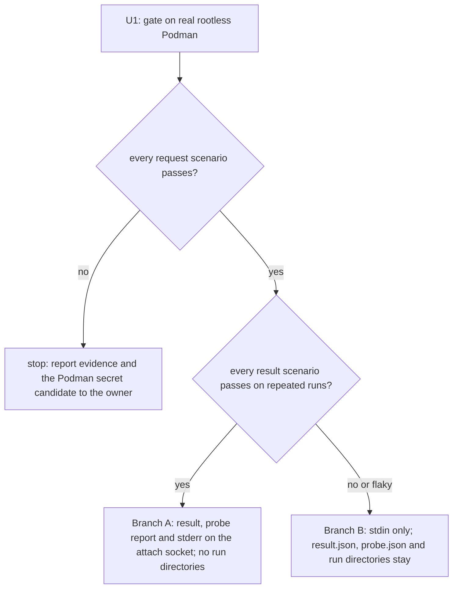
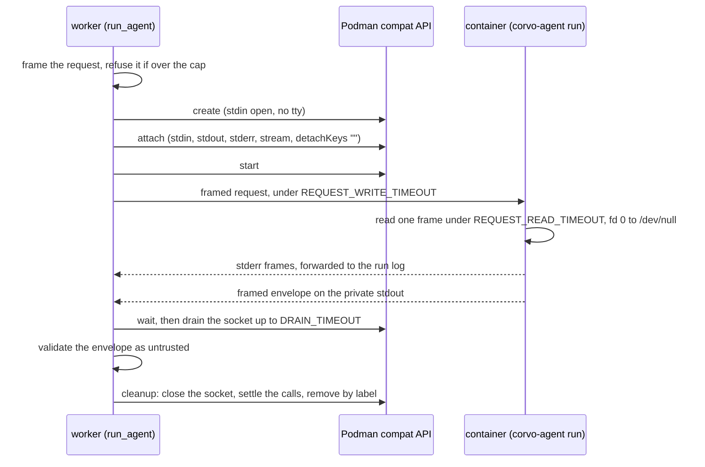

# Agent Request Over Stdin - Plan

## Goal Capsule

- **Objective:** An agent run gets its request into its container without the request ever sitting in a host file that a group can read, and without any new credential inside the container. The code-scanning check on the agents work passes because the pattern is gone, not because an alert was dismissed.
- **Means:** The worker writes the request to the container's standard input, framed by its length (KTD1, KTD2).
- **Product authority:** The repository owner. A failed request gate (R7) returns to the owner, and the plan does not decide it.
- **Stop conditions:** Stop after U1 when any request scenario fails, and report the evidence (R7). Otherwise U1's result scenarios pick Branch A or Branch B (KTD5), and the remaining units follow that branch.
- **Execution profile:** Proof first. U1 runs on the real rootless Podman before any production code changes, and its outcome is recorded in this plan and in PR #36's body.
- **Who finishes:** `ce-work` on branch `feat/agents-u4-container-piece`, through review and CI, up to PR #36 ready for review.

---

## Builds on

This work builds on U4 as it stands on `feat/agents-u4-container-piece` (head 72faf6a), and on U3's runner below it. Read the code, not the plans. Every unit extends these pieces in place; none is rewritten or replaced by a parallel version.

**Kept as they are:**
- **Agent state:** `Runtime`, `enable`, `disable` and `current`, the in-flight set, and `AgentFailed` with its no-echo messages, in `src/corvo/worker/agent_runtime/containers.py`.
- **Cancel-safe calls and cleanup:** `Calls` and its `settle()`, `shielded`, and `clean_up` with `CLEANUP_TIMEOUT` and its log-don't-raise rule. U4 of this plan adds the socket's close before `settle()`, and nothing else.
- **Removal:** `remove`, `remove_labelled` and `remove_in_flight`, the 404 and 409 handling, and `PODMAN_TIMEOUT` on the client.
- **The stderr path:** `forward_stderr` with its prefix, line cut, line cap and `printable`.
- **The run's labels and name:** `Run`, `task_run_label`, `deployment_label` and `session_budget`, in `src/corvo/worker/agent_runtime/spec.py`.
- **Startup:** `prepare`, `prepare_until_stopped`, `checked_runtime`, `check`, the sweep with `sweep_decision` and `lookup`, and `install_sigterm_hook`, in `src/corvo/worker/agent_runtime/startup.py`.
- **The runner's session:** U3's `outcome` logic after the request is read, the budget timeout, and `probe()`'s report, in `src/corvo/agents/runner.py`.
- **The tests' harness:** the fake Podman's gates (`create_gate`, `remove_takes`, `remove_fails_with`, `hangs`), `matching_report`, and the integration fixtures, with their real Hatchet, rootless Podman, image builds and namespaced workers.

**Extended in place:**
- `container_spec` gains stdin, and in Branch A the log driver, and loses the run mount there.
- `run_agent` gains the attach and the write between `create` and `start`.
- `follow` reads the socket instead of `logs()` in Branch A. `conclude` keeps its outcomes and messages and, in Branch A, reads bytes from the socket instead of the file.
- `guard_rerun` keeps its container half.
- The probe reuses the same spec and cleanup.
- The runner's `outcome` takes the request bytes, and `main` reads them.
- `read_untrusted`'s checks stay for Branch B's files, and Branch A applies the same limits to the socket's bytes.

**Removed:** `write_request` everywhere. In Branch A also `make_run_dir`, the run-directory half of `guard_rerun`, and `remove_run`'s directory removal.

---

## Product Contract

### Summary

Each agent run gets its request over its container's standard input, framed by its length, so no file on the host ever holds it. A gate test on the real rootless Podman proves the channel first. The same gate decides whether the agent's result and the probe's report also leave the shared run directory, over the same connection. The change lands in U4's pull request (#36) before it merges.

### Problem Frame

U4 hands each agent run's request to its container as `request.json`, written into the run directory with mode `0o640`. The worker and the container run as different host users in production, so the container can read the file only through the run directory's `corvo-agents` group. CodeQL flags that mode as `py/overly-permissive-file` (alert #17, high severity), and the CodeQL check fails on PR #36.

The file holds no credential, and only the dedicated Podman user shares the group. The owner still does not accept a group-readable request file as the way agents receive their work. Dismissing the alert would ship the pattern as is. Narrowing the mode to `0o600` would make the CI pass, because the integration tests run the worker and Podman as one user, while breaking every run on the compose topology.

Product Contract preservation: changed: R10 — it now covers every agent, not only those without a working directory, because a working directory is its own mount and needs no run directory; the owner confirmed this in the plan's scoping synthesis. R6 and AE4 now name both supported Podman versions, because CI runs the gate on 4.9.3; the owner approved this in the plan's review. Dependencies / Assumptions now records what research established about Podman's attach, and Outstanding Questions was resolved in place.

### Key Decisions

- **The alert is closed by changing the code, not by dismissing it.** (session-settled: user-directed — chosen over dismissing alert #17 as "won't fix": the owner does not want this kind of vulnerability in the code.) Governs R1.
- **The request travels over the container's standard input.** (session-settled: user-directed — chosen over a Podman secret per run, copying the file into the created container, a git repository, a GitHub issue, reading the input from Hatchet, and an environment variable or argument: stdin leaves no file on the host, adds no credential or network reach to the container, and stays within docker-py.) Governs R1, R2, R4.
- **A failed request gate goes back to the owner, with the Podman secret as the candidate.** (session-settled: user-approved — chosen over the plan switching on its own: a secret needs Podman's libpod API next to docker-py, which reopens the parent plan's KTD5.) Governs R7.
- **The result's path is decided by the gate.** (session-settled: user-directed — chosen over moving the result and the probe report off the run directory now, and over leaving them there: the stream's reliability on Podman was unproven.) Governs R8, R9, R10.
- **The fix lands in U4's pull request before it merges.** (session-settled: user-approved — chosen over a follow-up pull request: `main` never receives the alert.) Governs R11.

### Requirements

**Request delivery**

- R1. The worker gives each agent run's request to its container over the container's standard input, and no file on the host ever holds the request.
- R2. The request is framed by its length, so the container reads it whole without depending on seeing the end of its input.
- R3. The runner in the container treats what it reads as untrusted, as it treats `request.json` today: a request that is truncated, too large or invalid ends in a `failed` envelope naming `invalid_request`.
- R4. The container gains no credential, no network reach and no mount for this. The request carries what it carries today: the agent, its input and the session budget.
- R5. The run's other guarantees hold over the new channel: a cancel, a timeout, a lost worker, a re-run and a SIGTERM still leave no stray container, and a container that never reads its request cannot block the worker past the run's bounds.

**Feasibility gate**

- R6. Before any production code changes, a test on the real rootless Podman, on both supported versions (6.1 locally and 4.9.3 in CI), through docker-py's Docker-compatible API, shows the request arriving whole at the largest size the runner accepts. The same test measures the result direction: whether a framed result read from the container's output stream arrives whole, including past the length at which conmon splits lines.
- R7. If the request does not arrive reliably over stdin, the work stops and goes back to the owner, with the Podman secret as the candidate (Key Decisions).

**Result and probe report**

- R8. When R6 shows the output stream reliable, the agent's result and the startup probe's report leave the run directory over that stream. Otherwise they stay as the parent plan's KTD4 defines them.
- R9. Whichever path they take, the result and the probe report keep KTD4's guarantees: untrusted, at most 1 MiB, never echoed, and validated before use.
- R10. When the result and the probe report leave the run directory, no run directory is created for any agent. The re-run guard then infers a lost worker from leftover containers alone.

**Delivery**

- R11. The change lands on `feat/agents-u4-container-piece` (PR #36). The parent plan's KTD4 and KTD7 and the U5, U6 and U7 plans are updated wherever they describe `request.json`, `result.json`, `probe.json` or the run directory.

### Acceptance Examples

- AE1. **Covers R1, R2.**
  - **Given** the `tone` task on the real Hatchet and rootless Podman.
  - **When** it runs to the fake's friendly verdict.
  - **Then** no file under the agent root held the request at any point of the run.
- AE2. **Covers R3.**
  - **Given** a request whose length header promises more bytes than arrive.
  - **When** the runner reads it.
  - **Then** the run ends with a `failed` envelope naming `invalid_request`, and no session starts.
- AE3. **Covers R5.**
  - **Given** a `fake:hang` run.
  - **When** it is cancelled, and in a second run, when its worker gets a SIGTERM.
  - **Then** no container labelled with the run is left, as in U4's integration tests today.
- AE4. **Covers R7.**
  - **Given** the gate shows a request cut short or never delivered on either supported Podman version.
  - **When** U1 ends.
  - **Then** no later unit starts, and the owner gets the gate's evidence and the Podman secret candidate.

### Success Criteria

- The CodeQL check on PR #36 passes, with alert #17 closed by the code change and not dismissed.
- The U4 integration proofs still pass on the real engine and Podman: `tone` end to end, AE3, AE4 and AE5 of the parent plan, and the SIGTERM proof.

### Scope Boundaries

- **A GitHub issue as an agent's input source is deferred.** The direction that does not block it: the worker fetches the issue and passes it over the same channel, and the GitHub credential never enters the container.
- **The working directory stays a bind mount.** Agents that read or write files (`dir-summary` and `dir-review`) still mount their working directory. It is the agent's material, not its request.
- **Rejected transports:** reading the input from Hatchet would put a tenant-wide API token in the container. A git repository brings back group-readable files or needs a server and a credential. An environment variable or argument shows up in `podman inspect`, an argument also shows up in `ps`, and both are size-limited.
- **Outside this work:** the zizmor alerts on the workflow files, finding #11 of U4's review (a sweep past its bound), and the organization workflow's coverage Python.
- **Considered and not built:**
  - A sentinel file or a sweep record to flag a worker lost before it created its container. No session ran in that case, so a re-run costs nothing extra. A lost worker whose container exists is still caught (KTD6). Evidence that would change this: a failure mode that pays for a session with no container left behind.
  - Half-closing stdin after the write in Branch A. Length framing makes end of input unnecessary (KTD1), and research could not rule out a half-close affecting the output side. Evidence that would change this: an agent that must read stdin to its end.

### Dependencies / Assumptions

- KTD5 of the parent plan stays: the worker talks to Podman only through docker-py over the Docker-compatible socket.
- docker-py's `attach_socket` returns a stream over the unix socket and does not drop the client's timeout, unlike its log and wait streams. Closing it does not reliably deliver end of input on Docker (docker/docker-py#1507). On Podman, a half-close or a disconnect does close the container's stdin (the fix for containers/podman#7479), but R2's framing does not rely on it.
- Podman accepts an attach to a created container before it starts, and attach output is live only: nothing is replayed to a late attacher. Both come from Podman v6.1.1's source and are proven by U1, not assumed.
- Podman's attach echoes a request body (containers/podman#19901), so the attach sends none.
- Attach stdout reaches the client raw, in frames of at most 8192 bytes with arbitrary boundaries. The log path splits long lines into partial records, under journald (the default here) and k8s-file alike.

### Outstanding Questions

**Resolved by U1**

- **U1 selects Branch A (KTD5).** Every request scenario and every result scenario passed on both supported versions, on repeated runs:
  - **Podman 6.1.1 (local, rootless):** five full runs in a row, all passing.
  - **Podman 4.9.3 (CI's integration job, Ubuntu 24.04):** the runs on d0a715f and 713f3fb, all passing.
- **One expectation was refuted.** Without a tty, Podman 6.1.1 cut no request at ctrl-p ctrl-q, whether the attach sent `detachKeys=ctrl-p,ctrl-q`, an empty value or none. The scenario was therefore kept only in its positive form: a request holding those bytes arrives whole. KTD2 keeps `detachKeys=""`, because docker-py otherwise sends the detach keys of `~/.docker/config.json`.

### Sources / Research

- CodeQL alert #17, `py/overly-permissive-file`, on `write_request` in `src/corvo/worker/agent_runtime/containers.py`.
- The parent plan's KTD4 (envelope), KTD5 (docker-py), KTD6 (container spec), KTD7 (run directories), KTD8 (re-run guard and cleanup) and KTD10 (probe): `docs/plans/2026-10-15-0020-feat-agents-skeleton-plan.md`.
- Hatchet: no artifact or file storage in its documentation index (https://docs.hatchet.run/llms.txt). Streams go from a task to its subscribers (https://docs.hatchet.run/v1/streaming).
- Podman secrets and their mount options (https://docs.podman.io/en/latest/markdown/podman-run.1.html). The compat create handler has no secret handling (`pkg/api/handlers/compat/containers_create.go` in containers/podman).
- Git's `core.sharedRepository=group` (https://git-scm.com/docs/git-config). GitHub App installation tokens (https://docs.github.com/en/rest/apps/apps#create-an-installation-access-token-for-an-app).
- Podman v6.1.1 attach: `pkg/api/handlers/compat/containers_attach.go` (query parameters, `detachKeys=""` meaning no detach keys), `libpod/container_api.go` (attach to a created container), `libpod/oci_conmon_common.go` (half-close to conmon, re-framing at 8192 bytes). conmon: `src/conn_sock.c` (stdin closed when the attach reader leaves), `src/ctr_logging.c` (partial log records).
- docker-py 7.2.0 installed source: `api/container.py` (`attach_socket`), `api/client.py` (`_get_raw_response_socket`, `_disable_socket_timeout`), `utils/socket.py` (`frames_iter`, the 8-byte frame header), `transport/unixconn.py`.

---

## Planning Contract

### Key Technical Decisions

- KTD1. **One framing rule for both directions: an ASCII decimal length, a newline, then exactly that many bytes, at most 1 MiB.** It lives in a stdlib-only module under `corvo.agents`, which the worker and the runner both import, so neither side carries its own copy. The header is digits only: no sign, no space, no leading zero, and a length of zero is invalid. Only the first frame counts and it must start at offset 0; bytes after it are ignored. The 1 MiB cap is the envelope's existing `MAX_UNTRUSTED_BYTES`, moved into that module. An ASCII header cannot contain Podman's detach sequence, and the JSON body escapes control characters, so neither can the body. Governs R2, R3, R9.
- KTD2. **One attach socket per run, opened between `create` and `start`, through the cancel-safe `Calls` tracker.** Its parameters are stdin and stream, plus stdout and stderr in Branch A, with `detachKeys` set to the empty string and no request body. Podman otherwise scans stdin for ctrl-p, ctrl-q and would cut the request short without a word. One small adapter in `containers.py` is the only code that touches docker-py's private raw socket (`_sock`): send all, shut down, close, and read frames. That is one type-checker exception and one seam for the fake. Cleanup shuts the socket down both ways and closes it before `Calls.settle()`, since a thread blocked on the socket would otherwise hold `settle()` for the whole `CLEANUP_TIMEOUT`. The holder that receives the socket from the attach thread closes it even when a cancel landed during the attach. Governs R1, R5.
- KTD3. **The bounds are set by the worker before and during the write, and by the runner on its read.**
  - The worker refuses a request whose payload exceeds the cap before any container call, failing the run with the size and the cap, never the content.
  - The write runs in a thread after `start` returns, so a slow start does not fail a good run. The socket inherits the client's 10 s `PODMAN_TIMEOUT`, and a socket timeout bounds the whole of `sendall`. The adapter therefore sets the socket's timeout to `REQUEST_WRITE_TIMEOUT` (45 s) just before the write, which makes that the real bound in production and under the test fixture's client alike.
  - A broken pipe or a reset during the write means the container exited before reading. The write swallows it, and the exit and the envelope decide the outcome as they do today.
  - A socket timeout during the write, while the container still runs, fails the run as "never read its request".
  - The runner reads the frame under `REQUEST_READ_TIMEOUT` (30 s), a total deadline polled on fd 0, shorter than the worker's, so a runner about to report `invalid_request` is not cut off by the worker.
  - After the write, the socket's timeout is turned off for the read phase. This matches today's log stream, which docker-py also leaves unbounded: the session's bounds are the runner's budget and Hatchet's timeout.

  Governs R3, R5.
- KTD4. **The runner reads its request before anything else touches stdin, then points fd 0 at `/dev/null`.** The Claude CLI subprocess and any tool it runs then cannot read late bytes or hold the request channel. A short read, a bad header, an oversized length, the deadline and a validation error all return the existing `Failed(reason="invalid_request")`, logging the size at most. The two `except` clauses stay separate, for the organization's Python 3.12 coverage parser. Governs R2, R3.
- KTD5. **U1's result scenarios pick the branch, and any doubt picks Branch B.** U1's tests stay as the permanent proof and run in CI's integration job, on Ubuntu 24.04's Podman 4.9.3, as well as on the local Podman 6.1. So the gate counts on both versions. Branch A is taken only when every result scenario passes on repeated runs on both: a 1 MiB result delivered whole after a fast exit, a single line past 8 KiB, stdout and stderr interleaved, a request written while output comes back on the same socket, delivery with the `none` log driver, and the stream ending within the drain bound after exit. A flake counts as unreliable. A request scenario failing on either version triggers R7. (session-settled: user-directed — chosen over deciding the result's path before measuring: the stream's reliability on Podman was unproven.) Governs R6, R8.
- KTD6. **Branch A: the attach socket carries the result, the probe report and stderr, and run directories go away.**
  - The runner moves its real stdout to a private descriptor at start and points fd 1 at stderr, so nothing the CLI, a tool or a library prints can corrupt or forge the frame. It writes the framed envelope, or the probe report, to that private descriptor.
  - The worker reads the socket's frames in the existing follow thread. Stderr frames go to the existing forwarder, unchanged. Stdout frames fill a buffer bounded by the cap plus its header: past it, the worker stops keeping bytes but keeps draining, so the container never blocks. `logs()` is no longer used.
  - The container spec sets the log driver to `none`. conmon otherwise copies every byte of stdout into the log driver, journald here, and each envelope would then persist in the host's journal, outside the run, which R9's "never echoed" forbids. Attach does not need a log driver; only `passthrough` disables it.
  - The worker reads until the socket ends, because `wait()` can return before the last frames arrive. After `wait()` returns, the socket gets `DRAIN_TIMEOUT` (5 s) to end, then it is closed.
  - A socket error mid-run never fails the run on its own. The exit code and the envelope decide, as today.
  - No run directory and no `/corvo/run` mount exist for any agent. KTD7 of the parent plan keeps only the working directories.
  - The re-run guard keeps only its container half. A lost worker is still caught: the sweep removes only containers whose run Hatchet reports ended (`sweep_decision` in `src/corvo/worker/agent_runtime/spec.py`), and a re-queued run has not ended, so its earlier container survives to the next attempt. Only a worker lost before it created its container goes unflagged, and no session ran then.

  Governs R8, R9, R10.
- KTD7. **Branch B: the attach socket carries stdin only, and is closed once the request is written.** Unread output frames would fill the socket and stall the container through conmon's backpressure, so no output stream is attached. Stderr stays on `logs()`, `result.json` and `probe.json` stay in the run directory as KTD4 defines them, and R10 does not apply. Closing the socket closes the container's stdin on Podman. The framing already makes that irrelevant to the runner. Governs R8.
- KTD8. **The fake Podman models the attach socket, and every behaviour receives the request bytes.**
  - The fake keeps the run directory as an optional argument for Branch B and for the probe.
  - It records the order of create, attach and start.
  - It asserts the attach parameters and that the spec opens stdin without a tty.
  - It tracks open sockets, so each test can show none is left open.
  - For the request, U3 adds these modes: a container that reads, one that never reads, one that exits before reading, and an attach that fails.
  - For Branch A only, U5 adds the output modes: a stream that never ends, stdout split across frames with a header split across reads, interleaved stderr, stdout past the cap, garbage, and a truncated frame. Branch B then ships no test support without a consumer.

  Governs R5.
- KTD9. **The runner's change lands in PR #36, even though `src/corvo/agents/runner.py` is U3's file.** The change is not a fix U3 needs on its own; it is half of U4's transport. The gh stack rule of putting lower parts' fixes on their own branch therefore does not apply. The agent image is rebuilt by the integration fixture each session, and the fingerprint check refuses a stale one, as today. Governs R11.

### High-Level Technical Design

The gate decides which branch the later units take:

A run in Branch A. In Branch B the socket carries stdin only and closes after the write, stderr comes from `logs()`, and the envelope is read from the run directory.

### System-Wide Impact

- **The SIGTERM hook and the sweep** keep their behaviour. Force-removing a container ends the worker's blocked socket read, as it ends the log stream today. U4 and U5 test that through cleanup.
- **The startup probe** runs through the same container spec, so it opens stdin too. In Branch A its report comes over the same stream as a result.
- **Operations (the parent plan's KTD18, U5's plan):** in Branch A the worker writes nothing under the agent root for a run, and the root holds only the working directories. The provisioning of `runs` and its setgid group no longer applies to runs, and U6 updates U5's plan to say so. The compose overlay still mounts the root for working directories, and still adds the `corvo-agents` group for the Podman socket.
- **The agent image:** the runner and, in Branch A, the `Dockerfile` change. The fingerprint check refuses a stale image until it is rebuilt, as it does today.

### Assumptions

- The Claude CLI subprocess gets its own stdin pipe from the SDK's transport. KTD4's redirect of fd 0 covers it either way.
- The CodeQL rule does not flag `make_run_dir`'s `0o770` directory in Branch B, as it did not on U4's current head. If it does, the alert goes back to the owner.

### Sequencing

U1 runs first and decides everything after it. Then U2 and U3, which are independent of each other. U4 needs both. U5 runs in Branch A only, after U4. U6 runs last, once the branch is known.

---

## Implementation Units

### U1. The gate on the real rootless Podman

**Goal:** Prove or refute stdin delivery, and measure the result stream, before any production code changes.

**Requirements:** R6, R7; KTD5.

**Dependencies:** None.

**Files:**
- Modify: `tests/integration/worker/test_podman.py`
- Modify: `docs/plans/2026-10-15-1030-fix-agent-request-stdin-plan.md` (the recorded outcome)

**Approach:**
1. Write the scenarios as sync tests in the style of the existing Podman proof, on the session's rootless Podman and the pulled Python image. Each runs a small reader script with the container spec, `stdin_open=True` and no tty. Each attaches before start, with KTD2's parameters.
2. Run them several times in a row on the local Podman 6.1, then push them and let CI's integration job run them on Podman 4.9.3 (KTD5).
3. Record each version's outcome in this plan's Outstanding Questions and in PR #36's body: which branch, and what failed if anything.
4. When a request scenario fails on either version, stop here and report (R7, AE4).

**Execution note:** These tests are the evidence the branch decision rests on, so run them on the real Podman before writing anything else. Keep them as the permanent proof of the transport.

**Patterns to follow:** `tests/integration/worker/test_podman.py` (`agent_container`, the `image` fixture, removal in `finally`).

**Test scenarios:**
- Request at exactly 1 MiB arrives byte for byte.
- Request over 64 KiB arrives whole when the reader starts reading 2 s after start.
- Request containing the bytes 0x10 0x11 arrives whole with `detachKeys=""`. (The negative form was dropped: see Outstanding Questions.)
- Bytes written right after start, before the process reads, are not lost.
- A container that never reads makes the write time out within its bound, and removal still ends the container.
- Dropping the worker's socket mid-write closes the container's stdin, and the reader's deadline fires.
- Result: a 1 MiB framed blob written just before exit arrives whole when the stdout frames are concatenated.
- Result: a single line past 8 KiB arrives unsplit over attach.
- Result: stdout and stderr written concurrently arrive separated by stream.
- Result: with the log driver set to `none`, attach still delivers stdout and stderr whole.
- Result: a 1 MiB request written while the same socket returns interleaved stdout and stderr and then a framed result: both directions arrive whole.
- Result: the socket ends within 5 s of the container's exit.

**Verification:** The outcome on both Podman versions and its evidence are recorded in this plan and in PR #36's body, and the branch is named.

---

### U2. The framing module

**Goal:** One stdlib-only implementation of KTD1, used by both sides.

**Requirements:** R2, R3, R9; KTD1.

**Dependencies:** U1, which must pass its request scenarios.

**Files:**
- Create: `src/corvo/agents/frame.py`
- Create: `tests/agents/test_frame.py`
- Modify: `src/corvo/worker/agent_runtime/containers.py` (import the cap from the module)

**Approach:**
1. The module provides what both branches need. The first piece encodes a payload, refusing one over the cap. The second reads one frame from a file descriptor under a total deadline, for the runner. The worker-side extractor of a frame from accumulated bytes is Branch A only, and U5 adds it.
2. Move `MAX_UNTRUSTED_BYTES` into the module, so the cap has one owner.

**Patterns to follow:** `src/corvo/agents/fingerprint.py` and `src/corvo/agents/envelope.py` (SDK-free modules the worker imports). `tests/test_import_boundaries.py` keeps the module SDK-free.

**Test scenarios:**
- A payload encodes as its decimal length, a newline and the payload, and decodes back unchanged.
- A payload of exactly 1 MiB encodes; 1 MiB plus one byte is refused.
- Headers with a sign, a space, a leading zero, a non-digit, no newline within the header's maximum length, or a zero length are invalid.
- A header promising more bytes than arrive before the deadline reads as truncated.
- A reader that gets the frame one byte at a time, under a total deadline that runs out midway, reports the deadline, not a hang.
- Bytes after the first frame are ignored.

**Verification:** The module's tests pass, and the import-boundary test shows it pulls in no SDK.

---

### U3. The fake Podman's attach socket

**Goal:** Let the unit tests drive the new channel without Podman (KTD8).

**Requirements:** R5; KTD8.

**Dependencies:** U1.

**Files:**
- Modify: `tests/worker/agent_runtime/fake_podman.py`
- Modify: `tests/worker/agent_runtime/test_containers.py`, `tests/worker/agent_runtime/test_startup.py`, `tests/worker/agents/test_tone.py` (behaviours take the request bytes)

**Approach:**
1. `FakeClient.api.attach_socket` returns a fake socket with send-all, shutdown, close, timeout and frame reads, and asserts the attach parameters.
2. Behaviours receive the request bytes. The run directory stays as an optional argument, and the fake's `run_dir` returns nothing when the spec has no `/corvo/run` mount.
3. `start()` runs the behaviour once the request has been written, so a cancel before the write stays testable.
4. The client records event order and open sockets.
5. Only the request-side modes of KTD8 come in here. The output-side modes and stdout in `Exit` wait for U5.

**Patterns to follow:** The fake's existing gates (`create_gate`, `remove_takes`, `hangs`).

**Test scenarios:** Test expectation: none -- test support only. U4 and U5's scenarios exercise each mode.

**Verification:** The existing unit tests pass on the reworked fake before U4 changes production code.

---

### U4. The request over stdin

**Goal:** Every agent run and the probe get their request, or none for the probe, over the attach socket, and `request.json` is gone.

**Requirements:** R1, R2, R3, R4, R5, AE1, AE2, AE3; KTD2, KTD3, KTD4, KTD7.

**Dependencies:** U2, U3.

**Files:**
- Modify: `src/corvo/agents/runner.py`
- Modify: `src/corvo/worker/agent_runtime/spec.py` (`stdin_open`, no tty)
- Modify: `src/corvo/worker/agent_runtime/containers.py` (attach adapter, write, cleanup order; `write_request` removed)
- Modify: `src/corvo/worker/agent_runtime/startup.py` (the probe container opens stdin and gets no request, so its runner never waits on one)
- Test: `tests/agents/test_runner.py`, `tests/worker/agent_runtime/test_containers.py`, `tests/worker/agent_runtime/test_spec.py`, `tests/worker/agents/test_tone.py`, `tests/integration/worker/test_agents.py`

**Approach:**
1. In `run_agent`, frame the request after the re-run guard and refuse it over the cap before any container call (KTD3).
2. Create, attach and start through `Calls`, then write under the write bound and close or keep the socket per branch (KTD2, KTD6, KTD7).
3. `clean_up` closes the socket before `settle()`.
4. In Branch B this unit is the whole production change: the attach is stdin only and closed after the write. In Branch A, U5 keeps the socket for the read phase.
5. The runner's `outcome` takes the request bytes as a parameter. `execute` keeps the run directory, where Branch B still writes `result.json`. `main` reads the bytes from fd 0 (KTD4) before the session starts. `probe` reads no stdin.
6. Module and function docstrings drop `request.json`. The `containers.py` header names the new transport.

**Patterns to follow:** `Calls` and `shielded` in `containers.py`. The two-clause `except` style in `runner.py`. `forward_stderr`'s no-echo discipline.

**Test scenarios:**
- The request the container receives carries the input and a budget below the timeout, as the existing request test asserts today, read from the socket instead of the file.
- No file under the agent root holds the request at any point of a run, checked from inside the behaviour.
- Create happens before attach, and attach before start.
- The spec opens stdin without a tty.
- A request over the cap fails the run before any container call, naming the size and the cap.
- A container that exits before reading ends the run on its own outcome (no envelope, or OOM), not on a write error.
- A container that never reads fails as "never read its request" within the write bound, and its container is removed.
- Integration: with the production client timeout, a request larger than the socket and pipe buffers still arrives whole when the reader starts reading after more than 10 s.
- A cancel during the attach leaves no open socket and no container.
- A cancel during the write leaves no open socket and no container.
- A cleanup with a blocked socket read finishes well inside `CLEANUP_TIMEOUT`.
- The runner reads a valid frame and runs the session.
- Covers AE2. The runner given a header promising more bytes than arrive returns `invalid_request` and starts no session.
- The runner given a bad header, an oversized length, or nothing before its deadline returns `invalid_request`.
- After its read, the runner's fd 0 is `/dev/null`.
- Covers AE1. Integration: `tone` runs end to end on the real Hatchet and Podman, and no file under the agent root holds the request at any point.
- Covers AE3. Integration: the existing cancel and SIGTERM proofs still leave no container.

**Verification:** Every unit and integration test passes, no code writes `request.json`, and CodeQL reports no new alert on the branch.

---

### U5. The result and the probe report over the stream (Branch A only)

**Goal:** The envelope, the probe report and stderr come back over the attach socket, and run directories disappear.

**Requirements:** R8, R9, R10; KTD6.

**Dependencies:** U4, and U1 selecting Branch A.

**Files:**
- Modify: `src/corvo/agents/frame.py` (the worker-side extractor)
- Modify: `src/corvo/agents/runner.py` (private stdout, framed envelope and probe report)
- Modify: `src/corvo/worker/agent_runtime/containers.py` (`follow` reads the socket's frames, `conclude` validates from bytes, `make_run_dir`, the run-directory half of `guard_rerun` and `remove_run`'s directory removal go)
- Modify: `src/corvo/worker/agent_runtime/startup.py` (the probe reads its report from the stream; no `runs` directory)
- Modify: `src/corvo/worker/agent_runtime/spec.py` (no run-directory argument, no `/corvo/run` mount, log driver `none`)
- Modify: `Dockerfile` (no `/corvo/run` directory)
- Modify: `tests/worker/agent_runtime/fake_podman.py` (KTD8's output-side modes, stdout in `Exit`)
- Test: `tests/agents/test_frame.py`, `tests/agents/test_runner.py`, `tests/worker/agent_runtime/test_containers.py`, `tests/worker/agent_runtime/test_startup.py`, `tests/worker/agent_runtime/test_spec.py`, `tests/integration/worker/test_podman.py`

**Approach:**
1. Frame module: add the extractor of the first frame from accumulated bytes, reporting complete, missing or invalid. The frame must start at offset 0 (KTD1).
2. Runner: the private descriptor for stdout comes first in `main`, before any import that may print. The envelope and the probe report go through U2's encoder.
3. Worker: follow the socket until it ends, stderr to the forwarder and stdout to the bounded buffer. Then wait, and drain under `DRAIN_TIMEOUT` (KTD6).
4. `conclude` keeps its outcomes and messages, mapped as follows:
   - no frame, or a truncated frame: "no envelope";
   - over the cap, a bad header, or invalid JSON: "invalid envelope".

**Patterns to follow:** `read_untrusted`'s checks, now applied to bytes from the socket. `forward_stderr`'s cap and prefix, unchanged.

**Test scenarios:**
- An ok envelope split across many frames returns the output and logs cost, turns and session ID.
- A frame header split across two reads is still read.
- Stdout past the cap fails as "invalid envelope", and the container is never blocked: the socket is drained to its end.
- Garbage or a bad header on stdout fails as "invalid envelope", echoing nothing.
- No frame, or a truncated one, fails as "no envelope", logging cost and turns as `unknown` with the exit code.
- Stderr interleaved with stdout reaches the run log behind its prefix, and never enters the envelope.
- Something printed to fd 1 inside the runner after start goes to stderr, not into the frame.
- A stream that never ends after exit is closed after `DRAIN_TIMEOUT`, and the run concludes.
- A socket error mid-run falls through to the exit code and the envelope.
- The probe's report arrives over the stream, matches the spec, and leaves no directory.
- A re-run with an earlier attempt's container left fails as a lost worker. A replay with none left runs.
- The spec has no `/corvo/run` mount, and nothing under the agent root's `runs` is created.
- The spec sets the log driver to `none`.
- The extractor reads a frame at offset 0, and treats one starting later as invalid.

**Verification:** Every unit and integration test passes, and an integration run leaves the agent root with no `runs` entry.

---

### U6. The plans follow the code

**Goal:** The parent plan and the unit plans describe the transport that shipped (R11).

**Requirements:** R11.

**Dependencies:** U4, and U5 when Branch A.

**Files:**
- Modify: `docs/plans/2026-10-15-0020-feat-agents-skeleton-plan.md` (KTD4, KTD6, KTD7, KTD8, KTD10 and the run flowchart)
- Modify: `docs/plans/2026-10-15-0020-feat-agents-skeleton-u1-podman-fixture-plan.md`, `-u3-tone-agent-plan.md`, `-u4-container-piece-plan.md`, `-u5-operations-plan.md`, `-u6-dir-summary-plan.md`, `-u7-dir-review-plan.md`

**Approach:**
1. Rewrite each passage that names `request.json`, `result.json`, `probe.json`, the run directory or `/corvo/run` to the selected branch, citing this plan. Resolve in place, with no strikethrough.
2. In Branch A, KTD4's sentence "A file beats stdout..." gives way to KTD6's reason: attach stdout is raw and never reaches Hatchet's log. In Branch B that sentence stays for the result.

**Test scenarios:** Test expectation: none -- documentation only.

**Verification:** A search of `docs/plans/` finds no passage that describes the request as a file, and none that contradicts the selected branch.

---

## Verification Contract

- `uv run prek run --all-files`: ruff, format, mypy strict with `types-docker`, lockfile.
- `uv run pytest tests/test_import_boundaries.py tests/test_settings.py tests/agents tests/core tests/worker`: unit tests, no Docker or Podman.
- `uv run pytest tests/integration/worker`: integration on compose and the test's rootless Podman, U1's gate included (needs Docker and Podman).
- `uv run --locked --with coverage==7.16.2 coverage run --branch --source=src -m pytest`, then `coverage report --fail-under=90` the same way: CI's coverage floor.
- Every module parses on Python 3.12, for the organization's coverage job.
- CI on PR #36: every check passes, CodeQL included, with no alert dismissed.

## Definition of Done

- U1's outcome and the selected branch are recorded in this plan and in PR #36's body.
- Every gate above passes locally and in CI.
- No code path writes the request to a file, and in Branch A no run directory is created.
- The plans under `docs/plans/` match the shipped transport (U6).
- No abandoned attempt remains in the diff, including the branch not taken.
- The diff extends U4's pieces as Builds on lists them. No kept piece is rewritten, and no parallel version of one is added.
