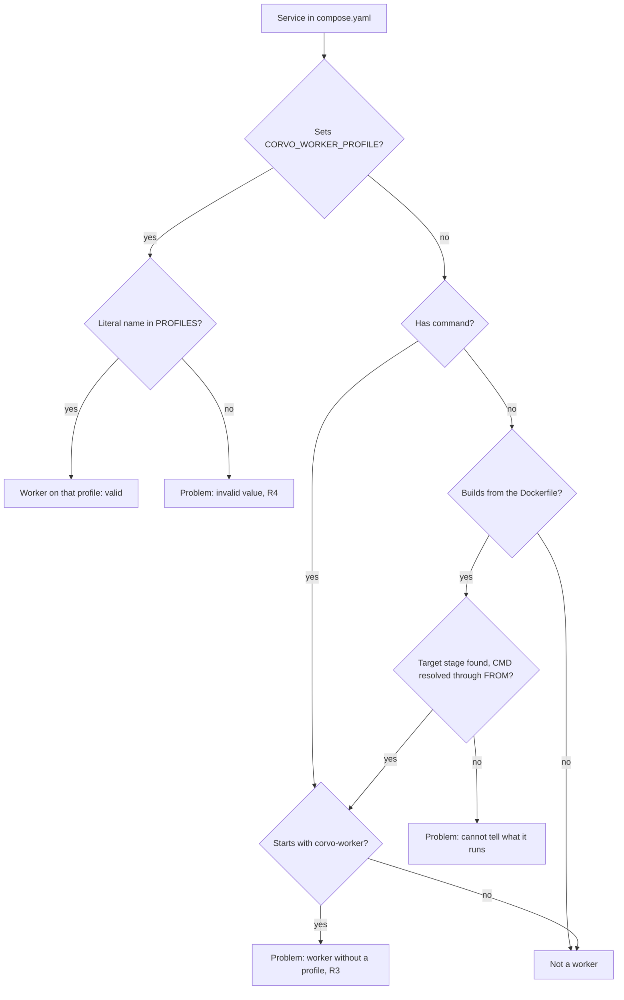

# Worker Name Setting and Compose Profile Check - Plan

## Goal Capsule

- **Objective:** The owner runs any number of workers per permission profile from `compose.yaml` and tells each worker service apart in Hatchet's dashboard. If a worker service names no profile or an unknown one, or a profile has no service, the tests fail. Without that check the first case shows up as a worker quietly serving the main profile and the second as runs that wait until they time out.
- **Means:** a `CORVO_WORKER_NAME` setting that overrides the name each profile declares (KTD1), and a test that checks `compose.yaml` against `PROFILES` (KTD2 to KTD5).
- **Product authority:** the repository owner, who settled every decision recorded under Key Decisions. The Product Contract wins on behavior, the Key Technical Decisions on mechanism. The worker profiles themselves (`Profile`, `PROFILES`, `CORVO_WORKER_PROFILE`, registration by profile) came from the agents skeleton plan's U2 and are not changed here.
- **Open blockers:** none. U2 (#34) and U9 (#43) have both landed, so `PROFILES` exists and every profile has a compose service.
- **Stop conditions:** stop and ask when an implementation unit would need a new profile, a new compose service, a check of the integration overlays, or a check of volumes or credentials (Scope Boundaries). Also stop when `compose.yaml` changes beyond R6.
- **Execution profile:** two implementation units, U1 then U2. Each lands as one commit with its tests. The work ships as one pull request through crew's development stage.

---

## Product Contract

### Summary

`CORVO_WORKER_NAME` in `compose.yaml` sets the Hatchet name of each worker, overriding the name its profile declares. A test reads `compose.yaml` and fails when a worker service does not state its profile, states one that does not exist, or when a profile has no service. The `worker` service now states its profile, `main`, so the check passes on today's compose.

### Problem Frame

corvo's workers are split by permission profile. One worker base serves the profile `CORVO_WORKER_PROFILE` names: `main` for tasks and workflows, `agents` for agent tasks, and later one profile per credential, such as the database or a GitHub bot. A worker registers only its own profile's definitions, and Hatchet never hands a task to a worker that did not register it. So a task never runs with more permission than its profile, provided compose runs the right workers.

Nothing checks that it does. A profile with no service leaves its runs queued until their schedule timeout, 60 minutes for agents, while every test passes. A service that names a misspelled profile fails only when it starts. A service that omits the profile falls back to `main`, as the `worker` service does today. That is harmless for `worker`, which holds only the Hatchet token. A future database worker that forgot its profile, though, would serve `hello` while holding the database password, which is exactly the leak the profiles exist to prevent.

Several workers of one profile all show up in the dashboard under that profile's fixed name, even when compose runs them as separate services. Extra workers matter most for `main`, whose slots stay taken while workflow steps wait on agent children, and for redundancy. They do not raise agent parallelism: one agent worker already runs up to `AGENT_MAX_RUNS` sessions at once. That cap holds across the whole tenant whatever the number of workers, and raising it means raising `AGENT_MAX_RUNS` and the agent worker's container limits.

### Key Decisions

- **Routing between workers is by registration per profile, not by Hatchet's worker labels and affinity.** Affinity draws a task to a labeled worker but never keeps one away, so a task that asks for nothing can land on the most privileged worker. In hatchet-sdk 1.42.1, `DesiredWorkerLabel.required` also defaults to `False`, and `on_failure_task` takes no desired labels, so a failure handler cannot be routed by affinity at all. (session-settled: user-directed — chosen over worker labels with required desired labels on each task: the owner's risk is a low-permission task on a high-permission worker, which affinity cannot exclude.)
- **A worker serves exactly one profile, and a profile is a code area, not a list of names in compose or capabilities declared per task.** A list of task names per worker in compose could not be checked against what each task needs. Capabilities matched as a subset would let a worker with more permissions serve tasks that need fewer. Both would also make every worker import every task, against the agents plan's rule that the main worker never imports the Claude Agent SDK. (session-settled: user-directed — chosen over `CORVO_WORKER_WORKFLOWS` name lists and over capabilities declared per task.)
- **One worker base, configured by profile, with no worker code copied per profile.** The agents plan's U2 built it. This plan adds only the name and the compose check. (session-settled: user-directed — chosen over a separate `agent_worker` module with its own `main()` and list, and over building the base in this plan.)
- **This work adds the mechanism only, with no new profile and no new worker service.** The database and GitHub-bot profiles arrive with the first task that needs one. (session-settled: user-directed — chosen over splitting the examples across two workers in compose.)
- **The compose check lands now, before any profile beyond `main` and `agents` exists.** (session-settled: user-directed — chosen over adding it with the next profile and over no check.) Governs R3, R4, R5.
- **Every worker service states its profile, although `CORVO_WORKER_PROFILE` defaults to `main`.** The default suits a developer's machine. In compose, an omitted profile would put a credentialed worker on `main`. (session-settled: user-approved — chosen over accepting the default in compose: a forgotten profile on a credentialed service is the leak this work guards against.) Governs R3, R6.
- **The check reads `compose.yaml` only.** The integration tests' overlay adds a test-only `scripted-api` service and changes the agent worker's engine and root. (session-settled: user-approved — chosen over checking the overlays too.) Governs R3, R4, R5.
- **The check covers each service's profile, not the volumes a second worker of the same profile must share.** Every agents worker must mount the same `agent-root` volume. Otherwise the runs that land on one without it fail, because the caller created their work directory on the other worker's volume. Today one agents service exists, and agent parallelism grows through `AGENT_MAX_RUNS` on that worker rather than through more workers. (session-settled: user-approved — chosen over a note in `docs/agents.md` and over the test also checking that every agents service mounts `agent-root`: no second agents service is planned.)

### Requirements

**Worker name**

- R1. When `CORVO_WORKER_NAME` is set, the worker registers with Hatchet under that name instead of the name its profile declares.
- R2. When `CORVO_WORKER_NAME` is empty or unset, the worker keeps its profile's name, so the `main` worker stays `corvo-worker` and the agents worker `corvo-agent-worker`.

**Compose profile check**

- R3. A test fails, naming the service, when a service in `compose.yaml` that runs the worker does not set `CORVO_WORKER_PROFILE`.
- R4. The test fails, naming the service and the value, when a service sets a `CORVO_WORKER_PROFILE` that is not in `PROFILES`.
- R5. The test fails, naming the profile, when a profile in `PROFILES` has no service in `compose.yaml`.

**Compose**

- R6. The `worker` service in `compose.yaml` sets `CORVO_WORKER_PROFILE: main`, so it passes R3.

### Acceptance Examples

- AE1. **Covers R3.** **Given** a `db-worker` service that holds the database password and runs the worker without `CORVO_WORKER_PROFILE`, **when** the tests run, **then** the test fails and names `db-worker`, even though that worker would start and serve `main`.
- AE2. **Covers R4.** **Given** a service with `CORVO_WORKER_PROFILE: agent`, **when** the tests run, **then** the test fails and names the service and `agent`.
- AE3. **Covers R5.** **Given** a new `db` profile in `PROFILES` and no service for it, **when** the tests run, **then** the test fails and names `db`.
- AE4. **Covers R1, R2.** **Given** three separate compose services on the `main` profile, **when** one sets `CORVO_WORKER_NAME: corvo-worker-a` and the others set nothing, **then** the first registers as `corvo-worker-a` and the others as `corvo-worker`.
- AE5. **Covers R3, R6.** **Given** today's `compose.yaml` with R6 applied, **when** the tests run, **then** the check passes for `worker` on `main` and `agent-worker` on `agents`.

### Scope Boundaries

**Deferred for later**

- Checking that every service of the agents profile mounts the shared `agent-root` volume (Key Decisions).
- Slots for the profiles that do not declare them. The agents profile already declares its own.
- Publishing the profile as a Hatchet worker label, for Hatchet's per-label slot metrics and autoscaling per group of workers. It comes with autoscaling.
- The database and GitHub-bot profiles, and the per-worker database settings they need.
- Checking compose overlays as well as `compose.yaml`.
- Checking each service's credentials against the profile it states, so that a credentialed service on a valid but wrong profile, such as a database worker set to `main`, fails the tests. It comes with the first profile that holds a credential.
- Distinct names for the replicas of one service. Replicas made with `deploy.replicas` or `--scale` share their service's environment, and so its name. Hatchet accepts that (Dependencies / Assumptions).

**Considered and not built**

- Routing by worker labels and affinity, alone or on top of registration (Key Decisions).
- `CORVO_WORKER_WORKFLOWS`, a list of task names per worker in compose (Key Decisions).
- Capabilities declared per task and matched against each worker's (Key Decisions).
- A worker module and console script per profile (Key Decisions).
- Reading `environment` in its list form. No service uses it, and a worker service written that way fails R3 by name at once, which is cheap to fix then. Would change if a service needs the list form.
- Removing `CORVO_WORKER_NAME` from the environment the integration `worker` fixture inherits. A name leaked from a developer's shell makes the integration tests fail visibly on the worker's name. Would change if that leak happens in practice.

### Dependencies / Assumptions

- **What exists on main**, from the agents skeleton plan's U2 (#34) and U9 (#43):
  - `src/corvo/worker/profiles/__init__.py` holds the frozen `Profile` dataclass (`name`, `workflows`, optional `slots`, `before_start` and `on_sigterm`) and `PROFILES`, which maps each profile's name to its module path without importing any profile.
  - `corvo.worker.profiles.main` (`corvo-worker`) and `corvo.worker.profiles.agents` (`corvo-agent-worker`, `AGENT_MAX_RUNS` slots) each expose `PROFILE`.
  - `corvo.worker.worker.main()` reads `worker_profile` (`CORVO_WORKER_PROFILE`, default `main`, under the settings' `CORVO_` prefix). It exits with status 1 on an unknown name, imports the profile by name and serves it, and `serve()` passes `profile.name` to Hatchet as the worker's name. Settings have no worker-name setting yet.
  - `tests/worker/test_registration.py` walks `PROFILES`.
  - In `compose.yaml`, the `worker` service runs `command: ["corvo-worker"]` and sets no `CORVO_WORKER_PROFILE`. The `agent-worker` service sets `CORVO_WORKER_PROFILE: agents` and has no `command:`. It inherits the `agent-worker` Dockerfile target's `ENTRYPOINT`, a root script that drops to uid 1000 before running its argument, and that target's `CMD ["corvo-worker"]`.
  - `tests/integration/worker/test_proxy.py` already reads `compose.yaml`, for the pinned Caddy image.
- **Hatchet behavior this rests on** (Hatchet's workers and worker-affinity docs, hatchet-sdk 1.42.1):
  - A task goes only to workers that registered it, and several workers registering the same task share its runs.
  - A run that no worker can take waits until its schedule timeout.
  - Worker names need not be unique, which R2 relies on: replicas, and separate services of one profile that set no `CORVO_WORKER_NAME` as in AE4, share their profile's name. Verified in engine v0.110.5's source, not on a live engine. Registration always inserts a new worker row with its own id, the workers table has no unique constraint on the name, and the engine looks workers up by id. The name is a display label that must match `^[a-zA-Z0-9\.\-_]+$`.

### Sources / Research

- `src/corvo/worker/worker.py`, `src/corvo/worker/profiles/`, `src/corvo/settings.py`, `src/corvo/worker/defaults.py` (`AGENT_MAX_RUNS`, `AGENT_CONCURRENCY`, `AGENT_SCHEDULE_TIMEOUT`), `compose.yaml`, `Dockerfile`, `tests/worker/test_worker.py`, `tests/worker/test_profiles.py`, `tests/worker/test_registration.py`.
- `docs/agents.md`, on agent work directories in the `agent-root` volume.
- `docs/plans/2026-10-15-0020-feat-agents-skeleton-plan.md`, KTD2, KTD10, KTD18, KTD19 and KTD26 as rewritten for U2.
- Hatchet docs: https://docs.hatchet.run/v1/workers.md, https://docs.hatchet.run/v1/advanced-assignment/worker-affinity.md, https://docs.hatchet.run/v1/inter-service-triggering.md, https://docs.hatchet.run/v1/autoscaling-workers.md, https://docs.hatchet.run/v1/concurrency.md.
- hatchet-sdk 1.42.1: `hatchet_sdk/types/labels.py:69` (`required: bool = False`), `hatchet_sdk/runnables/workflow.py` `on_failure_task` (`desired_worker_labels=None`), and `hatchet_sdk/worker/worker.py`, which passes the worker's name unchanged.
- Hatchet engine v0.110.5 (github.com/hatchet-dev/hatchet): `internal/services/dispatcher/server.go` (`Register` inserts a worker with `gen_random_uuid()`, `Listen` and `ListenV2` look it up by id) and `sql/schema/v0.sql` (the `Worker` table, unique only on `id` and `webhookId`).

---

## Planning Contract

Product Contract preservation: unchanged in scope. Planning resolved the two questions the brainstorm deferred, through KTD3 and KTD4, and a third, Hatchet's acceptance of shared worker names, through research. With nothing left open, the Outstanding Questions section was removed. The name assumption under Dependencies / Assumptions is now stated as verified, and the replica bullet in Scope Boundaries points to it. Scope Boundaries gained two entries under "Considered and not built" from planning.

### Key Technical Decisions

- KTD1. **`main()` applies the name, and `serve()` stays unaware of settings.** `Settings` gains `worker_name: str = ""`, following the other optional strings. `main()` gives `serve()` a copy of the profile carrying `CORVO_WORKER_NAME` as its name when the value is not blank, and the profile unchanged otherwise. A whitespace-only value counts as blank, because Hatchet's name pattern rejects spaces. Slots, workflows and hooks always stay the profile's. Governs R1, R2.
- KTD2. **The check parses `compose.yaml` with PyYAML's `safe_load`, which becomes a dev dependency along with `types-pyyaml`.** A structured read resolves the `<<: *corvo` merge and reads `environment` per service. A regex on the text, as `tests/integration/worker/test_proxy.py` uses for one image line, cannot do that reliably. `docker compose config` would resolve everything, but it needs Docker, which the `tests/worker` collection does not have. PyYAML is already installed only through `uvicorn[standard]`, and strict mypy over `tests/` rejects an import without its stubs. Licenses: PyYAML is MIT and `types-pyyaml` (typeshed) is Apache-2.0. Both are dev-only and compatible with corvo's MIT.
- KTD3. **A service runs the worker when its effective command starts with `corvo-worker`, or when it sets `CORVO_WORKER_PROFILE` at all.** The effective command is the service's `command:` when it has one. Otherwise it is the `CMD` of the Dockerfile stage the service builds: its `build.target`, or the Dockerfile's last stage when it names none, inheriting `CMD` from the stage it starts `FROM`. A service with only `image:` and no `command:` runs no worker unless it sets the variable. A build target the Dockerfile lacks, or a stage whose `CMD` cannot be resolved, is a problem named with its service, never a skip. This makes the check fail closed. The Dockerfile is read only for this. The Key Decision that the check reads `compose.yaml` only rules out the integration overlays, not the Dockerfile the services build. Governs R3, R5.
- KTD4. **Only a literal name in `PROFILES` is a valid profile.** A `${...}` interpolation, an empty string, a key with no value (which compose fills from the host's environment) or a non-string value fails R4. The value is shown with `repr` so that an empty or missing value reads clearly. Otherwise the host would choose the profile, which the test cannot check. `environment` is read in its map form, the only form `compose.yaml` uses. R4 applies to every service that sets the variable, not only to services KTD3 recognizes by command. Governs R4.
- KTD5. **The check is a pure function over parsed data, shaped like `tests/worker/test_registration.py`.** It takes the parsed compose services, the Dockerfile's stages and `PROFILES`, and returns a list of problem strings that each name a service or a profile. A test asserts the list is empty for the repository's own `compose.yaml` and `Dockerfile`, which also fails R5 for `main` or `agents` if recognition stops matching either service. Small tests over synthetic compose data cover each failure. R5 counts a service whose profile is valid, whether or not compose's own `profiles:` key gates it. Governs R3, R4, R5.

### High-Level Technical Design

How the check classifies one service, per KTD3 and KTD4. R5 then compares the profiles of the services that end in "valid" against `PROFILES`.

### Assumptions

- The organization's CI installs the dev dependency group from the pull request's `pyproject.toml` and `uv.lock`, so `types-pyyaml` is available to mypy in the same pull request. `mypy.ini` and `.github/python.yml` come from the pull request's base, and this plan changes neither.
- Dockerfile parsing only needs the `FROM <image-or-stage> [AS <name>]` lines and the exec-form `CMD [...]` lines this repository uses. The final stage is a bare `FROM app`. A `CMD` in shell form is a problem under KTD3, not something to support.

### Sequencing

U1 and U2 are independent: U1 changes the worker's naming, and U2 adds the compose check plus R6's one line. U1 goes first only because it is smaller, and either can land alone.

---

## Implementation Units

### U1. Name each worker from `CORVO_WORKER_NAME`

**Goal:** a worker registers under `CORVO_WORKER_NAME` when it is set, and under its profile's name otherwise.

**Requirements:** R1, R2, AE4; KTD1.

**Dependencies:** none.

**Files:**
- `src/corvo/settings.py`: add `worker_name`, with a comment in the style of its neighbours naming what it overrides.
- `src/corvo/worker/worker.py`: apply the name in `main()` before `serve()`.
- `tests/worker/test_worker.py`: the name cases.

**Approach:**
1. Add `worker_name: str = ""` to `Settings` next to `worker_profile`.
2. In `main()`, after the profile is imported, replace the profile's name with the stripped setting when that is not empty. The frozen dataclass's `replace` keeps every other field. `serve()` keeps its signature and its tests.

**Patterns to follow:** the `events` fixture and the tuple assertions in `tests/worker/test_worker.py`. For the agents profile, use the `dataclasses.replace(..., before_start=None)` monkeypatch already used in `test_main_serves_the_profile_its_variable_names`. Optional strings are `str = ""`, as `hatchet_token` and `agent_root` are.

**Test scenarios:**
- Covers AE4. With `CORVO_WORKER_NAME=corvo-worker-a` and no profile set, `main()` registers `corvo-worker-a` with the main profile's workflows and slots.
- With `CORVO_WORKER_PROFILE=agents` and `CORVO_WORKER_NAME=corvo-agent-worker-b`, `main()` registers `corvo-agent-worker-b` with the agents profile's slots and workflows.
- Covers AE4. With `CORVO_WORKER_NAME=""`, `main()` registers `corvo-worker`.
- With `CORVO_WORKER_NAME="  "`, `main()` registers `corvo-worker`.
- The existing default test keeps proving that `corvo-worker` is used when the variable is unset. It deletes `CORVO_WORKER_NAME` as it already deletes `CORVO_WORKER_PROFILE`, so a developer's shell cannot leak into it.

**Verification:** the new and existing `tests/worker/test_worker.py` cases pass, and the integration suite still finds both workers by their profile names.

### U2. Check `compose.yaml` against `PROFILES`

**Goal:** a test fails, naming the culprit, when a worker service in `compose.yaml` states no profile or an unknown one, or when a profile has no service. Today's `compose.yaml` passes it.

**Requirements:** R3, R4, R5, R6, AE1, AE2, AE3, AE5; KTD2, KTD3, KTD4, KTD5.

**Dependencies:** none. It is independent of U1.

**Files:**
- `pyproject.toml` and `uv.lock`: add `pyyaml` and `types-pyyaml` to the `dev` dependency group (KTD2).
- `tests/worker/test_compose.py` (new): the check and its tests. The existing `tests/worker` collection in `.github/python.yml` collects it.
- `compose.yaml`: add `CORVO_WORKER_PROFILE: main` to the `worker` service's environment, with a short comment that every worker service states its profile (R6).
- `src/corvo/worker/profiles/__init__.py`: the docstring's recipe for a new profile says its compose service must set `CORVO_WORKER_PROFILE`, which `tests/worker/test_compose.py` checks.

**Approach:**
1. Read the services from `compose.yaml` with `safe_load`, and the Dockerfile's stages with a small line reader (Assumptions).
2. For each service, decide whether it runs the worker (KTD3) and what `CORVO_WORKER_PROFILE` it sets (KTD4).
3. Collect the problems in a fixed order, so the real-repository assertion and the per-failure tests compare exact lists: services without a profile (R3), then invalid values (R4), then profiles without a service (R5).
4. Word each message after `tests/worker/test_registration.py`'s, naming the service and, where it applies, the value or the profile. The exact wording is the implementer's.

**Execution note:** write the per-failure tests over synthetic compose dictionaries and Dockerfile text first. Add the real-repository tests and R6's compose line last, so the first run against the real file shows the `worker` service failing R3 before R6 fixes it.

**Patterns to follow:** `tests/worker/test_registration.py` (a pure `problems(...)` function, a real-repository test asserting `== []`, and sentence-style test names such as `test_a_definition_missing_from_its_profile_is_named`). `ROOT`-relative paths as in `tests/integration/worker/test_proxy.py`. Ruff lifts the `corvo.worker` import ban for `tests/worker/**`, so the test imports `PROFILES` directly.

**Test scenarios:**
- Covers AE5. The repository's `compose.yaml` and `Dockerfile` give no problems.
- Covers AE1. A `db-worker` with `command: ["corvo-worker"]`, a database password in its environment and no `CORVO_WORKER_PROFILE` gives one problem naming `db-worker`.
- A service with no `command:` that builds a target whose stage has `CMD ["corvo-worker"]` and states no profile gives a problem naming it.
- A target stage that starts `FROM` a stage with `CMD ["corvo-worker"]` and declares no `CMD` of its own inherits it, so the service counts as a worker.
- A service whose build names no target uses the Dockerfile's last stage. With that stage's `CMD` running uvicorn, it is not a worker.
- A service whose `build.target` is missing from the Dockerfile gives a problem naming the service and the target.
- Covers AE2. A service with `CORVO_WORKER_PROFILE: agent` gives a problem naming the service and `'agent'`.
- A `CORVO_WORKER_PROFILE` written as `${PROFILE}`, as `""` or as a key with no value gives a problem showing that value, in each case.
- A service with only `image:` and `CORVO_WORKER_PROFILE: nope` gives an R4 problem, although its command does not name the worker.
- An `environment` inherited through a `<<: *anchor` merge is read like one written in place.
- Covers AE3. With `PROFILES` holding an extra `db` profile and no service for it, the problems name `db`.
- A profile whose only service sets an invalid value counts as having no service, so the problems name the service under R4 and the profile under R5.

**Verification:** `tests/worker/test_compose.py` passes against the repository, and each synthetic case fails with a message naming its service or profile. mypy accepts the `yaml` import, and `uv.lock` holds both new dev dependencies.

---

## Verification Contract

| Gate | Command | Proves |
|---|---|---|
| Worker unit tests | `uv run pytest tests/worker` | U1's naming cases and U2's compose check, in the collection CI runs as `corvo-worker` |
| Whole unit suite | `uv run pytest tests --ignore=tests/integration` | Nothing else depends on the worker's fixed name |
| Types | `uv run mypy` | The `yaml` import is typed through `types-pyyaml` under `strict = true` |
| Lint and format | `uv run prek run --all-files` | ruff check, ruff format, mypy and zizmor, as each commit runs them |
| Integration, where Docker is available | `uv run pytest tests/integration/worker` | The `worker` fixture still serves under `corvo-worker`, and `test_agents.py` still finds both workers by name |

---

## Definition of Done

- R1 to R6 hold, and every Acceptance Example has a test that covers it, as U1 and U2 list.
- Today's `compose.yaml` passes the check, and its only change is R6's line.
- `pyproject.toml` and `uv.lock` add exactly `pyyaml` and `types-pyyaml` to the dev group.
- The profiles docstring's recipe names the compose check.
- Every gate in the Verification Contract passes. The integration gate counts too wherever Docker is available, and the pull request says so when it was not run.
- No code from abandoned attempts remains in the diff, such as an unused helper, a skipped test or a debugging print.
