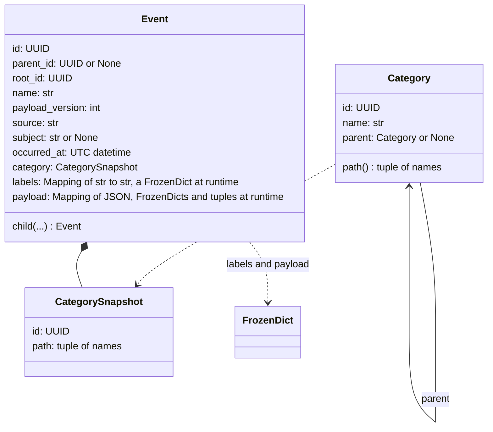

# Event Contract - Plan

## Goal Capsule

- **Objective:** corvo has one event shape that every later piece can build on. The shape is immutable and validated, chains events like spans in a trace, and carries a nested category and key-value labels ready to be counted later.
- **Means:** an event contract in `corvo.core.events`, written with Pydantic, with no framework, engine or database (KTD1). Labels and payload are held in frozen containers that serialize back to plain JSON (KTD3).
- **Product authority:** the repository owner, who settled every decision recorded under Key Decisions. The Product Contract wins on behavior; a KTD wins on mechanism within its cited requirements.
- **Stop conditions:** stop and report, without working around it, when the frozen payload and labels cannot pass both the JSON round trip (R21) and hashing with Pydantic 2.14 as KTD3 describes, or when mypy strict cannot type them as read-only without a cast at every use.
- **Execution profile:** two parts, each its own pull request, as Sequencing describes: part 1 is U1 and U2, part 2 is U3 and U4 and starts once part 1 merges.
- **Open blockers:** none.

---

## Product Contract

### Summary

`corvo.core.events` defines the event: an immutable, fully validated envelope with an id, a parent id and a root id, a name, a payload version, a source, a subject, an occurrence time, a category, labels and a JSON object payload. An event can create a child event and can be serialized to JSON and back. Categories nest, and in this version the only category is `unknown`.

The event is a frozen Pydantic model whose labels and payload are converted on validation into immutable containers and converted back to plain JSON on serialization. Child creation builds a new, fully validated event and never copies an existing one.

### Problem Frame

corvo's direction is that its work reacts to events: each piece receives events and emits events. Nothing in corvo defines what an event is today. The first piece to need one would invent its own fields, and every later piece, along with the future storage and metrics, would inherit that improvisation.

Two later needs shape the contract now even though they are not built here. Events will be stored in Postgres, and their categories and labels will be counted, for example how many events carry a given label or fall under a given category. Changing the event's shape after events exist is expensive, so this step fixes the shape and nothing else.

### Key Decisions

- **The payload is free JSON, with no model per event type, no decorator and no type registry.** The contract stays the envelope alone. (session-settled: user-directed — chosen over a Pydantic payload model per event type registered by a decorator with name and version.) Governs R11.
- **The payload is always a JSON object.** (session-settled: user-approved — chosen over any JSON value: an object can be queried in Postgres later and gain keys without breaking readers.) Governs R11.
- **The category belongs to the event.** It has no relation to the event's name or payload, and it defaults to `unknown`. (session-settled: user-directed — chosen over a category declared per event type by a decorator.) Governs R9, R17.
- **Categories are data that will live in the database and grow there, never declared in code.** An event references an existing category and never creates one. (session-settled: user-directed — chosen over categories declared in code and over free dotted paths that any string turns into a category.) Governs R15, R16, R18.
- **The event records its category both by id and by a snapshot of its path at creation.** Counts can follow either today's tree or the tree at the time, at the cost of one more field per event. (session-settled: user-directed — chosen over a live reference by id alone and over a path snapshot alone.) Governs R17.
- **Labels are key-value pairs of strings.** This follows Prometheus and Kubernetes labels, and counts by key need no pre-registered values. (session-settled: user-approved — chosen over plain tags and over labels registered in the database.) Governs R10.
- **Category names and label keys use restricted alphabets.** (session-settled: user-approved — chosen over free text: a category path then converts to Postgres `ltree` without loss and label keys follow Prometheus, and tightening the rule after events exist is not possible.) Governs R10, R15.
- **The event is built with Pydantic, and the whole event is immutable at every depth.** "Pure Python" means no framework, engine or database, not stdlib only. (session-settled: user-directed — chosen over a stdlib-only contract.) Governs R12, R13.
- **`recorded_at` is not part of the event.** It belongs to whatever records the event later, so nothing in an event is filled in after creation. (session-settled: user-approved — chosen over setting both times at creation and over a recorded copy with the same id.) Governs R8.
- **`occurred_at` is held in UTC.** (session-settled: user-approved — chosen over keeping the creator's offset: one representation for comparison and storage, with the instant unchanged and the original offset lost.) Governs R8.
- **The envelope adds a root id, a subject and a payload version to the fields first listed.** The root id makes a whole chain one lookup instead of a walk from parent to parent. (session-settled: user-directed — chosen among offered extras, with all four taken; the second timestamp was later moved out by the decision above.) Governs R3, R5, R7.
- **The payload version is a whole number, 1 by default.** (session-settled: user-approved — chosen over a required version: a creator names a version only once its payload changes shape.) Governs R5.
- **The built-in actions are creating a child and serializing.** There is no copy-with-changes action. (session-settled: user-directed — chosen over also offering copy-with-changes and lifecycle events such as `task.started`.) Governs R19, R20, R21.
- **A child inherits from its parent only when its creator asks.** (session-settled: user-directed — chosen over always inheriting labels and subject, and over never inheriting.) Governs R20.
- **For each inheritable field, the creator picks one of inherit, a value of its own, or none.** (session-settled: user-approved — chosen over one choice for all three fields and over inherit flags beside a given value: no conflict between the two exists to resolve.) Governs R20.
- **Reading back rejects fields the contract does not define, and no event is its own parent.** (session-settled: user-approved — chosen over ignoring unknown fields: typos fail loudly, at the cost that an older reader cannot open an event written by a newer contract.) Governs R14, R21.

### Requirements

**Envelope**

- R1. Every event has an id, a UUID generated when the event is created.
- R2. Every event has a parent id, which is the id of the event that led to it and is empty for a root event.
- R3. Every event has a root id: the id of the first event in its chain. A root event's root id is its own id.
- R4. Every event has a name that says what happened.
- R5. Every event has a payload version, a whole number from 1 that says which shape its payload has, and 1 when its creator gives none.
- R6. Every event has a source that says who generated it.
- R7. An event may have a subject that says what it is about, separate from its source.
- R8. Every event has `occurred_at`, the timezone-aware time it happened, given by its creator, defaulting to the moment of creation, and held in UTC.
- R9. Every event has a category, which is `unknown` when its creator gives none.
- R10. Every event has labels, a possibly empty set of keys mapped to non-empty string values, where a key starts with a letter or `_` and holds only letters, digits and `_`.
- R11. Every event has a payload, a valid JSON object that follows no schema and is empty when its creator gives none.

**Immutability and validation**

- R12. No part of a created event can change, at any depth, including its labels and its payload.
- R13. Every field is validated when the event is created, and an event with an invalid field is never created.
- R14. An event with an empty parent id has its own id as its root id, and an event with a parent id has a root id different from its own id; creation fails for any other combination, and for an event whose parent id is its own id.

**Categories**

- R15. A category has an id, a name and an optional parent category, so categories nest. A name holds only letters, digits, `_` and `-`.
- R16. Creating an event never creates a category and looks none up in any store: its creator hands it a category it already holds, and the event takes the category's id and path snapshot from it.
- R17. An event records its category's id and a snapshot of the category's full path at the moment of creation: the names from the top category down to it.
- R18. `unknown` is the one category the contract defines itself, the exception to categories living in the database, with a fixed known id and no parent. It is the only category in this version.

**Actions**

- R19. An event can create a child event, whose parent id is the parent's id and whose root id is the parent's root id.
- R20. When creating a child, the creator picks for each of category, labels and subject whether the child inherits the parent's value, gets a value of its own, or gets none. Without a pick, the child gets none: category `unknown`, no labels, no subject. A child that inherits the category copies the parent's recorded category id and path snapshot.
- R21. An event serializes to JSON and deserializes back to an event equal to the original. Reading an event back restores its recorded category id and path snapshot as stored, without requiring the category to still exist, and rejects any field the contract does not define.

### Acceptance Examples

- AE1. **Covers R2, R3, R19.** **Given** root event A, **when** A creates child B and B creates child C, **then** B's parent id is A's id, C's parent id is B's id, and A, B and C all have A's id as their root id.
- AE2. **Covers R20.** **Given** event A with label `repo=corvo` and subject `issue/42`, **when** A creates a child asking to inherit labels only and giving no category, **then** the child has `repo=corvo`, no subject, and category `unknown`.
- AE3. **Covers R9, R17, R18.** **Given** no category from the creator, **when** an event is created, **then** its category id is `unknown`'s id and its path snapshot is `unknown`'s path.
- AE4. **Covers R12.** **Given** a created event, **when** code tries to set a field, add a label or change a value nested in the payload, **then** the attempt fails and the event is unchanged.
- AE5. **Covers R11, R13.** **Given** a payload that is not valid JSON, or a label value that is not a string, **when** an event is created, **then** creation fails and no event exists.
- AE6. **Covers R21.** **Given** any valid event, **when** it is serialized to JSON and read back, **then** the result equals the original, its category snapshot and labels included.
- AE7. **Covers R14.** **Given** a new id X, **when** an event is created with no parent id and root id Y, or with parent id P and root id X, or with parent id X, **then** creation fails in each case.
- AE8. **Covers R11, R13.** **Given** a payload that is a list, or a payload holding `NaN` or `Infinity` at any depth, **when** an event is created or read back from JSON, **then** it fails.
- AE9. **Covers R21.** **Given** stored JSON of an event whose category path is `billing` then `invoices`, a category no code holds, **when** it is read back, **then** the event has that id and that path; **given** the same JSON with an extra field, **then** reading it fails.
- AE10. **Covers R8.** **Given** `occurred_at` of 12:00 at offset `-03:00`, **when** an event is created, **then** its `occurred_at` is 15:00 UTC.

### Scope Boundaries

- Persistence, Postgres tables and `recorded_at`.
- Reading metrics: counts by label or by category.
- Loading, creating or editing categories other than `unknown`.
- Typed payloads, a decorator and a registry of event types.
- Copying an event with changes.
- Lifecycle events such as `task.started`.
- Anything that consumes or emits events: tasks, workflows, the worker or the API.

**Considered and not built**

- Limits on label count, label value length, payload size and payload depth beyond Pydantic's own nesting limit of about 200 levels. Cardinality and size matter once metrics and storage exist, and they set the limits then.
- Rejecting the NUL character in strings. Postgres rejects it at insert time, so the storage piece decides.
- A stable child id for a task that retries. No task emits events yet; the first one that does decides whether `child` takes an id.
- An envelope version beside the payload version. No event is stored yet, so a version can still be added before the first one is.
- A check that a child's `occurred_at` is not earlier than its parent's. Clocks across machines disagree, and nothing reads the order yet.
- Closing `object.__setattr__` and `model_construct`, which bypass frozen models and validation. Python cannot prevent them; R12 and R13 hold for every normal path.

#### Deferred to Follow-Up Work

- `init_typed = true` under `[pydantic-mypy]` in `mypy.ini`, so mypy checks constructor argument types. KTD3's `Mapping` types already accept plain `dict` and `list` arguments; the category field then needs the read-only protocol KTD7 names, so passing a `Category` still type-checks. The organization's CI reads `mypy.ini` from the base commit, so the change applies only once merged on its own.

### Sources / Research

- CloudEvents 1.0: `id`, `source`, `type`, `subject`, `time`, and a free-form `data` beside flat context attributes. https://github.com/cloudevents/spec/blob/v1.0.2/cloudevents/spec.md
- OpenTelemetry trace model: a root mints the trace id that every descendant inherits; the parent id only rebuilds the tree's shape. https://opentelemetry.io/docs/specs/otel/trace/api/
- Correlation id for the whole flow, causation id for the direct parent (the roles of R3 and R2). https://kurrentdb.kurrent.io/blog/eventstoredb-visualise-tab/
- Fowler's occurred and recorded times, the reason `recorded_at` belongs to the record. https://martinfowler.com/eaaDev/EventSourcing.html
- Label cardinality: every unique label set is a new series. Prometheus label names match `[a-zA-Z_][a-zA-Z0-9_]*`. https://prometheus.io/docs/practices/naming/ and https://prometheus.io/docs/concepts/data_model/ and https://kubernetes.io/docs/concepts/overview/working-with-objects/labels/
- Counting a category subtree with `ltree`; a label holds letters, digits, `_` and, since Postgres 16, `-`. corvo's database runs `postgres:18` in `compose.yaml`. https://www.postgresql.org/docs/current/ltree.html
- UUIDv7 and index locality; `uuid.uuid7()` is new in Python 3.14 and monotonic within one process. https://docs.python.org/3.14/library/uuid.html and https://www.rfc-editor.org/rfc/rfc9562.html
- Pydantic `frozen` is shallow, and `model_copy(update=...)` skips validation. https://pydantic.dev/docs/validation/latest/concepts/models/
- Python 3.14 has no builtin `frozendict`; PEP 814 adds one in 3.15. https://peps.python.org/pep-0814/
- `pydantic.JsonValue` in 2.14.1 accepts `NaN` and `Infinity` from Python and from JSON, and `model_dump_json` writes them as `null`; `allow_inf_nan=False` does not cover JSON input. Source: `pydantic/types.py` and `pydantic/config.py` of the installed 2.14.1, confirmed by running it.

---

## Planning Contract

Product Contract preservation: changed, as the owner confirmed in this session. R5, R8, R10, R11, R14, R15, R17, R20 and R21 now state the answers to the questions deferred to planning, and AE7 to AE10 illustrate them. Six Key Decisions record those answers. Two questions are answered here instead: the UUID version (KTD5) and deep immutability (KTD3). The Outstanding Questions section was removed because nothing in it remains open. Scope Boundaries gained the considered-and-not-built lines and one deferred item. No other requirement changed.

### Builds on

| Piece | Today | Under this plan |
|---|---|---|
| `src/corvo/core/` | empty `__init__.py` files and small pure modules (`tasks/hello.py`, `workflows/greeting.py`) | **Extended** with the `events` package. |
| `pyproject.toml` and `uv.lock` | `pydantic` 2.14.1 arrives only through `pydantic-settings` | **Changed.** `pydantic` becomes a direct dependency (KTD2). |
| `tests/core/` and its Trunk collection `29TSvQtU` in `.github/python.yml` | runs every test under `tests/core` | **Kept.** `tests/core/events/` falls inside it, so `.github/python.yml` does not change. |
| `tests/test_import_boundaries.py` and the `TID251` bans in `ruff.toml` | keep `corvo.core` free of the SDK, Hatchet, FastAPI and the worker, and reject relative imports | **Kept.** The new package imports only Pydantic and the standard library, with absolute imports. |
| `CONCEPTS.md` `## Events` | names Event, Root id, Category and Label, from this plan's docs pull request | **Kept.** No unit changes it. |

### Key Technical Decisions

- KTD1. **The package is `src/corvo/core/events/`, with three modules and an empty `__init__.py`.** `frozen.py` holds the immutable containers, `categories.py` the categories, and `event.py` the event and child creation. Every `__init__.py` in corvo is empty and callers import module paths, so this follows suit. The modules import only Pydantic and the standard library, absolutely, as `tests/test_import_boundaries.py` requires.
- KTD2. **`pydantic>=2.14.1` becomes a direct dependency, and `uv.lock` is regenerated with uv.** Core now imports Pydantic itself, and ten modules elsewhere in `src/` already do without declaring it. Pydantic is MIT, like corvo. The entry goes in alphabetical order, before `pydantic-settings`.
- KTD3. **Labels and payload are typed as read-only `Mapping`s and held at runtime in a small immutable mapping and tuples, converted on validation and converted back on serialization.**
  - `frozen.py` defines `FrozenDict`, a hashable, picklable `Mapping` that refuses every write. It is the runtime type only; no field is annotated with it.
  - The payload's static type is `Mapping[str, JsonRead]`, where `JsonRead` is a recursive alias over `Mapping`, `Sequence` and the JSON scalars. Its schema first thaws `FrozenDict`s and tuples at every depth, so a payload that holds another event's payload, or any part of it, is accepted. It then validates as `dict[str, JsonValue]` and freezes recursively: every object becomes a `FrozenDict`, every array a tuple. Serialization thaws it back to `dict` and `list`.
  - The labels' static type is `Mapping[str, str]`, with key and value checked as strict strings so bytes are rejected, and the validated dict becomes a `FrozenDict`.
  - Because `Mapping` and `Sequence` are read-only and covariant, mypy rejects `event.payload["a"] = 1`, accepts plain `dict` and `list` arguments even under `init_typed`, and needs no cast at read sites. Building the payload schema from a recursive alias over `FrozenDict` instead was tried and rejected: it accepts tuples, bytes and `NaN`, and dumps tuples.
  - Every model sets `frozen=True` and `extra="forbid"`, and none sets `strict=True` model-wide, under which `model_validate(model_dump(mode="json"))` fails. `model_dump(mode="json")` and `model_dump_json` give plain JSON for the whole event.
  - Rejected: `types.MappingProxyType`, which in 3.14 is neither hashable nor picklable nor serializable by Pydantic; the payload as JSON text, which double-encodes it and compares it as text; `Json[...]`, which does not survive a round trip; labels as a tuple of pairs, which changes the wire format. When corvo moves to Python 3.15, the builtin `frozendict` can replace `FrozenDict`. That move waits on Hatchet: `hatchet-sdk` 1.42.1 pins `protobuf<7`, and the first `grpcio-tools` with 3.15 wheels needs protobuf 7 (https://github.com/hatchet-dev/hatchet/issues/5187).

  Governs R10, R11, R12, R21.
- KTD4. **Freezing rejects non-finite floats at any depth.** Pydantic's `JsonValue` accepts `NaN` and `Infinity` and serializes them as `null`, which breaks R21's equality, and `allow_inf_nan=False` misses JSON input. The freeze step sees both inputs, so the check lives there. Governs R11, R13.
- KTD5. **Ids are `UUID` fields that default to `uuid.uuid7()` and accept any UUID version on input.** A time-ordered id indexes well in Postgres. Accepting any version lets an event from another producer be read back. `root_id` defaults through a factory that reads the already validated `id`, so `id` is declared before it. One after-validator enforces R14, with a message that names the missing root id when a child is given none. Governs R1, R2, R3, R14.
- KTD6. **A category is a frozen model with `id`, `name` and `parent: Category | None`, and its `path` is the tuple of names from the top down.** The path is derived, never stored on the category, so a parent and its child cannot disagree. A name matches `^[A-Za-z0-9_-]{1,255}$`, the `ltree` alphabet for Postgres 16 and later. `UNKNOWN` is a module constant with a literal UUID written in the code and the name `unknown`. Governs R15, R18.
- KTD7. **The event holds a category snapshot, a frozen model with `id` and `path`, in a field typed as that snapshot.**
  - The snapshot's path is a non-empty tuple of names under KTD6's rule, serialized as `"category": {"id": …, "path": [...]}`. The default is `UNKNOWN`'s snapshot.
  - A before-validator on the field turns a `Category` into its snapshot (R16), and a snapshot read back from JSON validates as it is (R21).
  - With `init_typed` off, mypy types constructor arguments as `Any`, so passing a `Category` type-checks. A read-only protocol that both `Category` and the snapshot satisfy would keep that true under `init_typed`; it waits for that follow-up, since it changes no stored data.

  Governs R9, R16, R17, R21.
- KTD8. **`child` is a method on the event that builds a new event through the constructor.**
  - The creator gives the child's `name` and `source`, and may give `payload_version`, `payload` and `occurred_at`.
  - `category`, `labels` and `subject` each take a value, the `INHERIT` sentinel, or nothing (R20). `INHERIT` is the one member of an `Inherit` enum, which mypy narrows with `is`. `INHERIT` on the category copies the parent's snapshot.
  - The constructor runs every validator again; `model_copy` and `copy.replace` skip validation and are not used.

  Governs R19, R20.
- KTD9. **Scalar fields are bounded strings, and the version is a strict integer.** `name` and `source` hold 1 to 255 characters. `subject` is `None` or 1 to 255 characters. `payload_version` is an integer of at least 1 in strict mode, so `True` and `"1"` are rejected. `occurred_at` is an `AwareDatetime` that an after-validator converts to UTC and that defaults to `datetime.now(UTC)`. Governs R4 to R8.
- KTD10. **Every failure surfaces as Pydantic's `ValidationError`.** Validators raise `ValueError`, which Pydantic wraps. `CorvoError` stays for business errors that interfaces translate, and an invalid event is a programming error.

### High-Level Technical Design

The pieces and what each holds:



The wire form an event serializes to, as directional guidance for the shape, not exact values:

```json
{
  "id": "0199f2a4-6c1e-7a3b-9d10-5e2f8c7b4a01",
  "parent_id": null,
  "root_id": "0199f2a4-6c1e-7a3b-9d10-5e2f8c7b4a01",
  "name": "issue.opened",
  "payload_version": 1,
  "source": "corvo.server",
  "subject": "issue/42",
  "occurred_at": "2026-10-16T09:43:00Z",
  "category": {"id": "<unknown's fixed id>", "path": ["unknown"]},
  "labels": {"repo": "corvo"},
  "payload": {"number": 42, "tags": ["a", "b"]}
}
```

### Output Structure

```text
src/corvo/core/events/
  __init__.py
  frozen.py
  categories.py
  event.py
tests/core/events/
  __init__.py
  test_frozen.py
  test_categories.py
  test_event.py
  test_child.py
```

### Risks

- A payload reader that narrows with `isinstance(x, dict)` or `isinstance(x, list)` never matches, since nested values are `FrozenDict`s and tuples, and mypy does not flag it. Readers narrow with `Mapping` and `Sequence`, checking `str` first, and `frozen.py`'s docstring says so.
- Event equality and hashing are Python's, so a payload `{"a": true}` equals `{"a": 1}` though their JSON differs. Round-trip tests also compare the JSON text, and a later deduplication by content must hash the JSON form, not the event.
- Tests that try to mutate an event must get past mypy strict, which flags a write to a frozen field. Those lines carry a targeted `type: ignore`, and `warn_unused_ignores` catches one that is no longer needed.

### Sequencing

The owner chose two parts, each merging alone:

- **Part 1, U1 and U2: the building blocks.** The frozen containers, the Pydantic dependency and the categories, with no event yet. It ships alone because each module is complete and tested on its own.
- **Part 2, U3 and U4: the event.** The envelope, its round trip and child creation, on top of part 1.

Part 2 is blocked by part 1: U3 depends on U1 and U2.

---

## Implementation Units

### U1. Immutable containers and the Pydantic dependency

- **Goal:** the event's labels and payload have containers that nothing can change, that validate from plain JSON and that serialize back to it.
- **Requirements:** R10, R11, R12, R13, R21; AE4, AE5, AE8; KTD1, KTD2, KTD3, KTD4.
- **Dependencies:** none.
- **Files:**
  - Modify `pyproject.toml` and `uv.lock`.
  - Create `src/corvo/core/events/__init__.py` (empty) and `src/corvo/core/events/frozen.py`.
  - Create `tests/core/events/__init__.py` (empty) and `tests/core/events/test_frozen.py`.
- **Approach:**
  1. Add the dependency per KTD2 and regenerate the lock with uv.
  2. `FrozenDict`: a `Mapping` with equality, hashing, pickling and deep copy, and no write method. Writes through item assignment raise.
  3. The freeze and thaw pair per KTD3 and KTD4, plus two annotated types the event uses: one for labels, one for a payload that must be a JSON object. The payload type thaws a `FrozenDict` input before validating it.
  4. A module docstring states the module's role, that it imports only Pydantic and the standard library, as `src/corvo/agents/report.py` does, and that readers narrow payload values with `Mapping` and `Sequence`, checking `str` first.
- **Patterns to follow:** `src/corvo/agents/report.py` (module docstring, plain `BaseModel`), `src/corvo/agents/tone/models.py` (PEP 695 `type` aliases), `tests/core/tasks/test_hello.py` (test style: plain `assert`, sentence-named tests, `-> None`).
- **Test scenarios:**
  - A `FrozenDict` built from `{"a": "b"}` equals that dict, has the same keys and length, and hashes.
  - Item assignment and deletion on a `FrozenDict` raise.
  - A `FrozenDict` survives `pickle` and `copy.deepcopy` equal to itself.
  - A nested payload `{"a": [1, {"b": [2, 3]}], "c": null}` validates into `FrozenDict`s and tuples at every depth, and thaws back to the same `dict`.
  - Covers AE8. A payload `[1, 2]` fails as not an object, and `NaN` or `Infinity` at any depth fails from Python input and from JSON text.
  - Covers AE5. A label value `1` or a label key `1abc` fails, and a label key `repo_name` passes.
  - A plain payload holding bytes or a non-string key fails.
  - A payload that spreads another event's payload, or holds one of its nested objects or arrays, validates and freezes equal to the same data given as plain dicts and lists.
  - A bytes label key or value fails.
- **Verification:** the tests pass, `uv lock --check` passes, and `import corvo.core.events.frozen` pulls in nothing outside Pydantic and the standard library.

### U2. Categories and the `unknown` category

- **Goal:** a creator can hold a category, nested under a parent, and hand it to an event, which keeps its id and path.
- **Requirements:** R15, R16, R17, R18; AE3; KTD6, KTD7.
- **Dependencies:** U1.
- **Files:**
  - Create `src/corvo/core/events/categories.py` and `tests/core/events/test_categories.py`.
- **Approach:**
  1. `Category` and its derived `path` per KTD6, and `UNKNOWN`.
  2. The category snapshot model per KTD7, with a way to take a snapshot from a `Category`.
- **Patterns to follow:** U1's module docstring and model config.
- **Test scenarios:**
  - A category `invoices` whose parent is `billing` has the path `("billing", "invoices")`.
  - `UNKNOWN` has the fixed id, the name `unknown`, no parent, and the path `("unknown",)`.
  - The snapshot of `invoices` carries its id and its path.
  - A name with a dot, a space, a slash or no characters fails, and `bill-ing_2` passes.
  - A snapshot with an empty path fails.
  - Assigning to a category's field raises.
- **Verification:** the tests pass.

### U3. The event envelope and its round trip

- **Goal:** a creator can build a validated, immutable event and turn it into JSON and back.
- **Requirements:** R1 to R18, R21; AE3, AE4, AE5, AE6, AE7, AE8, AE9, AE10; KTD3, KTD5, KTD7, KTD9, KTD10.
- **Dependencies:** U1, U2.
- **Files:**
  - Create `src/corvo/core/events/event.py` and `tests/core/events/test_event.py`.
- **Approach:**
  1. The `Event` model with fields in the order of the wire form in the High-Level Technical Design, so `id` comes before `root_id` (KTD5).
  2. Field rules per KTD5, KTD7 and KTD9, and the R14 after-validator.
  3. The module docstring says how a chain is built: a root event through the constructor, every other through `child` (U4).
- **Execution note:** tests pass explicit ids and `occurred_at` rather than patching a clock; the repo has no clock fixture.
- **Patterns to follow:** U1 and U2.
- **Test scenarios:**
  - A root event given only `name` and `source` has a version 7 id, no parent, a root id equal to its id, `payload_version` 1, no subject, an aware UTC `occurred_at`, no labels and an empty payload.
  - Covers AE3. That event's category id is `UNKNOWN`'s id and its path is `("unknown",)`.
  - An event given the `invoices` category records its id and `("billing", "invoices")`.
  - Covers AE10. `occurred_at` of 12:00 at `-03:00` becomes 15:00 UTC, and a naive datetime fails.
  - Covers AE7. No parent with a foreign root id fails, a parent with a root id equal to the event's id fails, and a parent id equal to the event's id fails.
  - A child built through the constructor with a parent id and a root id different from its own id passes.
  - Covers AE5. An empty `name`, an empty `source`, an empty `subject`, `payload_version` 0, `True` or `"1"`, and an unknown keyword each fail.
  - Covers AE4. Assigning to `name`, setting a label, and writing into a nested payload object or array each raise, and the event still equals a copy taken before.
  - Covers AE6. An event with a parent, a subject, labels, the `invoices` category and a nested payload holding `true`, `1` and `1.0` survives `model_validate_json(model_dump_json())` and `model_validate(model_dump(mode="json"))` equal, with the same JSON text.
  - `model_dump(mode="json")` of that event passes through `json.dumps` and gives plain objects and arrays.
  - Covers AE9. JSON of an event whose category path is `["billing", "invoices"]` reads back with that id and path, and the same JSON with an extra field fails.
  - Covers AE8. JSON whose payload holds `NaN` fails to read back.
  - Two events with equal fields hash equally.
- **Verification:** the tests pass, and every branch in `event.py` is covered.

### U4. Child creation

- **Goal:** an event can create a child that continues its chain, inheriting only what the creator asks for.
- **Requirements:** R19, R20; AE1, AE2; KTD8.
- **Dependencies:** U3.
- **Files:**
  - Modify `src/corvo/core/events/event.py`.
  - Create `tests/core/events/test_child.py`.
- **Approach:**
  1. `INHERIT` as a single-member sentinel that mypy can type, exported from `event.py`.
  2. `child` per KTD8, built through the constructor so the R14 validator runs again.
- **Patterns to follow:** U3.
- **Test scenarios:**
  - Covers AE1. A creates B and B creates C: B's parent is A, C's parent is B, and all three have A's id as their root id.
  - Covers AE2. A with `repo=corvo` and subject `issue/42` creates a child with labels inherited and nothing else given: the child has `repo=corvo`, no subject and category `unknown`.
  - A child with nothing inherited has category `unknown`, no labels and no subject, whatever the parent holds.
  - A child inheriting the category of a parent read back from JSON copies the parent's id and path, with no `Category` held by anyone.
  - A child given its own labels `{"step": "review"}` has only those, and a child given `{**parent.labels, "step": "review"}` has both.
  - A child given its own category, subject and payload carries them, and its `occurred_at` defaults to the moment of creation.
  - A child given an invalid label fails like any event.
- **Verification:** the tests pass, and no code path in `event.py` calls `model_copy` or `copy.replace`.

---

## Verification Contract

| Gate | Command | Proves |
|---|---|---|
| Lint, format, types, lockfile | `uv run prek run --all-files` | ruff (including the `TID251` bans), ruff format, mypy strict over `src` and `tests`, `uv lock --check` |
| Unit tests | `uv run pytest tests/core/events tests/test_import_boundaries.py` | R1 to R21; AE1 to AE10; core imports nothing it may not |
| Coverage floor | `coverage: 90` in `.github/python.yml`, statements and branches, enforced by CI | every validator branch is exercised |
| CI | the org workflow `tnmn.io: python` on each part's pull request | the same gates with CI's pinned ruff and mypy |

---

## Definition of Done

- Every gate in the Verification Contract passes locally, and CI passes on each part's pull request.
- Each acceptance example AE1 to AE10 has a test that names it.
- `corvo.core.events` imports only Pydantic and the standard library, and `pydantic` is a direct dependency.
- No abandoned attempt remains in the diff: no unused helpers, no commented-out code, no leftover tests.
- Per unit:
  - U1: a nested payload freezes at every depth and thaws back equal.
  - U2: a nested category's path and `UNKNOWN` behave as R15 and R18 say.
  - U3: an event survives the round trip in text and in dict form.
  - U4: a three-generation chain shares one root id, and inheritance follows R20.
