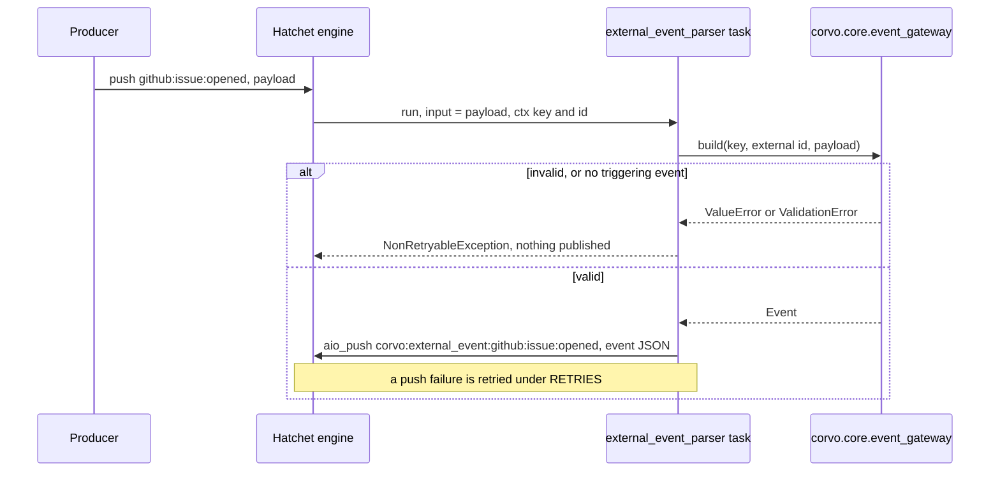

# External Event Parser - Plan

## Goal Capsule

- **Objective:** an event an outside source publishes to Hatchet, starting with GitHub, becomes a corvo event that corvo's workflows can react to, and the corvo event can be traced back to the event it came from.
- **Means:** an `external event parser` workflow in a new `worker/event_gateway/` area over a pure conversion in `corvo.core.event_gateway` (KTD1, KTD2), and an `external_id` field on the event contract in `corvo.core.events` (KTD3).
- **Product authority:** the repository owner, who settled every decision recorded under Key Decisions. The Product Contract wins on behavior; a KTD wins on mechanism within its cited requirements. Storing events in the database is not active scope.
- **Stop conditions:** stop and report, without working around it, when the engine does not start the parser for a pushed `github:` event in the integration suite, or when a run without a triggering event cannot be told apart from one with an event.
- **Execution profile:** one pull request, units in order U1 to U5.
- **Open blockers:** none.

---

## Product Contract

Product Contract preservation: no R-ID changed. The retry Key Decision now says which duplicates `external_id` can catch. Two non-goals joined Scope Boundaries. The Deferred to Planning questions are answered by KTD1, KTD2, KTD5 and U5, and were removed.

### Summary

A workflow on the existing main worker listens to Hatchet events whose key starts with a known external prefix, today only `github`. For each one it builds a root corvo event that keeps the original payload and the original event's Hatchet id, and publishes that event back to Hatchet under the `corvo:external_event:` name. The event contract gains an optional `external_id` to hold that id.

### Problem Frame

corvo's work is meant to react to events, and `corvo.core.events` now defines what a corvo event is (`docs/plans/2026-10-16-0643-feat-event-contract-plan.md`). Nothing turns a signal from outside into one. An event pushed to Hatchet by GitHub or any other source arrives with a free key and payload, without an id chain, a source or the rest of the envelope, so no corvo workflow has a corvo event to start from.

Persisting events in Postgres was the first idea for this step. It was set aside because nothing emits a corvo event yet: the entry point comes first, and storage follows once events flow.

### Key Decisions

- **Events are not stored in the database in this work.** (session-settled: user-directed — chosen over building event persistence first: nothing emits a corvo event yet, so the entry point comes first.)
- **The parser and its task live in their own area, `worker/event_gateway/`, not in the existing `worker/tasks/` or `worker/workflows/`.** (session-settled: user-directed — chosen over placing them in the existing areas.) Governs R17.
- **The parser subscribes to a fixed list of external prefixes.** Hatchet's trigger can only include keys, and its filters ignore an event pushed without a matching scope, which no outside source sends. (session-settled: user-directed — chosen over subscribing to every event and ignoring `corvo:` keys in the task, which starts one wasted run per corvo event, and over a reserved prefix every outside source must adopt.) Governs R1, R2, R3.
- **What Hatchet receives is the whole corvo event, not only the original payload.** A later listener rebuilds the event and continues its chain with `child()`. (session-settled: user-approved — chosen over publishing the original payload alone, which loses the envelope, and over spreading the envelope into Hatchet's metadata.) Governs R13.
- **The corvo event has an id of its own and keeps the original's Hatchet id as `external_id`.** (session-settled: user-directed — chosen over reusing the Hatchet id as the corvo id and over linking the original through the subject.) Governs R7, R10.
- **`external_id` is optional text and a child never inherits it.** Text leaves room for ids from systems other than Hatchet. A descendant reaches the external origin through its root id. (session-settled: user-approved — proposed with the tradeoff shown and accepted.) Governs R10, R11.
- **`occurred_at` is the moment the task builds the event.** The task does not receive the original's time, and fetching it costs a REST call per event. (session-settled: user-directed — chosen over fetching the time Hatchet saw the original event through its API and over requiring producers to send a time.) Governs R8.
- **A retry may publish a second corvo event for the same external event, and nothing deduplicates it in this work.** Every attempt of one run carries the same `external_id`, so storage can later drop corvo's own retry duplicates by it. A producer that pushes the same event again gets a new Hatchet id, which `external_id` cannot catch. (session-settled: user-approved — proposed with the tradeoff shown and accepted.) Governs R16.

### Requirements

**Trigger**

- R1. The `external event parser` workflow runs for every Hatchet event whose key starts with a prefix on a fixed list of external prefixes declared in code, followed by `:`.
- R2. The list holds one prefix in this version, `github`.
- R3. An event whose key starts with `corvo:`, or with a prefix not on the list, never starts a parser run.

**Conversion**

- R4. For each event received, the parser's task, also named `external event parser`, builds exactly one corvo event, named `corvo:external_event:` followed by the received key.
- R5. The corvo event's source is the received key's prefix: the text before its first `:`.
- R6. The corvo event's payload is the received payload, unchanged.
- R7. The corvo event's id is generated like any event's, and its `external_id` is the Hatchet id of the received event.
- R8. The corvo event's `occurred_at` is the moment the task builds it.
- R9. The corvo event is a root event, with category `unknown`, no labels, no subject and payload version 1.

**Event contract**

- R10. Every event has an `external_id`: empty, or a string of 1 to 255 characters naming the event it was built from in the system that produced it.
- R11. A child event never inherits its parent's `external_id`.
- R12. `external_id` survives the event's JSON round trip like every other field.

**Publishing and logs**

- R13. The task publishes the corvo event to Hatchet with the event's name as key and the whole serialized event as payload.
- R14. The task logs at info the received key and Hatchet id and the published name and corvo id, at debug the received payload, and at error every failure with the received key and Hatchet id.

**Failures**

- R15. A received event that cannot become a valid corvo event fails its run without a retry, logs the error and publishes nothing.
- R16. A failure to publish follows the default retries.

**Placement**

- R17. The workflow and its task live in the new `worker/event_gateway/` area and are served by the existing main worker.

### Acceptance Examples

- AE1. **Covers R1, R4 to R9, R13.** **Given** an event `github:issue:opened` with payload `{"number": 42}` pushed to Hatchet, **when** the parser runs, **then** Hatchet receives `corvo:external_event:github:issue:opened`. Its payload is a corvo event with source `github`, payload `{"number": 42}`, `external_id` equal to the pushed event's Hatchet id, no parent, a root id equal to its own id, and category `unknown`.
- AE2. **Covers R3.** **Given** the published `corvo:external_event:github:issue:opened`, or a pushed `jira:issue:created`, **when** Hatchet processes it, **then** no parser run starts.
- AE3. **Covers R15.** **Given** a pushed `github:` key long enough that the corvo name would pass 255 characters, **when** the parser runs, **then** the run fails without a retry, an error log names the key and the Hatchet id, and nothing is published.
- AE4. **Covers R16.** **Given** a run whose publish succeeded and then failed before the run completed, **when** Hatchet retries it, **then** a second corvo event is published with a new id and the same `external_id`.
- AE5. **Covers R10, R11, R12.** **Given** the corvo event from AE1, **when** it creates a child and is serialized to JSON and read back, **then** the child has no `external_id` and the read-back event equals the original, its `external_id` included.

### Scope Boundaries

- Storing events in Postgres, `recorded_at`, and deduplicating events by `external_id`.
- A producer of `github:` events. No part of corvo pushes one yet, and Hatchet's own webhooks, which the engine records as `triggering_webhook_name`, are a candidate for later.
- Prefixes other than `github`, and a list read from settings instead of code.
- The original event's time, the webhook name or the scope, which the task does not receive and could fetch only through Hatchet's REST API.
- Reading the payload to set a category, labels or a subject.
- Detecting an external event whose payload is not a JSON object, which reaches the task as an empty payload.
- A permission profile or compose service of the parser's own.
- Workflows that react to `corvo:external_event:` events.
- Considered and not built:
  - **Checking in the task that the key's prefix is on the list.** The anchored trigger (KTD2) already delivers only listed prefixes. A run with no triggering event fails on the missing key (KTD5) before any prefix is read. Build it if a second way of starting the parser appears.
  - **A size cap on the payload before publishing.** A corvo event over gRPC's 4 MB default fails to publish and exhausts its retries with an error log per attempt (R14, R16), so it is seen. Build it if GitHub payloads near that size show up in the logs.

### Dependencies / Assumptions

- Hatchet matches a trigger key with `*` as a SQL `LIKE` wildcard, since engine 0.65. corvo's compose runs v0.110.5.
- hatchet-sdk 1.42.1, the locked version, gives the task the triggering event's key and Hatchet id, and the received payload as its input.
- The engine accepts any valid JSON as an event payload, but hatchet-sdk 1.42.1 hands the task an empty input when the payload is not a JSON object, so the task cannot tell it from `{}`. Such an event becomes a corvo event with an empty payload, which is accepted for now because GitHub payloads are objects.
- Until a producer exists, the parser is exercised by pushing a `github:` event by hand.
- Adding a prefix means a code change and a worker restart, because Hatchet registers triggers when the worker starts.

### Sources / Research

- Hatchet events and wildcard triggers: https://docs.hatchet.run/v1/events
- Hatchet filter scopes: when a workflow has filters, an event without a matching scope triggers nothing. https://docs.hatchet.run/v1/events
- Hatchet Python `Context` reference: https://docs.hatchet.run/reference/python/context
- Hatchet logging, root logger forwarding and `ctx.log`: https://docs.hatchet.run/v1/logging
- Engine wildcard matching, `k.event_key LIKE REPLACE(eventRef."eventKey", '*', '%')`: `pkg/repository/sqlcv1/triggers.sql` in hatchet-dev/hatchet at v0.110.5.
- Engine metadata for event-triggered runs, `hatchet__event_id` and `hatchet__event_key`, and no event time: `pkg/repository/trigger.go` (`ToMetadata`) and `pkg/repository/input.go` in hatchet-dev/hatchet.
- hatchet-sdk 1.42.1:
  - `Context.triggering_event_id` and `triggering_event_key`: `hatchet_sdk/context/context.py:718-725`.
  - Input validation runs inside the task, so a failing validator is retried: `hatchet_sdk/runnables/workflow.py:285-291`, `hatchet_sdk/worker/runner/runner.py:317-331`.
  - `aio_mock_run` builds its context without the triggering event and drops a plain `dict` input: `hatchet_sdk/runnables/task.py:594-645`.
  - `aio_push` serializes with plain `json.dumps` and adds `hatchet__source_workflow_run_id`: `hatchet_sdk/clients/events.py:50-65, 152-229`.
  - Log forwarding takes the root logger's level when the worker starts: `hatchet_sdk/worker/runner/utils/capture_logs.py:178-219`.
  - Default schedule timeout of 5 minutes: `hatchet_sdk/hatchet.py:460`.
- The event contract this work extends: `docs/plans/2026-10-16-0643-feat-event-contract-plan.md` and `src/corvo/core/events/event.py`.
- The main profile and its registration checks, which a new area joins: `src/corvo/worker/profiles/main.py`, `tests/worker/test_registration.py`, `tests/test_import_boundaries.py`.
- Learnings: `docs/solutions/best-practices/hatchet-retries-zero-is-not-at-most-once.md` and `docs/solutions/best-practices/negative-tests-must-fail-without-their-protection.md`.

---

## Planning Contract

### Key Technical Decisions

- KTD1. **One workflow module in `worker/event_gateway/workflows/`, over a pure conversion in `corvo.core.event_gateway`.** The workflow and its one task live together in `src/corvo/worker/event_gateway/workflows/external_event_parser.py`, because a workflow's task is declared on the workflow object. `event_gateway/tasks/` is created only when a standalone task exists, so no empty package ships. The conversion lives at `src/corvo/core/event_gateway/external_event_parser.py`, following the mirrored-path rule in `src/corvo/worker/tasks/hello.py:3-5`. It returns an `Event`, a core type, rather than the `str`/`int`/`bool` the existing core twins return, so the hexagonal direction still holds. Hatchet registers the workflow as `external-event-parser` and its task as `external_event_parser`, matching the repo's kebab-case workflow names and snake_case step names. Instantiates the Key Decision that governs R17.
- KTD2. **The prefix list lives in the worker module and becomes the trigger `github:*`.** Only `on_events` reads it, and the engine's anchored `LIKE` match delivers exactly the listed prefixes, so `corvo:external_event:github:…` can never loop back into the parser. Core derives the source from the key without consulting the list. Instantiates the Key Decision that governs R1 to R3.
- KTD3. **`external_id` is `Text | None`, declared right after `root_id`.** R10's "empty" is `None`; an empty string is rejected like any `Text`, as `subject` already does. The ids sit together in the event's JSON order. `child()` passes it nowhere, so a child gets `None` with no change to `child()`; a test pins that.
- KTD4. **The task takes Hatchet's permissive `EmptyModel` input and validates inside its body.** A strict `input_validator` fails inside the task call, where Hatchet retries it like any error. The task builds the event from `input.model_dump()`. A `ValidationError` or the core's `ValueError` from that build alone becomes `NonRetryableException` (R15). The push sits outside that `try`, so an encoding or transport error from `aio_push`, itself a `ValueError`, keeps the default retries (R16).
- KTD5. **A run without a triggering event fails like an invalid event.** A manual trigger from the dashboard reaches the task with an empty or missing key and id; the SDK passes proto strings through, so either `""` or `None` arrives. The core function rejects an empty key, a key with nothing before its first `:`, and an empty external id with `ValueError`, which KTD4 turns into a failure without retry. Governs R15.
- KTD6. **The publish is `await hatchet.event.aio_push(name, event.model_dump(mode="json"))` on the shared client.** `aio_push` runs `json.dumps` itself, and `model_dump(mode="json")` already reads back equal in `tests/core/events/test_event.py`. The deprecated `options=` argument is not used. The SDK adds `hatchet__source_workflow_run_id` and `hatchet__source_step_run_id` to the published event's metadata, which links it to the parser run at no cost. The task returns the corvo id and the published event's Hatchet id, which show on the run in the dashboard. Governs R13.
- KTD7. **Logs go through `logging.getLogger(__name__)`, not `ctx.log`.** The SDK forwards Python log records from inside a task to the run's log with their level, while `ctx.log` sends everything as INFO. Governs R14.
- KTD8. **A `CORVO_LOG_LEVEL` setting sets the root logger's level in `corvo-worker`, default `INFO`.** `worker.main()` keeps `logging.basicConfig()` for the stdout handler and sets the level on the root logger itself before the worker starts, because the SDK's log forwarder copies the root level at start. `basicConfig(level=...)` would not do: it sets the level only when the root logger has no handler yet, which already fails under pytest's capture handlers. It applies to both profiles, and compose passes it to both worker services. (session-settled: user-directed — chosen over turning on DEBUG through the existing `CORVO_DEBUG`, which only FastAPI reads, and over leaving debug lines invisible.) Governs R14.
- KTD9. **The parser waits up to 24 hours for a worker, through a named `EVENT_SCHEDULE_TIMEOUT` in `corvo.worker.defaults`.** Hatchet's 5-minute default would drop every GitHub event that arrives during a longer outage of the main worker, with no log from corvo. A day covers an outage noticed the next morning. The parser keeps `RETRIES` and `EXECUTION_TIMEOUT`, and its header says why a non-idempotent task keeps `RETRIES`: the duplicates are the accepted cost of the Key Decision that governs R16.
- KTD10. **Unit tests replace the triggering event properties and the publish, following the repo's class-level replacements.** `aio_mock_run` cannot set the triggering key or id, so tests monkeypatch `Context.triggering_event_key` and `Context.triggering_event_id` with properties, and `hatchet.event.aio_push` on the shared client, as `tests/worker/workflows/test_greeting.py` replaces `aio_run`. Tests pass the payload as `EmptyModel(**payload)`, since a plain dict reaches the task as `{}`. Hatchet's `Depends` would also work, but it would be the repo's first use and changes the task's signature only for tests.

### High-Level Technical Design



### Output Structure

```text
src/corvo/core/event_gateway/
  __init__.py
  external_event_parser.py
src/corvo/worker/event_gateway/
  __init__.py
  workflows/
    __init__.py
    external_event_parser.py
tests/core/event_gateway/
  __init__.py
  test_external_event_parser.py
tests/worker/event_gateway/
  __init__.py
  workflows/
    __init__.py
    test_external_event_parser.py
tests/integration/worker/test_event_gateway.py
```

### System-Wide Impact

- **Event contract.** Every serialized event gains an `external_id` key, `null` unless set. No event is stored yet, so no reader breaks.
- **Main worker.** Registers its first event-triggered workflow. Its logs gain the level setting of KTD8, which also governs the agent worker.

---

## Implementation Units

### U1. `external_id` on the event contract

- **Goal:** every event carries an optional `external_id` that children never inherit.
- **Requirements:** R10, R11, R12; AE5; KTD3.
- **Dependencies:** none.
- **Files:**
  - Modify `src/corvo/core/events/event.py`.
  - Modify `tests/core/events/test_event.py` and `tests/core/events/test_child.py`.
- **Approach:**
  1. Declare `external_id: Text | None = None` right after `root_id`, and mention it in the class docstring where the ids are described.
  2. Leave `child()` unchanged, since it passes only named fields.
  3. Add `external_id` to the `full_event()` builder in `test_event.py`, so both round-trip tests and the JSON-dict test cover it.
- **Patterns to follow:** `subject: Text | None` in `event.py`, and the parametrized invalid-field cases in `test_event.py`.
- **Test scenarios:**
  - A root event given only a name and a source has `external_id` `None`.
  - An event given `external_id="abc"` keeps it.
  - Invalid values are rejected by the parametrized cases: `""` and a 256-character string.
  - A 255-character `external_id` is accepted.
  - Covers AE5. A child of an event with `external_id` set has `external_id` `None`. The test first asserts the parent's id is set, so it would fail if `child()` began to copy it.
  - Covers AE5. `full_event()` with `external_id` survives `model_dump_json()` / `model_validate_json()` and `model_dump(mode="json")` / `model_validate()` equal.
- **Verification:** the event tests pass, and the JSON key order puts `external_id` after `root_id`.

### U2. The pure conversion in `corvo.core.event_gateway`

- **Goal:** one function turns a received key, external id and payload into the root corvo event, or raises.
- **Requirements:** R4 to R9, R15; AE1, AE3; KTD1, KTD5.
- **Dependencies:** U1.
- **Files:**
  - Create `src/corvo/core/event_gateway/__init__.py` and `src/corvo/core/event_gateway/external_event_parser.py`.
  - Create `tests/core/event_gateway/__init__.py` and `tests/core/event_gateway/test_external_event_parser.py`.
- **Approach:**
  1. A constant holds the name prefix `corvo:external_event:`.
  2. The function takes the key, the external id and the payload mapping as plain values. It raises `ValueError` for a missing or empty key, a key with no `:` or nothing before it, or a missing or empty external id (KTD5).
  3. It builds `Event(name=prefix + key, source=key before its first ':', external_id=..., payload=...)` and lets the defaults supply id, root id, `occurred_at`, category, labels and payload version (R9).
  4. Pydantic's `ValidationError` from the event (a name over 255 characters, a non-finite number) propagates as is.
  5. The module docstring states the mirrored-path role and imports only `corvo.core.events` and the standard library.
- **Patterns to follow:** `src/corvo/core/tasks/hello.py` and its test in `tests/core/tasks/`, which call the function directly with no mock run.
- **Test scenarios:**
  - Covers AE1. `github:issue:opened`, id `"evt-1"` and `{"number": 42}` give name `corvo:external_event:github:issue:opened`, source `github`, payload `{"number": 42}`, `external_id` `"evt-1"`, no parent, root id equal to id, category `unknown`, no labels, no subject and payload version 1.
  - A key with more segments, `github:pull_request:review:submitted`, keeps the whole key in the name and `github` as source.
  - Two calls with the same arguments give different ids and the same `external_id`.
  - `occurred_at` falls between timestamps taken before and after the call, in UTC.
  - A nested payload comes back equal after thawing.
  - Covers AE3. A key that makes the name 256 characters raises `ValidationError`, and a key that makes it exactly 255 succeeds.
  - Each of `""`, `None`, `"github"` (no `:`) and `":x"` as key raises `ValueError`.
  - `""` and `None` as external id raise `ValueError`.
  - A payload holding infinity raises `ValidationError`.
- **Verification:** the core tests pass, and `tests/test_import_boundaries.py` still passes with the new core package.

### U3. `CORVO_LOG_LEVEL` for `corvo-worker`

- **Goal:** an operator can turn on debug lines, the parser's payload among them, on stdout and in Hatchet's run log.
- **Requirements:** R14; KTD8.
- **Dependencies:** none.
- **Files:**
  - Modify `src/corvo/settings.py`, `src/corvo/worker/worker.py` and `compose.yaml`.
  - Modify `tests/test_settings.py` and `tests/worker/test_worker.py`.
- **Approach:**
  1. Add a `log_level` setting limited to `DEBUG`, `INFO`, `WARNING` and `ERROR`, default `INFO`, with a comment that it is the worker's root level.
  2. In `worker.main()`, read the settings first, keep `logging.basicConfig()` for the handler, then set the root logger's level from the setting (KTD8).
  3. In `compose.yaml`, give the `worker` and `agent-worker` services `CORVO_LOG_LEVEL: ${CORVO_LOG_LEVEL:-INFO}`.
- **Patterns to follow:** `worker_profile` and `agent_credential_kind` in `settings.py`, and their tests in `tests/test_settings.py`.
- **Test scenarios:**
  - The level defaults to `INFO`.
  - `CORVO_LOG_LEVEL=DEBUG` reads as `DEBUG`.
  - An unknown level is rejected.
  - `main()` with `CORVO_LOG_LEVEL=DEBUG` leaves the root logger at DEBUG before `serve` runs. The test first asserts the root level is not DEBUG beforehand, so it fails if `main()` ignores the setting.
  - `main()` with no variable leaves it at INFO.
  - Each `main()` test restores the root logger's level afterwards, so a DEBUG root does not leak into later tests.
- **Verification:** the settings and worker tests pass, and `tests/worker/test_compose.py` still passes.

### U4. The `external-event-parser` workflow on the main worker

- **Goal:** the main worker serves a workflow that turns each `github:` event into a published corvo event.
- **Requirements:** R1 to R4, R13 to R17; AE1, AE3, AE4; KTD1, KTD2, KTD4 to KTD7, KTD9, KTD10.
- **Dependencies:** U2, U3.
- **Files:**
  - Create `src/corvo/worker/event_gateway/__init__.py`, `src/corvo/worker/event_gateway/workflows/__init__.py` and `src/corvo/worker/event_gateway/workflows/external_event_parser.py`.
  - Modify `src/corvo/worker/defaults.py` (`EVENT_SCHEDULE_TIMEOUT`) and `src/corvo/worker/profiles/main.py`.
  - Modify `tests/worker/test_registration.py`, `tests/test_import_boundaries.py` and `tests/worker/test_defaults.py`.
  - Create `tests/worker/event_gateway/__init__.py`, `tests/worker/event_gateway/workflows/__init__.py` and `tests/worker/event_gateway/workflows/test_external_event_parser.py`.
- **Approach:**
  1. In the worker module, declare the prefix list (KTD2) and the workflow `external-event-parser` with `on_events` built from it. Declare its async task `external_event_parser` with `RETRIES`, `EXECUTION_TIMEOUT` and `EVENT_SCHEDULE_TIMEOUT` (KTD9).
  2. The task logs the received key and id at info and the payload at debug.
  3. It builds the event through U2 inside a `try` that turns `ValueError` and `ValidationError` into an error log with key and id plus `NonRetryableException` (KTD4).
  4. It publishes outside that `try` (KTD6). On a push error it logs at error with key and id and re-raises.
  5. On success it logs the published name and corvo id at info, and returns the corvo id and the published Hatchet id.
  6. The module's docstring header states the area's rules, as the first module of a new area: the thin-shell rule, the trigger list, and why this non-idempotent task keeps `RETRIES`.
  7. Register the workflow on `PROFILE.workflows` in `profiles/main.py`, and widen its comment to name `corvo.worker.event_gateway`.
  8. Add `corvo.worker.event_gateway` to `AREAS["main"]` and the import block in `test_registration.py`, and widen its docstring. Add it to `MAIN_PROFILE_AREAS` in `test_import_boundaries.py`.
  9. Add `EVENT_SCHEDULE_TIMEOUT = timedelta(hours=24)` to `defaults.py` with a comment on the outage it covers.
- **Execution note:** write the failure-path tests so each asserts its evidence first, then its absence, per `docs/solutions/best-practices/negative-tests-must-fail-without-their-protection.md`. Log tests set the level with `caplog.set_level`.
- **Patterns to follow:**
  - `src/corvo/worker/workflows/greeting.py` for the workflow declaration, `NonRetryableException` and the header.
  - `tests/worker/workflows/test_greeting.py` for `aio_mock_run` with replaced attributes and `pytest.raises(NonRetryableException)`.
  - `tests/worker/tasks/test_hello.py` for asserting declared retries and timeouts.
- **Test scenarios:**
  - Covers AE1. With the key `github:issue:opened`, an id and the payload `{"number": 42}`, the task pushes once. The push key is `corvo:external_event:github:issue:opened` and the pushed dict validates back into an `Event` with source `github`, the payload and that `external_id`.
  - The returned corvo id equals the pushed event's id.
  - The info logs name the received key and id, then the published name and corvo id.
  - With the level at DEBUG, a debug line holds the payload. At INFO it is absent, which the test checks only after asserting the info lines exist.
  - Covers AE3. A key making the name 256 characters raises `NonRetryableException`, logs at error with the key and id, and never calls the push. The test asserts the error log first, then that the fake push recorded no call.
  - Each of an empty key, a `None` key and an empty id raises `NonRetryableException` without a push (KTD5).
  - A push that raises `ValueError` propagates as that error, not `NonRetryableException`, and logs at error with key and id (R16).
  - A push that raises a transport error propagates unchanged.
  - Covers AE4. Two runs with the same key and id push two events with different ids and the same `external_id`.
  - The workflow declares `on_events == ["github:*"]` and its task declares `RETRIES`, `EXECUTION_TIMEOUT` and `EVENT_SCHEDULE_TIMEOUT`.
  - `EVENT_SCHEDULE_TIMEOUT` is longer than Hatchet's 5-minute default, in `test_defaults.py`.
  - The registration test passes with the workflow on the main profile, and fails, naming it, when it is removed from `PROFILE.workflows`. Check this once by hand, without committing the removal.
- **Verification:** unit tests pass, the registration and import-boundary tests pass with the new area, and `corvo-worker` starts locally with the new workflow listed.

### U5. Integration test against the engine

- **Goal:** the real engine starts the parser for a `github:` event, receives the corvo event, and starts nothing for the others.
- **Requirements:** R1, R3, R13, R15; AE1, AE2, AE3.
- **Dependencies:** U4.
- **Files:** create `tests/integration/worker/test_event_gateway.py`.
- **Approach:**
  1. Each test pushes a key unique to it, such as `github:test:<uuid>`, because the session shares one stack.
  2. Find the parser's run with `hatchet.runs.aio_list(triggering_event_external_id=pushed.event_id)`.
  3. Find the published event with `hatchet.event.aio_list(keys=[corvo name])`, polling within an `asyncio.timeout` as `finished_tasks` in `tests/integration/worker/conftest.py` does.
- **Patterns to follow:** `tests/integration/worker/test_workflows.py` for the `worker` fixture, the session loop mark and `aio_push`.
- **Test scenarios:**
  - Covers AE1. Pushing `github:test:<uuid>` with `{"number": 42}` publishes `corvo:external_event:github:test:<uuid>`, whose payload validates as an `Event` with source `github`, that payload and `external_id` equal to the pushed event's id.
  - Covers AE3. Pushing a `github:` key of 235 characters fails the parser run. After waiting long enough for a retry to have appeared, the run is `FAILED` with retry count 0, and no event with the corvo name exists.
  - Covers AE2. After the AE1 case has published, the published event's id has no runs, and a pushed `jira:test:<uuid>` has no runs either. Both are checked only after the AE1 run is found, so a parser that never runs cannot pass them.
- **Verification:** the integration suite passes locally with compose running, as the Verification Contract states.

---

## Verification Contract

| Gate | Command | Proves |
|---|---|---|
| Lint, format, types, lockfile | `uv run prek run --all-files` | ruff (including the `TID251` bans), ruff format, mypy strict over `src` and `tests`, `uv lock --check` |
| Unit tests | `uv run pytest tests --ignore tests/integration` | R1 to R17 at unit level; AE1, AE3, AE4, AE5; registration, import boundaries, settings, compose |
| Integration tests | `uv run pytest tests/integration/worker/test_event_gateway.py` | AE1, AE2 and AE3 against engine v0.110.5 |
| Coverage floor | `coverage: 90` in `.github/python.yml`, enforced by CI | every branch of the conversion and the task is exercised |
| CI | the org workflow `tnmn.io: python` on the pull request | the same gates with CI's pinned ruff and mypy, and the `tests/integration` collection |

---

## Definition of Done

- Every gate in the Verification Contract passes locally, and CI passes on the pull request.
- Each acceptance example AE1 to AE5 has a test that names it.
- `corvo.core.event_gateway` imports only `corvo.core` and the standard library. The Hatchet SDK appears only under `src/corvo/worker/`.
- No abandoned attempt remains in the diff: no unused helpers, no commented-out code, no leftover tests.
- Per unit:
  - U1: a child never carries its parent's `external_id`, and the round trip keeps it.
  - U2: an invalid key, id or name raises before any event exists.
  - U3: `CORVO_LOG_LEVEL=DEBUG` makes the root logger DEBUG before the worker starts.
  - U4: only a failure to publish is retried.
  - U5: a pushed `github:` event yields a published corvo event on the real engine.
